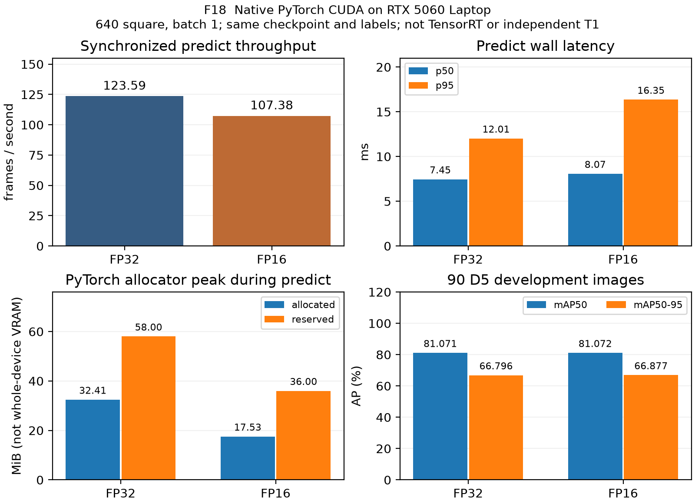

# Chương 5 — Phần HNHL cập nhật 15/11/2026

Bản thảo Markdown hiện hành để KR ghép; Word 01/11 là snapshot lịch sử. Chương 5 chung có ngân sách 3,5 trang, gồm thêm phần cửa của KR và deployment của DQK; editor chọn hình/rút gọn khi dàn trang. Nguồn E01–E20: [evidence gốc](evidence.md), [bổ sung 03/11](update-2026-11-03.md); N01–N11: [bổ sung 05/11](update-2026-11-05.md).

[Bổ sung15/11 và15 nguồn đã pin](update-2026-11-15.md) cập nhật door-camera ROC, Phase2 live, workload RTX4050 và phạm vi T2 của DQK.

## Vật cản, khoảng cách và bản đồ

YOLO phát hiện vật cản trên ảnh đã undistort; ray tại contact sàn được chiếu bằng chiều cao camera, pitch và roll theo session. Tape truth là forward từ điểm dưới lens, khác planar range dùng cho repulsion. Sàn bóng có phản chiếu nên bbox bottom không mặc định là contact; bbox cắt mép hoặc contact không rõ bị từ chối. Occupancy grid chỉ nhận FREE từ footprint/seen-floor đã xác nhận; UNKNOWN chặn đường/LOS. Vantage cần reachable, clearance, LOS và cửa có vị trí world đo được.

Trên tập ghế glossy, 8/9 vị trí có estimate, median/p90 relative error 5.34%/20.91%; ID21 thiếu do cắt mép. P90 tổng chưa đạt 20%, số ID chưa đủ ≥20; chưa có sweep pose/world truth để nghiệm thu map hoặc dựng F11 thật. [F10](figures/F10_distance.png), E01.

D5 có 397 ảnh, split 307 train/90 dev-val, cùng session glossy 24/10 và đã dùng chọn model/input size. YOLOv8n-640 là development candidate; footwear/bag còn thiếu recall, wire recall 0% ở operating point dev và chưa đo empty-floor alarms. 12 wire masks là annotation pilot. Chưa independent T1, distance hoặc collision T2; giữ nguyên target P≥80%/R≥90% cho legs/footwear/backpacks/bags, wire R≥80% và ≤1 alarm/20 empty-floor frames (E02).

## Face, re-ID và tracking

Face whitelist dùng SCRFD/MobileFaceNet buffalo_s, embedding512D chuẩn hóa, max cosine với reference. Pilot cafe D2 cũ125 frame/21 entries/3 người tại0,45: TAR82,99%/FAR46,40%; nhãn tự động cần review (E03). Buổi cửa14/11 của DQK với enrolment5 pose:822/877 genuine frame≥0,45 (93,73%), impostor0/1.754 straight hoặc0/5.254 mọi frame, max0,3362. CI mô tả9 clip [0,904;0,970], ba người/một session chưa xác lập TAR95% tại FAR1% trên quần thể. Hai dataset/enrolment được báo riêng. [ROC mới/quyết định giữ0,45](../week-07/threshold-118-2026-11-15/README.md).

Phase2 live đã có một reader ESP32, lịch5 Hz, N/M segmentation, top-3 ưu tiên frontal/quality và2 phiếu cùng ID. Pilot P01/người chưa enrol riêng:3 authorized/3 enqueue,5 unresolved+1 interrupted, coverage segment50%; enqueue9,387–10,245 s gồm quan sát/chờ kết thúc. Runtime sau sửa4,963 FPS ở Wi-Fi cảnh trống30 s, chưa đo lại recognition. Crop thân trên cần body-visibility/cross-camera. [Pilot/protocol](update-2026-11-15.md).

OSNet-AIN x1.0 và x0.25 đã chạy, nhưng 23 body crops chưa tạo được gallery/query hợp lệ: thiếu gallery ở 2/3 người. Rank-1/CMC và model thắng vẫn chưa có; gate ≥5 identities/rank-1≥85% giữ nguyên. ByteTrack nối detection theo chuyển động/IoU và confidence; appearance lock/re-lock yêu cầu đúng architecture/weights hash, cosine/margin và hai frame xác nhận. Track ID không phải identity; mất dấu/mơ hồ không xuất target. Replay 822 frame D2 chỉ chứng minh runtime vì timestamp xấp xỉ và chưa có body-ID truth; ≤1 switch/phút và re-lock accuracy trên D3 chưa đo (E03/E04).

## Ngân sách GPU và lựa chọn precision

Profiler nạp cùng detector, OSNet, pose, face và cửa, pad body/face khi thiếu người; chưa phải hai luồng camera thật. DINO FP16, các Torch model khác FP32; bộ nhớ NVML lấy mẫu gồm cả ORT/driver/process khác. [F9](figures/F9_gpu.png), E05–E07.

| RTX5060 workload | FPS | p95 ms | NVML peak GiB |
| :-- | --: | --: | --: |
| All every frame | 12.72 | 90.75 | 0.939 |
| XFeat every frame | 14.25 | 82.99 | 0.622 |
| All scheduled door | 19.65 | 87.62 | 0.939 |

Hai mode mỗi-frame chưa đạt15 FPS; scheduled door đạt4,52 Hz khi yêu cầu5 Hz. DQK đã đo RTX4050: all/XFeat mỗi-frame9,20/10,79 FPS, scheduled19,23 FPS với door4,614 Hz; p95 tương ứng138,05/120,59/121,36 ms, peak NVML0,894/0,564/0,890 GiB. Nguồn AC, ảnh khác HNHL, crop padding, một run/mode; chưa combined live hoặc accuracy FP16/FP32 RTX4050. [Nguồn/protocol](update-2026-11-15.md). Memory budget5,5 GB decimal khác5,5 GiB.

F18 so native PyTorch CUDA FP32/FP16 bằng cùng checkpoint D5-640 và 90 ảnh/nhãn dev-val, 640 square, batch 1; mỗi precision process riêng, 10 warmup/270 timing samples. FPS 123.59/107.38, p95 12.01/16.35 ms; Torch peak allocated 32.41/17.53 MiB. mAP50 81.071%/81.072%. FP16 giảm allocator nhưng chưa tăng tốc, nên chưa đổi precision triển khai. Synchronized predict timing gồm preprocess/NMS và hook kiểm tra dtype, loại disk/video/control; P/R là best-F1 dev operating point. Thứ tự/thermal/nguồn AC chưa kiểm soát; không kết luận FP16 tốt hơn nói chung hoặc thay TensorRT/independent accuracy (N05).

## Triển khai và giới hạn thực nghiệm

D5 custom export ONNX opset11: 90/90 ảnh cùng bbox count, 294 reference boxes ghép đủ IoU≥0,9 giữa PyTorch CUDA FP32 và ORT CPU; đây là conversion parity, chưa TensorRT accuracy (E08). DQK bổ sung F20/F21 từ bằng chứng Nano đã có; G2/Stage A chưa đạt và không làm edge mới trước giữa kỳ theo plan sau PR #98. KR/DQK bổ sung XFeat/DINOv2 và F12, không dùng timing để suy ra accuracy cửa.

PR99/102/103 đã merge11/11; #100/#101/#108/#115 cũng đã merge sau review. Tile_3_1 có902 rows:21 HOLD rows trong hai đoạn ngắn,80 rows3,4–7,4s là stopped PURSUE; smooth-score bỏ9 warm-up nên full-series/full-window ghi riêng. Experiment B tooling đã merge: ORG/D1 coverage8/24 obstacle-route,6/24 free-space so với configured1/24; error0,041m chỉ trên8 found, false components≈1,87/ảnh, empty-floor control còn thiếu. Không đổi detector mặc định. Retest ghế cũ0/36 distances và khác gốc tape giữ nguyên. [Nguồn11/11](update-2026-11-11.md).

Code handoff queue/tracker và TRACK_LOST bổ sung được kiểm tra T0; search coverage vẫn kế hoạch W9. DQK có6 lượt deployment được tính; hai lượt mới dùng manual_vantage nên không thay nghiệm thu map/automatic vantage/F11. D3/gallery/D5 độc lập, full door T1, raw latency và pursuit/hold đủ protocol vẫn thiếu. [Trạng thái15/11](update-2026-11-15.md). Chốt hình16/11, draft18/11, nộp23/11.

[Dòng Chương 7](chapter-07-rows.md), [appendix code](code-appendix.md), [checklist dữ liệu và bàn giao](update-checklist.md).
