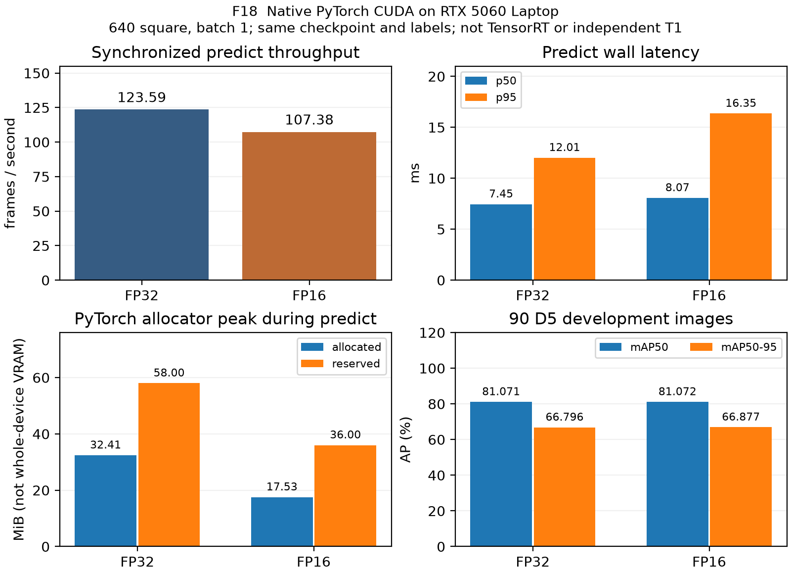

# Chương 5 — Phần HNHL cập nhật 09/11/2026

Bản thảo Markdown hiện hành để KR ghép; Word 01/11 là snapshot lịch sử. Chương 5 chung có ngân sách 3,5 trang, gồm thêm phần cửa của KR và deployment của DQK; editor chọn hình/rút gọn khi dàn trang. Nguồn E01–E20: [evidence gốc](evidence.md), [bổ sung 03/11](update-2026-11-03.md); N01–N11: [bổ sung 05/11](update-2026-11-05.md).

## Vật cản, khoảng cách và bản đồ

YOLO phát hiện vật cản trên ảnh đã undistort; ray tại contact sàn được chiếu bằng chiều cao camera, pitch và roll theo session. Tape truth là forward từ điểm dưới lens, khác planar range dùng cho repulsion. Sàn bóng có phản chiếu nên bbox bottom không mặc định là contact; bbox cắt mép hoặc contact không rõ bị từ chối. Occupancy grid chỉ nhận FREE từ footprint/seen-floor đã xác nhận; UNKNOWN chặn đường/LOS. Vantage cần reachable, clearance, LOS và cửa có vị trí world đo được.

Trên tập ghế glossy, 8/9 vị trí có estimate, median/p90 relative error 5.34%/20.91%; ID21 thiếu do cắt mép. P90 tổng chưa đạt 20%, số ID chưa đủ ≥20; chưa có sweep pose/world truth để nghiệm thu map hoặc dựng F11 thật. [F10](figures/F10_distance.png), E01.

D5 có 397 ảnh, split 307 train/90 dev-val, cùng session glossy 24/10 và đã dùng chọn model/input size. YOLOv8n-640 là development candidate; footwear/bag còn thiếu recall, wire recall 0% ở operating point dev và chưa đo empty-floor alarms. 12 wire masks là annotation pilot. Chưa independent T1, distance hoặc collision T2; giữ nguyên target P≥80%/R≥90% cho legs/footwear/backpacks/bags, wire R≥80% và ≤1 alarm/20 empty-floor frames (E02).

## Face, re-ID và tracking

Face whitelist dùng SCRFD/MobileFaceNet buffalo_s, embedding 512D chuẩn hóa và max cosine với reference. Pilot D2 có 125 face frames/21 entries/3 người; tại threshold 0.45, TAR 82.99%, FAR 46.40%. Chưa đạt TAR95% tại FAR1%; nhãn tự động và queries tương quan cần review. [F13](figures/F13_face_roc.png), E03.

OSNet-AIN x1.0 và x0.25 đã chạy, nhưng 23 body crops chưa tạo được gallery/query hợp lệ: thiếu gallery ở 2/3 người. Rank-1/CMC và model thắng vẫn chưa có; gate ≥5 identities/rank-1≥85% giữ nguyên. ByteTrack nối detection theo chuyển động/IoU và confidence; appearance lock/re-lock yêu cầu đúng architecture/weights hash, cosine/margin và hai frame xác nhận. Track ID không phải identity; mất dấu/mơ hồ không xuất target. Replay 822 frame D2 chỉ chứng minh runtime vì timestamp xấp xỉ và chưa có body-ID truth; ≤1 switch/phút và re-lock accuracy trên D3 chưa đo (E03/E04).

## Ngân sách GPU và lựa chọn precision

Profiler nạp cùng detector, OSNet, pose, face và cửa, pad body/face khi thiếu người; chưa phải hai luồng camera thật. DINO FP16, các Torch model khác FP32; bộ nhớ NVML lấy mẫu gồm cả ORT/driver/process khác. [F9](figures/F9_gpu.png), E05–E07.

| RTX5060 workload | FPS | p95 ms | NVML peak GiB |
| :-- | --: | --: | --: |
| All every frame | 12.72 | 90.75 | 0.939 |
| XFeat every frame | 14.25 | 82.99 | 0.622 |
| All scheduled door | 19.65 | 87.62 | 0.939 |

Hai mode mỗi-frame chưa đạt 15 FPS; scheduled door đạt 4.52 Hz khi yêu cầu 5 Hz. Kết quả RTX5060 chưa thay combined workload RTX4050; baseline từng model hai GPU khác power limits đã được tách riêng trong addendum 03/11. Giới hạn memory là 5,5 GB decimal, không phải 5,5 GiB.

F18 so native PyTorch CUDA FP32/FP16 bằng cùng checkpoint D5-640 và 90 ảnh/nhãn dev-val, 640 square, batch 1; mỗi precision process riêng, 10 warmup/270 timing samples. FPS 123.59/107.38, p95 12.01/16.35 ms; Torch peak allocated 32.41/17.53 MiB. mAP50 81.071%/81.072%. FP16 giảm allocator nhưng chưa tăng tốc, nên chưa đổi precision triển khai. Synchronized predict timing gồm preprocess/NMS và hook kiểm tra dtype, loại disk/video/control; P/R là best-F1 dev operating point. Thứ tự/thermal/nguồn AC chưa kiểm soát; không kết luận FP16 tốt hơn nói chung hoặc thay TensorRT/independent accuracy (N05).

## Triển khai và giới hạn thực nghiệm

D5 custom export ONNX opset11: 90/90 ảnh cùng bbox count, 294 reference boxes ghép đủ IoU≥0,9 giữa PyTorch CUDA FP32 và ORT CPU; đây là conversion parity, chưa TensorRT accuracy (E08). DQK bổ sung F20/F21 từ bằng chứng Nano đã có; G2/Stage A chưa đạt và không làm edge mới trước giữa kỳ theo plan sau PR #98. KR/DQK bổ sung XFeat/DINOv2 và F12, không dùng timing để suy ra accuracy cửa.

DQK đã bổ sung các run 08/11 và rút lại giải thích mount-slip/foot-stance; nguyên nhân sai lệch vẫn chưa rõ. Self-pose pitch estimates đổi từ −4,26° sang −0,64°; đây chưa chứng minh cơ chế phần cứng. home_6_1 dừng khi log khoảng 1,27 m nhưng tape do DQK báo 1,77 m, nên không lấy in-band estimates làm accuracy hoặc pursuit PASS. Ankle/box-height ranging thử nghiệm chưa được chọn dùng. PR #102 báo video stop-proxy 481–524 ms; chưa chứng minh stop≤350 ms hay vi phạm, trial4 có R1 end=0. PR #101 head969a5e0 đã sửa các ví dụ stale/handoff/projector hữu hạn và figure links; review lại còn lỗi observation API, HOLD sau gap và projector NaN. [Theo dõi bản sửa KR](followup-pr101-2026-11-09.md); không thay D3 hoặc thử robot. Lịch lớp 09/11 và scope matte đang được đề xuất đổi trong PR #102 chưa merge; chốt hình 16/11, draft 18/11, nộp 23/11 giữ nguyên. D3/re-ID/D5 độc lập/F11/raw latency/combined RTX4050 vẫn thiếu. [Audit mới và nội dung sửa cho editor](update-2026-11-09.md).

[Dòng Chương 7](chapter-07-rows.md), [appendix code](code-appendix.md), [checklist dữ liệu và bàn giao](update-checklist.md).
