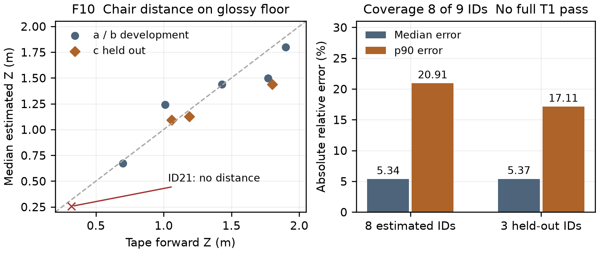
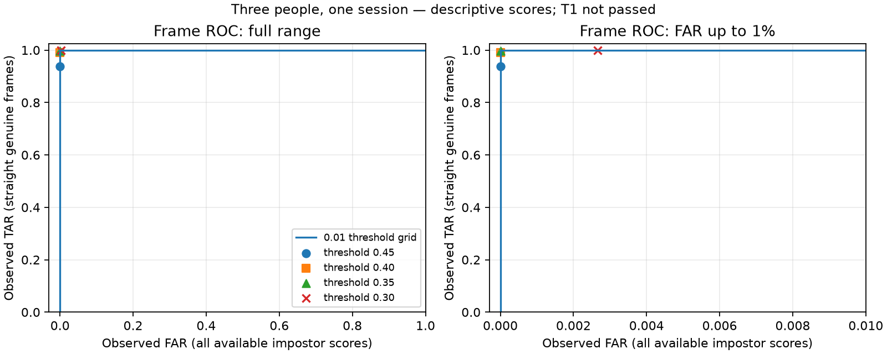
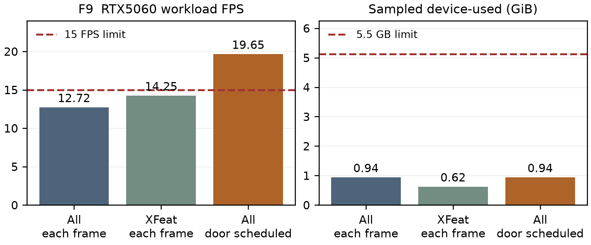
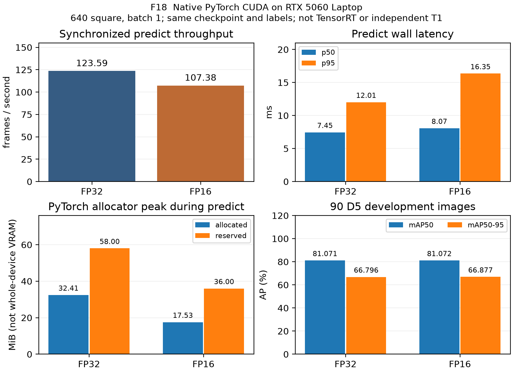
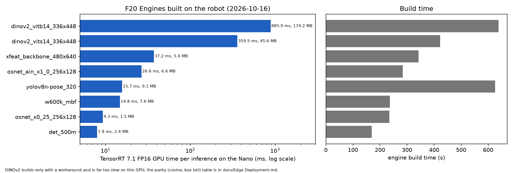

# Chương 5 — Nhận thức thị giác và tối ưu

Bản chốt đóng góp tuần 7 của HNHL, 21/11/2026, để DQK/KR review. Phần cửa phối hợp KR, triển khai Nano và số RTX 4050 thuộc DQK. Số liệu sau freeze 16/11 ghi ngày bổ sung; các mục chưa đủ dữ liệu giữ trạng thái chưa nghiệm thu.

## 5.1 Vật cản, contact và bản đồ

Pipeline YOLO phát hiện bbox, ước lượng điểm tiếp xúc rồi chiếu xuống mặt sàn. Bbox cắt mép, contact không rõ hoặc phản chiếu không giải được thì từ chối khoảng cách. FREE trong occupancy grid chỉ đến từ footprint/seen-floor đã xác nhận; UNKNOWN vẫn chặn đường và line-of-sight. Vantage cần reachable, clearance và vị trí cửa/world truth. Chưa có sweep đủ truth để nghiệm thu F11. [H1]

Median/p90 relative error của các ID có estimate là 5,34%/20,91%; ba vị trí held-out là 5,37%/17,11%. P90 tổng vượt 20%, chưa đủ ≥20 IDs và điều kiện độc lập. Bộ ghế glossy 09/11 có 0/36 khoảng cách hợp lệ; không diễn giải thành sai số bằng không. [H1, H2]

D5 có 397 ảnh, split 307 train/90 dev-val cùng phòng/session và đã dùng chọn checkpoint/input. YOLOv8n-640 đạt mAP50 khoảng 0,810, leg recall 0,960, wire recall 0; chưa nghiệm thu recall từng class hoặc empty-floor alarms. 12 wire masks mới là annotation pilot. [H1]

ORG/SegFormer-B0: trên ruler D1 24 vật, configured tìm 1/24, obstacle-route 8/24, free-space 6/24. Median error 0,041 m chỉ trên tám vật tìm được. Glare, ghế và missing objects vẫn là thất bại; không nhận mô hình làm default chỉ vì subset có error thấp. Width fallback của ghế là proposal một loại ghế, chưa tích hợp detector. [H2, D13]

## 5.2 Nhận diện cửa

XFeat + RANSAC kiểm tra hình học; DINOv2 hỗ trợ reference khác camera. Ngưỡng phải được hiệu chuẩn bằng negative sweep theo cửa. F12 so baseline ORB với XFeat/DINOv2; kết quả nhận cửa không chứng minh door range hoặc bắt tay đủ 10/10 đặt lại camera. Cự ly cửa không do detector trả về mà suy ra từ diện tích khung viền khớp so với một mốc tham chiếu lưu cùng enrolment (`ref_range_m`, đo một lần mỗi phòng, 1,96 m cho cửa lớp): range = ref·(A_ref/A)^(1/2). Ở hai lượt `approach_door` ngày 20/11, ước lượng khi dừng là 2,21 và 2,12 m (tape ghi tay 2,25 và 2,11 m), nhưng ước lượng đầu lượt thấp khoảng 10% ở lần đo 2,91 m so với tape 3,23 m (một lần đo). [K1, D20]

## 5.3 Whitelist, re-ID và tracking

SCRFD/MobileFaceNet tạo face embedding 512D chuẩn hóa; so maximum cosine với whitelist, ngưỡng hiện hành 0,45. D2 cafe pilot có 125 face frames, 21 entries, ba người: TAR 82,99%, FAR 46,40%. Queries liên tiếp tương quan, nhãn tự động cần review; chưa đạt TAR≥95% tại FAR≤1%. [H1]

Camera opt4 và guided enrollment trong phép thử ngày 13/11 cho mặt rộng 68–91 px ở 3,0–1,8 m. Ngày 14/11, ngưỡng cố định 0,45: TAR 822/877 = 0,937 (clip bootstrap [0,904; 0,970]); FAR 0/1754 straight-frame impostor scores. FAR gate đạt trên bộ này, TAR≥95% chưa được thiết lập. Chỉ ba người cùng một session, mỗi người so với hai enrolments còn lại; không suy ra population FAR. Ngưỡng 0,45 vẫn provisional (#118). [D14] [D13]

Phase 2 live do Huỳnh Nguyễn Hoài Lộc chủ trì (#115). Pilot 14/11 trên RTX 5060: 3 authorized/3 queued, coverage segment 50% mỗi cohort, 5 unresolved và 1 interrupted; median enqueue 9,387 s, hai người cùng session, chưa T1. Ngưỡng 0,45 provisional (#118). [H7] Ngày 16/11, đăng ký lại năm tư thế cho Đoàn Quốc Kiên rồi chấm lại cùng clip: TAR của Đoàn Quốc Kiên vẫn 0,930 (279/300 khung thẳng, cùng 21 frame dưới 0,45); còn thiếu người lạ ngoài nhóm và đăng ký lại cho Huỳnh Hữu Lộc, CSV lần chấm lại còn local. [D16]

Theo quyết định tạm ngày 14/11, person đã xác nhận nhưng thiếu mặt hợp lệ giữ unresolved và chưa enqueue. Đây là phần chưa đáp ứng đầy đủ yêu cầu flag người chưa đăng ký; counter confirmed-unresolved phục vụ audit, chưa thay chính sách. [S0, H7]

OSNet-AIN x1.0 và x0.25 đều chạy, nhưng 23 body crops hiện chưa tạo được gallery/query hợp lệ; thiếu gallery ở 2/3 người. Gate vẫn là ≥5 identities, rank-1≥85%; chưa có F14 đủ điều kiện. [H1]

ByteTrack dùng chuyển động/IoU và detection confidence thấp để nối track. Khóa/re-lock appearance cần cùng architecture, weight hash, preprocessing, cosine/margin và xác nhận qua hai frame. Vector/queue/tracker chạy trên laptop; JetBot nhận (v, w). Mất dấu/mơ hồ không được xem track ID là identity. [H1, K1]

Vendor ByteTrack đạt 407/407 synthetic ID agreement với backend tham chiếu, là T0 parity. Replay 822 frame D2 chứng minh runtime, chưa có body-ID truth/timestamp chuẩn để nghiệm thu ≤1 ID-switch/phút trên D3 ≥60 s, hai người. [H1, K1]

## 5.4 Ngân sách GPU trên laptop

Profiler nạp detector, OSNet, pose, face và cửa; có synthetic body/face padding khi thiếu detection, lập lịch tuần tự và sampled NVML. Kết quả workload không gồm đủ transport/control và hai camera thật, cũng không đo accuracy. DINO FP16, các Torch model khác FP32. Giới hạn VRAM 5,5 GB decimal khác 5,5 GiB. [H1, D13]

| Thiết bị / workload | FPS | p95 ms | Peak GiB / door Hz |
| :-- | --: | --: | :-- |
| RTX 5060, all mỗi frame | 12,72 | 90,75 | 0,939 / không schedule |
| RTX 5060, door scheduled | 19,65 | 87,62 | 0,939 / 4,52 |
| RTX 4050, all mỗi frame | 9,20 | 138,05 | 0,894 / không schedule |
| RTX 4050, door scheduled | 19,23 | 121,36 | 0,890 / 4,61 |

Dòng RTX 4050 lấy từ file JSON đo ngày 13/11 đã merge trong main; commit:path và SHA256 trong registry. Cờ `t1_accepted`/`target_rtx4050_verified` trong nguồn vẫn false. Hai GPU có điều kiện/power khác nhau, chưa phải so sánh có kiểm soát. Scheduled FPS vượt 15 nhưng door thực chưa 5 Hz; không tự coi toàn pipeline realtime đã đạt. [D13]

Cùng 90 ảnh dev-val, batch 1, mỗi precision process riêng: FP32/FP16 đạt 123,59/107,38 FPS, p95 12,01/16,35 ms; Torch allocated 32,41/17,53 MiB; mAP50 81,071%/81,072%. FP16 giảm allocator nhưng chậm hơn lần này; không kết luận FP16 tốt hơn nói chung. Timing gồm predict/preprocess/NMS và kiểm tra dtype, không gồm disk/video/control; chưa TensorRT hay independent accuracy. [H1]

## 5.5 Chuyển đổi và triển khai Jetson Nano

Model xuất ONNX trên laptop, xây TensorRT 7.1.3 FP16 trên Nano, batch 1/fixed shape. Nguồn 16/10 cho GPU time YOLOv8n-320 14,8 ms (FP32 20,7), pose 15,7 ms, OSNet x0.25 9,3 ms, AIN 26,6 ms; DINOv2-S 359,5 ms nên giữ trên laptop. Đây là latency model, không phải FPS cả vòng. [D13, E1]

SCRFD Resize opset 11 tạo sai khác trên TensorRT 7.1; lớp này được thay từ nearest-neighbor 2× sang grouped ConvTranspose. Stock-model cosine gần 1 không chứng nhận custom D5 hoặc re-ID độc lập. D5 ONNX parity laptop có 90/90 count, 294 reference boxes ghép IoU≥0,9; khác nghiệm thu accuracy/edge. [H1, E1]

| Bench Nano | FPS | p95 capture-to-result |
| :-- | --: | --: |
| 16/10, không người, stage B | 20,00 | 51,1 ms |
| 13/11, có người, stage B 60 s | 19,75 | 89,2 ms |
| 13/11, cửa ESP32 thật, 60 s | 17,7 / 17,1 | 118,5 / 123,9 ms |
| 13/11, cửa thật, người ngồi 600 s | 14,45 | 153,0 ms |

Lượt dài 600 s có RAM khoảng 2,13 GB, GPU tối đa 38,5°C, pin khoảng 11,96→11,72 V; vẫn chưa đủ 15 phút. Edge gate ≥20 FPS/p95≤100 ms chưa đạt với người và ESP32 thật. Lượt 16/10 không người/ảnh cửa tĩnh không thay kết quả mới. Các số 13/11 là bằng chứng từ #108 đã merge, không có motor/e-stop trong vòng benchmark. [D13]

Nguồn H1/H2, D13/D14/D16/D20, K1 và E1 được ghi commit:path/SHA256 trong [registry nhóm](../../kouun-rokku/week-07/editor-sources.md). ROC F13 dùng [CSV và protocol riêng](../week-07/threshold-118-2026-11-15/README.md); GPU/F18 và các kết quả cũ có [nguồn HNHL](evidence.md). [Bổ sung và checklist hiện hành 21/11](update-2026-11-21.md).
