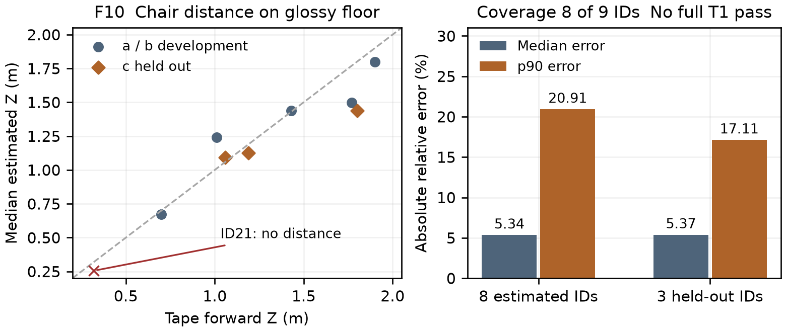
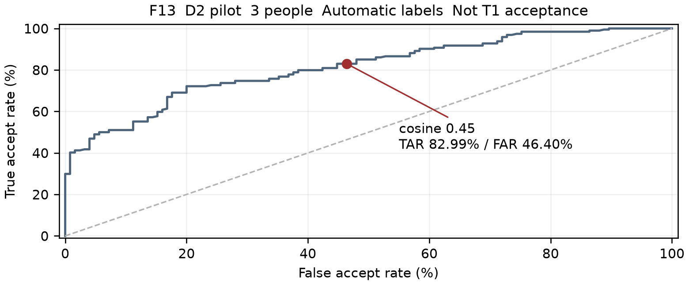
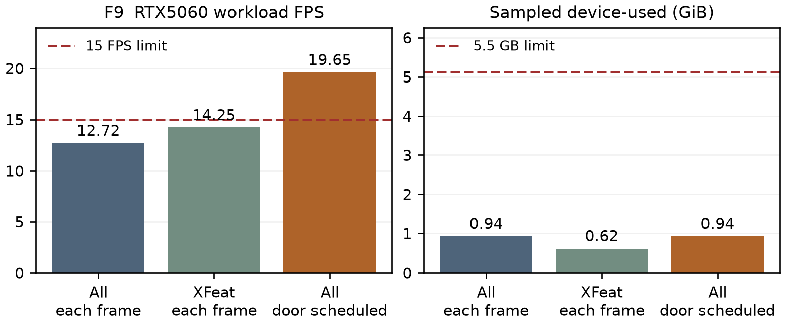

# Chương 5 Nhận thức thị giác và triển khai mô hình

HNHL • Snapshot 01/11/2026

Các module perception đã chạy trên laptop, gồm nhận diện vật cản, face verification, re-ID và tracking. Kết quả hiện có cho phép phân tích sai số và chi phí tính toán; chưa chứng minh đầy đủ các tiêu chí nhận diện và thử robot. Chương này phân biệt kết quả đo, pilot và các phép kiểm chứng còn thiếu.

## Vật cản và khoảng cách

Ảnh fisheye được undistort bằng intrinsics đã hiệu chuẩn. Ray tại điểm tiếp xúc sàn được chiếu theo chiều cao lens và pitch/roll của session. Khi roll bằng 0: Z = H / tan(pitch + atan((v - cy)/fy)). Z là forward distance từ điểm dưới lens, đúng với tape truth; planar range dùng cho repulsion là đại lượng riêng. Sàn bóng tạo phản chiếu nên bbox bottom có thể sai; contact estimator không đủ bằng chứng sẽ từ chối khoảng cách.

F10. Ghế trên sàn glossy: 8/9 vị trí có estimate, ID21 thiếu do cắt mép. Error median/p90: 5.34%/20.91%; ba vị trí held-out: 5.37%/17.11%. Điểm là median Z theo ID; error giữ cách tổng hợp gốc. [E01]

## Huấn luyện từ góc nhìn sát sàn

D5 có 397 ảnh, một phòng và một session glossy. Split 307 train/90 dev-val giữ nguyên nhóm khoảng cách; dev-val đã dùng chọn checkpoint và input size. Sau sửa nhãn nền, YOLOv8n được train 30 epochs, batch 8, seed 42. Kết quả dưới đây là development validation, chưa độc lập về floor/session. [E02]

| Input | mAP50 | mAP50-95 | Leg recall | Wire recall |
| --- | --- | --- | --- | --- |
| 320 | 0.759 | 0.626 | 0.920 | 0.000 |
| 416 | 0.753 | 0.622 | 0.920 | 0.000 |
| 640 | 0.810 | 0.656 | 0.960 | 0.000 |

640 là development candidate, chưa bật làm mặc định trên robot. Wire recall chưa đạt 80%; fallback hình học còn nhầm ron sàn. Mười hai masks dây mới là annotation pilot, chưa có kết quả segmentation. F10 chưa thay full T1: thiếu matte/control và số ID đủ điều kiện. F11 còn thiếu sweep với pose và vị trí vật/cửa đo thật.

## Face verification tại cửa

Whitelist dùng buffalo_s với SCRFD và MobileFaceNet, tạo embedding 512D được chuẩn hóa. Query so với tất cả reference bằng maximum cosine; threshold hiện tại 0.45. D2 cafe có 125 walker-face frames, 21 entries và 3 người. Nhãn largest-face/entry tự động cần được review, nhất là ảnh mờ và bystanders. [E03]

F13. ROC pilot cùng session, leave-one-member-out, enrollment từ entry đầu. Tại cosine 0.45: TAR 82.99%, FAR 46.40%; chưa đạt mục tiêu TAR95% tại FAR1%. Queries liên tiếp tương quan; không dùng chính pilot để chọn lại threshold rồi báo PASS. [E03]

## Re ID và chuyển appearance giữa camera

YOLO person crops được đưa qua OSNet-AIN x1.0 hoặc OSNet x0.25 với weights đã train re-ID. Cùng kích thước 512D không có nghĩa cùng embedding space: handoff yêu cầu đúng architecture, weights hash và preprocessing. D2 hiện chỉ có 23 body crops không mơ hồ; thiếu gallery ở 2/3 người. Vì vậy chưa có rank-1/CMC hợp lệ, chưa chọn model thắng và chưa có F14. Gate theo kế hoạch vẫn là rank-1 ≥85% với ≥5 gallery identities. [E03]

## Tracking và khóa mục tiêu

ByteTrack dùng chuyển động/IoU và detection confidence thấp để nối track. OSNet kiểm tra appearance mới của track đang quan sát; track ID không được coi là danh tính. Khóa mục tiêu cần cosine và margin, xác nhận qua hai frame; mất dấu hoặc mơ hồ thì không xuất target. Re-lock sau che khuất phải xác nhận lại. Reference không tự cập nhật bằng query, và record simulated không được dùng khóa người thật.

Đã chạy replay 822 frame D2 bằng cùng API live và có 584 CPU tests, 4 GPU tests passed trong suite tuần 5. Replay dùng timestamp xấp xỉ đều và chưa có body ID truth nên không cung cấp ID-switch accuracy. D3 cảnh hai người có reviewed IDs/visibility còn thiếu; mục tiêu ≤1 switch/phút chưa nghiệm thu. [E04, E11, E12]

## Nhận diện cửa và phạm vi phối hợp

XFeat ghép local features và kiểm tra homography RANSAC với robot-eye reference; DINOv2 hỗ trợ mô tả toàn ảnh khi reference khác camera. Threshold hiệu chuẩn bằng negative sweep theo cửa. Bearing không tự cung cấp door range. KR/DQK bổ sung kết quả cửa demo và F12; timing workload ở trang sau không phải accuracy cửa.

## Ngân sách GPU khi các model cùng nạp

Workload trên RTX 5060 Laptop nạp cùng YOLOv8n, OSNet-AIN, YOLOv8n-pose, SCRFD/MobileFaceNet, XFeat và DINOv2-B. Mỗi run có 5 warmup/100 iterations. DINO dùng FP16, Torch khác FP32. Khi thiếu detection, body/face work được pad tới ít nhất hai crop tổng hợp; đây không phải accuracy test. [E05-E07]

F9. Throughput workload và NVML device-used; không gồm transport, map/control hoặc hai camera live. Memory gồm Torch/ORT/driver/process khác, lấy mẫu 20 ms nên có thể bỏ lỡ spike. Không đồng nhất với PyTorch allocator. [E05-E07]

| Workload | FPS | p95 ms | VRAM GiB |
| --- | --- | --- | --- |
| Đủ model mỗi frame | 12.72 | 90.75 | 0.939 |
| XFeat mỗi frame | 14.25 | 82.99 | 0.622 |
| Đủ model cửa scheduled | 19.65 | 87.62 | 0.939 |

Run scheduled đạt 4.52 door updates/s khi yêu cầu 5 Hz; scheduler hiện ở profiler. Hai run mỗi-frame chưa đạt 15 FPS. Scheduled đạt budget của workload trên máy này; chưa thay nghiệm thu RTX 4050 hoặc main-loop live. Giới hạn memory là 5,5 GB decimal, tương đương 5,12 GiB. Nguồn AC/battery chưa xác nhận.

## Chuyển đổi mô hình và triển khai trên Jetson

D5 custom đã freeze class order và checkpoint, export ONNX opset11 fixed-shape. So PyTorch CUDA FP32 với ONNX Runtime CPU trên 90 ảnh: 90/90 frame cùng số bbox, 294 reference boxes ghép đủ ở IoU ≥0,9. Đây là conversion parity trên laptop, chưa phải TensorRT accuracy. [E08]

Kết quả stock edge models của DQK đạt cosine ≥0,999 trên các output được kiểm tra; YOLOv8n chỉ cùng count 205/208 frame. Không dùng phép đo đó chứng nhận model D5 custom hoặc OSNet-AIN handoff. DQK hoàn thiện phần engine build, workaround SCRFD Resize và F20/F21; các bước chưa qua gate chỉ được mô tả là kế hoạch. [E09]

## Phần cần kiểm chứng tiếp

Ưu tiên bổ sung D3 và gallery toàn thân, map/vantage có pose/truth, nhãn Wire, phép so FP32-FP16 về accuracy và budget RTX 4050. F11, F14, F18 và T2 robot còn chờ. Kết quả chưa đạt được giữ nguyên trong báo cáo; không hạ ngưỡng hoặc dùng pilot/dev-val thay nghiệm thu độc lập.

Nguồn E01-E12 và SHA256: midterm/evidence.md trong reports/HuynhNguyenHoaiLoc. Tài liệu phương pháp OSNet, ByteTrack, SCRFD/MobileFaceNets, YOLOv8 và phân công đọc nằm trong docs/Mid-Term Report Plan.md; KR tổng hợp bibliography của báo cáo nhóm.
