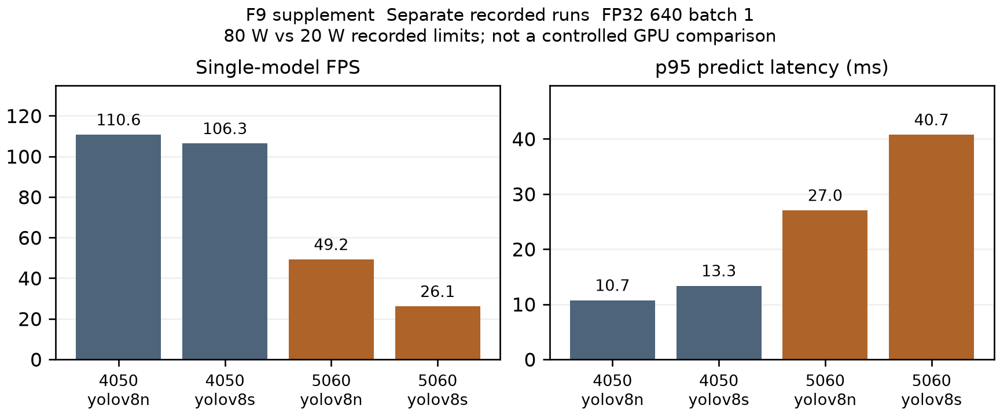

# Bổ sung giữa kỳ HNHL ngày 03/11/2026

Bản bổ sung cho snapshot Word/Markdown 01/11; không sửa số đo hoặc tự ghi nhận T1/T2 mới. Editor đọc cả hai bản khi ghép Chương 3/5/7. Các bảng dưới được tạo từ evidence, không chạy lại model.

## GPU từng model trên hai laptop

| GPU / model | FPS | p95 ms | Peak allocated / reserved MiB | Nguồn |
| :-- | --: | --: | --: | :-- |
| RTX 4050 Laptop GPU / yolov8n.pt | 110.62 | 10.70 | 33.07 / 58 | E13 |
| RTX 4050 Laptop GPU / yolov8s.pt | 106.28 | 13.34 | 78.62 / 94 | E13 |
| RTX 5060 Laptop GPU / yolov8n.pt | 49.18 | 27.02 | 33.54 / 58 | E10 |
| RTX 5060 Laptop GPU / yolov8s.pt | 26.06 | 40.74 | 78.62 / 94 | E10 |

640, batch 1, FP32, ảnh BGR tổng hợp cùng seed 532, 10 warmup/100 iterations; FPS gồm predict preprocessing/postprocessing. Enforced power limit ghi nhận RTX4050 80 W và RTX5060 20 W; nguồn AC/battery chưa xác nhận, drivers và clock khác nhau. Không suy ra GPU này nhanh hơn GPU kia theo kiến trúc, không lấy single-model FPS thay ngân sách toàn pipeline. Memory bảng này là PyTorch allocator; F9 workload W5 dùng sampled NVML toàn thiết bị.

## D5 precision và recall phải tách riêng

D5-640 là development validation đã dùng chọn checkpoint/input size: 307 train/90 val trong cùng session glossy. Các class không đạt vẫn được giữ nguyên. E02.

| Class | Precision % | Recall % | So gate P/R của nhóm class bắt buộc |
| :-- | --: | --: | :-- |
| leg | 94.06 | 96.00 | P/R đạt trên dev-val / R≥90%, P≥80% |
| footwear | 69.06 | 87.50 | Chưa đạt / R≥90%, P≥80% |
| backpack | 91.84 | 100.00 | P/R đạt trên dev-val / R≥90%, P≥80% |
| bag | 61.94 | 77.27 | Chưa đạt / R≥90%, P≥80% |
| wire | 0.00 | 0.00 | Chưa đạt R≥80%; gate ≤1 alarm/20 empty frames chưa đo |
| chair | 57.10 | 91.94 | Chưa đặt gate P/R tại bảng này |
| table | 98.75 | 70.00 | Chưa đặt gate P/R tại bảng này |
| plant | 98.89 | 100.00 | Chưa đặt gate P/R tại bảng này |

Backpack recall là 100%; khoảng 91,84% là precision. Footwear và bag đều thiếu cả recall≥90% lẫn precision≥80%; Wire recall 0% dưới 80% và chưa có số false alarms/20 empty-floor frames. Gate lấy từ [Implementation Plan §4.3](../../../docs/Implementation%20Plan.md), bao gồm cả bags. Các class đạt P/R trong dev-val vẫn chưa chứng minh full T1: còn held-out session, distance error và T2 drive-over/collision.

## Đường truyền để ghép Chương 3 và Chương 7

| Phép đo | Kết quả và phạm vi | Nguồn |
| :-- | :-- | :-- |
| Video camera thật 60 s | 1200 frames / 59.9s; 20.0 FPS; seq missing 0/1200; latency p50/p95/max 13/53/127 ms | E14, block Real camera 60 s |
| Watchdog, 5 chu kỳ | 313, 314, 315, 310, 305 ms; median 313, max 315 ms; robot_udp --dry-run trên robot, đo từ packet cuối tới log zero | E14, block O |
| Dead-man/e-stop đầu tiên | 3–15 ms theo daemon khi wheels off ground; không phải thời gian dừng cơ học khi robot đang chạy | E15, Test 1 |

p95 video 53 ms vượt target <50 ms; ghi chưa đạt tiêu chí latency. Seq gaps bằng 0 trong run này không chứng minh mọi mạng có packet loss 0%. Log chỉ chứa aggregate quantiles, không có raw per-frame latency samples: F7 CDF còn chờ, không nội suy CDF từ ba quantiles. Watchdog đạt giới hạn log-response ≤350 ms trong dry-run; không đánh đồng với HIL đo dừng cơ học. Quy tắc gamepad hiện tại cần lấy từ code/config hiện hành, không dùng câu hướng dẫn arming lịch sử như lệnh vận hành mới.

## Jetson và ESP32 để phối hợp mục 5.x của DQK

Run 28/10 trên pin, wheels still: 17,999 frames/900.1s, 20.00 FPS, capture-to-result p95 69.74 ms; 4,499 door runs (khoảng 5.00 Hz). Nhưng chỉ 2,121 ESP frames mới, 2.36 FPS: nhiều door runs dùng lại frame, không phải 5Hz thông tin độc lập. Đây là compute/runtime benchmark, chưa phải accuracy nhận diện danh tính hoặc driving under load. E16–E17.

README của DQK ghi RAM max 2,11 GB, nhiệt độ max 33°C và pin min 11,83 V, lấy từ tegrastats/battery logs; đây là RAM hệ thống Jetson, không phải NVML VRAM laptop. Firmware ESP32 cải thiện lên khoảng 9 FPS sau run này nhưng chưa re-bench cùng workload. Khi editor dùng các số phụ này, giữ link README/raw logs của DQK và điều kiện wheels still. G1 compute evidence không thay Stage A/G2 obstacle/control trials hoặc accuracy D1/D2.

## F15 mới và trạng thái tích hợp

Dùng [F15 đo điểm cuối của DQK](../../DoanQuocKien/week-05/f15/F15_dead_reckoning.png) và [giải thích nguồn](../../DoanQuocKien/week-05/f15/README.md), đã merge qua PR #94. Chỉ có end poses và tape offsets; không có per-frame poses nên không dựng quỹ đạo giữa chúng. Hai run 3m: open-loop error khoảng 186/158 cm (không/có mốc), closed-loop khoảng 98/14,5 cm. Chưa đủ 5 lượt T2, run tốt còn phụ thuộc vị trí board đo tay; các speed-scale khác cho khoảng 15,5–17,3 cm. Deployment 30/10 là protocol khác, không cộng chung thành 5 lượt 3m. E18–E19.

PR #92 HNHL đã merge; PR #93 KR đang có bản sửa sau review, chưa merge tại thời điểm snapshot E20. Kết quả hold/controller/ByteTrack trên nhánh KR là T0/simulation và còn phải review đúng head mới, không dùng làm T2 hoặc D3 accuracy. F15 không thay F11 occupancy/vantage của HNHL.

## Nguồn mở rộng E13–E20

SHA256 chuẩn hóa CRLF thành LF để không đổi khi Git checkout trên Windows/Linux; các source bytes khác giữ nguyên.

| Mã | File | SHA256 |
| :-- | :-- | :-- |
| E13 | [gpu_baseline_rtx4050.json](../../../reports/DoanQuocKien/week-01/gpu/gpu_baseline_rtx4050.json) | `d59ae21d6d188a048e20209e2a88ce64e19f64f83be8240b766f4dc1c0667b22` |
| E14 | [link_test_2026-10-04.txt](../../../reports/DoanQuocKien/week-01/link_test_2026-10-04.txt) | `3482135db29ef453aeb0431d4875471310f5ce848d1609fe4f6e099c5bd3da11` |
| E15 | [estop_deadman_2026-10-06.txt](../../../reports/DoanQuocKien/week-01/estop_deadman_2026-10-06.txt) | `c8716d6d0330a5de7e27b191089d61a9a2c6b1bb898e71ced67c59e93cbd9750` |
| E16 | [live_esp32_bench.json](../../../reports/DoanQuocKien/week-04/edge_deploy/live_esp32_bench.json) | `b7817b9ec72115747555b589944144cc4728820b0cbcd4574709cd3205433734` |
| E17 | [README.md](../../../reports/DoanQuocKien/week-04/edge_deploy/README.md) | `ba72ef08441cbe4abfa6a04c3f9d5ba5c76bde9f7c971c9d78d44a30b0e0e48f` |
| E18 | [README.md](../../../reports/DoanQuocKien/week-05/f15/README.md) | `e0752564c42710fef674522090d27db91dd4aa7e8c14744a6d5d2853c7689b86` |
| E19 | [tape_offsets_1030.json](../../../reports/DoanQuocKien/week-05/f15/tape_offsets_1030.json) | `a373deb53731181129b53224b1ccfef62865331fab61eea3107f05b6adf8c9d2` |
| E20 | [github-2026-11-03.json](../../../reports/HuynhNguyenHoaiLoc/midterm/github-2026-11-03.json) | `d7b09e3b355aa8bf90bfcab3fa9f83d1de3026d4640cd05df85b197740ed0d29` |

Nguồn E01–E12 và snapshot Word giữ tại [evidence.md](evidence.md). Bản số liệu đầy đủ của phụ lục: [update-2026-11-03.json](update-2026-11-03.json). Chạy lại `python -m tools.build_midterm_hnhl_update` để tạo bảng/hình từ các nguồn đã lưu; không tự fetch GitHub hoặc suy ra data mới.
