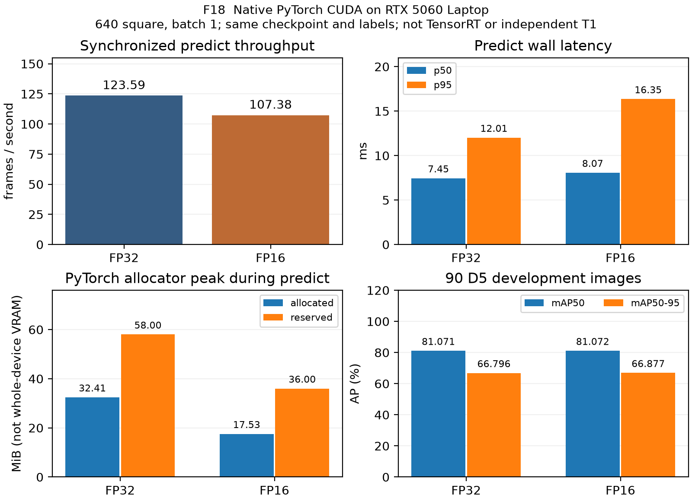

# Bổ sung giữa kỳ HNHL — 05/11/2026

Đối chiếu main sau PR #98 (`4c041b6`). Bản này bổ sung các snapshot 01/11 và 03/11; editor dùng trạng thái mới bên dưới khi ghép. Word 01/11 giữ nguyên bản đã render, các số đo lịch sử không bị thay thế. Nguồn N01–N11 và hash/commit: [JSON](update-2026-11-05.json).

## Kết quả mới F18: tốc độ, bộ nhớ và accuracy cùng dữ liệu

| Native PyTorch CUDA | FPS | p50 / p95 ms | Peak allocated / reserved MiB | mAP50 / mAP50–95 % |
| :-- | --: | --: | --: | --: |
| FP32 | 123.59 | 7.45 / 12.01 | 32.41 / 58 | 81.071 / 66.796 |
| FP16 | 107.38 | 8.07 / 16.35 | 17.53 / 36 | 81.072 / 66.877 |

FP16/FP32 throughput ratio **0.869×**: FP16 chậm hơn trong lần đo này, không có bằng chứng tăng tốc. Peak allocated giảm **14.88 MiB**; mAP50 đổi **+0.00052 điểm phần trăm**, mAP50–95 **+0.08011 điểm phần trăm**. Đây là sai khác số học/thực nghiệm nhỏ trên dev-val, không kết luận FP16 tăng accuracy hoặc tốt hơn khi triển khai.

**Protocol:** RTX5060 Laptop, cùng checkpoint YOLOv8n D5-640 và cùng dataset/labels hash của E02; 90 ảnh validation session 24/10. Mỗi precision chạy trong process riêng, thứ tự FP32 rồi FP16, 10 warmup + 3 lượt × 90 ảnh = 270 timing samples. Batch 1, `rect=False`, square 640, TF32 tắt; hook xác nhận cả input và weights thực sự CUDA FP32/FP16. Synchronized wall latency gồm preprocessing/inference/NMS/result của `predict()`, ảnh đã decode trong RAM; không gồm disk/video/control. Hook kiểm tra dtype cũng nằm trong đường timing.

Timing dùng conf=0,25; accuracy dùng conf=0,001 để tính AP, NMS IoU=0,7, max_det=300. P/R per class trong JSON là operating point best-F1 của validator, chưa frozen deployment threshold. Hai precision dùng cùng protocol mới; không đối chiếu trực tiếp accuracy này với E02 vốn khác batch/rect. Dataset gốc/checkpoint giữ nguyên; validator chỉ tạo cache trong bản sao private.

Đây là native PyTorch, chưa TensorRT; model đơn lẻ, chưa combined workload RTX4050, re-ID hoặc live loop. NVML whole-device sampled peak FP32/FP16 là 433.10/411.10 MiB, có thể gồm process khác và bỏ sót spike; không đồng nhất với allocator. Nguồn AC/battery chưa xác nhận; thứ tự/thermal chưa kiểm soát, không suy ra ưu thế GPU hoặc precision nói chung. [Raw metrics/provenance](../week-06/d5_precision_2026-11-05.json), [cách chạy](../week-06/README.md). F18 có bằng chứng laptop bước đầu; chưa hoàn tất toàn bộ optimization acceptance.

### Đoạn đề xuất ghép Chương 5

Trên RTX5060 Laptop, chúng tôi so sánh native PyTorch FP32 và FP16 bằng cùng checkpoint D5-640, cùng 90 ảnh/nhãn development và batch 1. Qua 270 mẫu timing mỗi precision, FP32/FP16 đạt 123.59/107.38 FPS; peak allocated của PyTorch là 32.41/17.53 MiB. mAP50 tương ứng 81.071%/81.072%. FP16 giảm bộ nhớ nhưng chưa tăng tốc trong lần đo, nên chưa đổi precision triển khai. Dữ liệu development cùng session đã dùng chọn model; kết quả chưa chứng minh independent accuracy, TensorRT/Nano hoặc ngân sách toàn pipeline trên RTX4050 (F18, N05).

## Trạng thái mới cần ghép Chương 7 và phần rủi ro

| Mục | Trạng thái ngày 05/11 | Việc còn lại / owner |
| :-- | :-- | :-- |
| Camera JetBot | DQK báo hỏng socket FPC; không có video; chưa xác nhận sửa xong (N01/N04) | DQK sửa/kiểm tra; HNHL dùng đúng calibration theo session khi nhận data |
| Tracking và re-ID | Code có; ID-switch/min, re-lock accuracy, rank-1 vẫn chưa đo hợp lệ | DQK thu D3; HNHL review IDs/timestamps, evaluate; gallery/query ≥5 người |
| D5 | Có dev-val và F18; footwear/bag/wire vẫn chưa đạt full gate, không có session độc lập | Thu session độc lập, QA labels/floor; không train tiếp để hợp thức hóa dev score |
| F7 / F11 | Chưa có raw latency CSV / sweep pose+world truth | DQK/HNHL phối hợp khi camera hoạt động; không dùng quantiles hoặc F15 endpoints để dựng thay |
| F9 / F18 | Có workload RTX5060 và baseline single-model RTX4050; mới có F18 native CUDA D5 | Combined RTX4050, paired independent accuracy và các model còn lại vẫn chờ |
| G2 / Stage A-B | G2 chưa đạt; không làm edge mới trước giữa kỳ theo plan đã merge | Dùng F20/F21 đã có của DQK, không claim on-robot obstacle layer hoặc Edge safety PASS |
| PR #98 / #99 | #98 merge; #99 request changes, chưa merge ở snapshot N06/N09 | Không lấy review/code merge làm T2; runner pursuit mới chưa là nghiệm thu của HNHL |

Camera hỏng làm chặn ghi D3/D5 và các thử nghiệm video robot, không chặn viết báo cáo, model inference, replay/simulation hoặc ESP32. Sau sửa camera, DQK kiểm tra frame và đo lại self-pose/height; nếu thay module phải hiệu chuẩn fisheye mới. Các frame D1/D2/D5 cũ tiếp tục gắn calibration/module cũ; không áp calibration mới ngược cho dữ liệu cũ.

## Kế hoạch chốt có điều kiện

- Camera hoạt động lại trước 07/11: chuẩn bị buổi 09/11; nếu chỉ kịp 13/11 thì 16/11 là buổi robot đầu tiên theo contingency của plan. Đây là kế hoạch, chưa ghi nhận các buổi đã chạy.
- Nếu 16/11 vẫn thiếu camera/data/≥5 identities/reviewed boxes: giữ null/chưa đo cho các chỉ tiêu đó; pursuit/HOLD chỉ trình bày simulation/replay và ghi rõ. Không hạ ngưỡng hoặc dùng D2 runtime thay D3.
- 16/11 chốt hình và thí nghiệm; 18/11 KR ghép full draft; 20/11 freeze PR, 21/11 nhóm kiểm tra tag; 23/11 nộp. F18 đưa vào ngân sách Chương 5 chung 3,5 trang bằng cách rút gọn cùng KR/DQK.

Đầu việc HNHL khả thi hiện đã có: bản thảo phương pháp/kết quả/giới hạn, evidence registry, F9/F10/F13/F18, dòng Chương 7, appendix và D3 handoff. [Checklist tiếp tục](update-checklist.md) xác định dữ liệu còn thiếu. Không có motor commands hoặc T2 mới trong lần bổ sung này.
