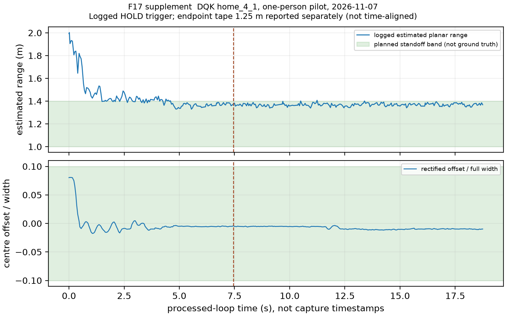

# HNHL — bổ sung từ bằng chứng DQK/KR, 07/11/2026

Đã kiểm tra PR và các nhánh/report của nhóm. Phần mới của DQK ở head `bb9f341` của PR #99, **chưa merge và đang request-changes**; đây là evidence được owner báo/commit, không phải HNHL chạy robot hoặc chứng nhận code đó đúng. [Registry và metrics](update-2026-11-07.json), [archive có provenance](team-evidence-2026-11-07/provenance.json), [re-review #99](../reviews/PR-99-2026-11-07.md).

## Camera pose và distance diagnostic mới

| Pose DQK sau sửa | Pitch ° | Roll ° | Spread ° | Marker frames |
| :-- | --: | --: | --: | --: |
| camera_pose_self_1106_1.json | -4.68 | 1.03 | 0.207 | 44 |
| camera_pose_self_1107_1.json | -4.49 | -2.08 | 0.059 | 40 |
| camera_pose_self_1107_2.json | -4.55 | 0.29 | 0.055 | 42 |

Height cơ khí giữ 0,100 m; self-pose ghi passed=true trong source, chưa là độc lập distance validation. Pose 30/10 pitch +2,15° khác sau sửa khoảng 6,8°; không áp pose cũ lên ảnh mới hoặc ngược lại. Pitch ba lần gần nhau; roll từ −2,08 đến +1,03° chưa giải thích. HNHL không fit lại pose hay suy ra repair là nguyên nhân chắc chắn.

| Tape forward m | Reading forward DQK báo m | Absolute relative error % | Foot-row median px / samples |
| --: | --: | --: | --: |
| 1.20 | 1.02 | 15.00 | 293.92 / 159 |
| 1.80 | 1.57 | 12.78 | 283.11 / 155 |
| 2.40 | 1.63 | 32.08 | 282.45 / 159 |

Readings lấy từ bảng README DQK, không phải ước lượng HNHL mới; median pixel tính lại từ numeric source. Domain raw/rectified của pixel chưa được ghi rõ nên không chiếu lại hoặc fit pitch từ các điểm này. 1,8→2,4 m thật chỉ làm reading 1,57→1,63 m; đây là dấu hiệu độ nhạy/box contact, không phải detector T1. Offset 3,5 px là tuning của một floor/người, không chuyển sang D1/furniture/D5 hoặc dùng làm validation độc lập.

## Pilot pursuit/HOLD mới của DQK — F17 bổ sung

`home_4_1`: 362 log rows, operator nói robot bắt đầu khoảng 2 m, logged TARGET_STATIONARY tại 7,45 s tính từ đầu run; một tape hold endpoint 1,25 m, source estimate khoảng 1,37 m. Endpoint tape không có timestamp alignment nên không vẽ thành ground-truth time series. Event time không phải dwell kể từ lúc người thật dừng. Bbox centring được đổi đơn vị half-width→full-width trên hình; chưa biến nó thành time-weighted acceptance.

**Giữ nguyên rút kết quả:** `home_1_3` distance-in-band bị DQK withdraw vì true distance và estimate mâu thuẫn; `home_3_1` bắt đầu sẵn gần target nên không là pursuit test. Các fraction trong summary chỉ là source diagnostics, không dùng báo PASS. Không có walk-back/side-step chuẩn, real stop time, hold exit, re-centering time hoặc người thứ hai. Video gaps và command/pose bugs trong PR #99 làm hạn chế thêm các diễn giải.

## Phần HNHL thiếu — người khác đã làm tới đâu?

| Phần | Evidence của nhóm đã có | Bổ sung hợp lệ / còn thiếu |
| :-- | :-- | :-- |
| Camera pose/distance | DQK home_1107 pose/tape/pixel và pilot mới | Bổ sung bảng trên; chưa thay distance T1 ≥20 IDs/floors |
| Tracking D3 / target re-lock | HNHL code/runtime; DQK home có một người; KR ByteTrack T0 | Vẫn thiếu reviewed JetBot ≥60s hai người, identity/visibility và target-event truth. Telemetry home không phải D3 labels |
| Re-ID F14 | HNHL có hai OSNet runtime; D2 gallery thiếu | Chưa ai cung cấp gallery/query ≥5 người hợp lệ; rank-1 giữ null |
| Map/vantage F11 | HNHL grid/vantage code; KR localization/F15 endpoints | Endpoint ArUco và simulated map không phải D1 sweep có poses/obstacle/door world truth |
| F7 latency CDF | DQK W1 đã có p50/p95/max; home log chỉ processed-loop t | Không có raw t_cap/t_rx clock-synced mới trong gói này; không dựng CDF từ quantiles hoặc processed gaps |
| F9 / F18 | DQK RTX4050 single-model, HNHL RTX5060 full mix + paired D5 precision | Đã đưa các kết quả có sẵn vào addenda trước; còn combined target RTX4050/independent accuracy |
| D5 | DQK cung cấp session 24/10, HNHL sửa/train/dev-val | Gói home mới chỉ người/footpoint, chưa là D5 độc lập có nhãn class/empty controls |
| Pursuit/HOLD / F17 | KR simulation/T0; DQK n=1 tape endpoint trên robot | Bổ sung pilot này, không gọi full T2 hoặc ID accuracy |
| Cửa/edge F12/F20/F21 | KR/DQK đã có entrance bake-off, engine parity và Nano runtime | Dùng nguồn đã có, giữ per-door/optimistic threshold và freshness limits; không yêu cầu HNHL làm lại |

Nguồn đã đối chiếu: [KR simulation](../../../reports/kouun-rokku/week-05/sim_pursuit_hold.json), [KR hold T0](../../../reports/kouun-rokku/week-05/hold_detector_metrics.json), [entrance bake-off](../../../reports/DoanQuocKien/week-02/d1/entrance_bench_2026-10-12.md), [RTX4050 baseline](../../../reports/DoanQuocKien/week-01/gpu/gpu_baseline_rtx4050.json). Registry pin các nguồn cũ theo commit; không coi kết quả mô phỏng là thử robot. F20/F21 và F15 đã tổng hợp ở [addendum 03/11](update-2026-11-03.md).

## Kiểm chứng và trạng thái PR

PR #99 head mới được review: 29 targeted CPU tests passed (10,58 s), integration main conflict-free; các main/sender failure paths vẫn lỗi nên đã REQUEST_CHANGES. Không motor/HIL/inference mới. PR #100 HNHL vẫn chờ DQK review; bổ sung evidence trên chính PR đó. Numeric archive bỏ track IDs/boxes khỏi telemetry/summary, giữ original/source hashes và mô tả chuyển đổi. Kết quả cũ Word/F18 và các null acceptance được bảo toàn.
