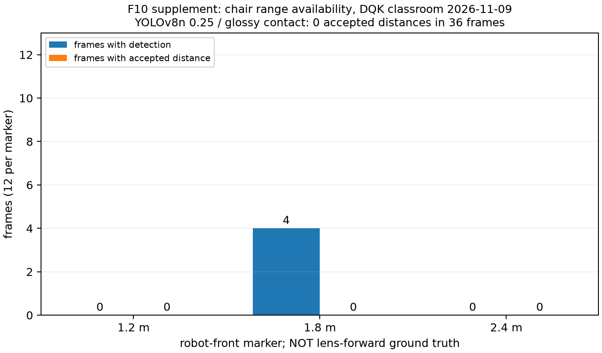

# HNHL — bổ sung giữa kỳ từ bằng chứng mới DQK, 10/11/2026

Nguồn PR99 head45416e7 và PR102 head8ec3598, đều chưa merge. HNHL đọc numeric evidence/review code, không chạy robot hoặc inference. [Registry](update-2026-11-10.json), [provenance](team-evidence-2026-11-10/provenance.json). Các snapshot trước giữ nguyên.

## Vật cản: bổ sung kết quả thất bại thay vì chỉ subset có distance

| Marker từ đầu robot | Frames | Detection | Distance hợp lệ | Median error |
| --: | --: | --: | --: | :-- |
| 1.2 m | 12 | 0 | 0 | chưa đo |
| 1.8 m | 12 | 4 | 0 | chưa đo |
| 2.4 m | 12 | 0 | 0 | chưa đo |

Một ghế khung kim loại trên sàn glossy lớp09/11; pose1109_4, YOLOv8n confidence0,25. Bốn detections ở1,8m đều reflection_unresolved. Giữ median/error=null, không coi0 distances là0 error. Tape từ đầu robot tới điểm ghế gần nhất; source nói skid khoảng1,46m từ lens khi marker1,2m, nên không cộng offset tùy ý hoặc gộp với8/9 IDs F10 trước. Không full T1≥20 IDs.

Offline JPEG sweep (12 frames/mốc) khác sampling của live: base1,8m có6 detections thay vì4. YOLOv8s:5/0,1/0,12/5 detection/distance theo1,2/1,8/2,4m; YOLO-World0/0,8/0,12/0. SegFormer không cải thiện; v8s+SegFormer bằng v8s. Median2,21m của5/12 far-frame v8s không đủ distance coverage và truth chưa cùng gốc. Không chọn model thắng chỉ vì nhiều bbox hơn.

## Person range: những lựa chọn đã thử

DQK đã thử DA-V2 Metric Indoor Small/Base/Large, Depth Pro, ZoeDepth; zoom/calibration không chuyển được sang set1,25m. Relative-depth floor anchor cũng không ổn định giữa hai sets≈1,8m. Đây là failed local comparisons, không kết luận mọi depth model đều bất khả thi. Raw model/dataset hashes và scripts đầy đủ chưa đi kèm; không chạy lại/download chỉ để tái tạo các số này.

| Tape dưới lens | Gated frames | Trunk0,50 raw median bias | Smooth median bias | Smooth frames trong±0,15m |
| --: | --: | --: | --: | --: |
| 1.25 m | 171/171 | +0.156 m | +0.154 m | 32.7% |
| 1.77 m | 455/455 | -0.016 m | -0.016 m | 100.0% |
| 1.80 m | 122/122 | +0.159 m | +0.159 m | 29.5% |

Tính lại từ arrays nguồn (748 gated frames nhưng chỉ một người/ba sets), không chép tỷ lệ làm tròn của README nguồn: bảng README ghi smooth29%/100%/32%, khác32,7%/100%/29,5% tính từ JSON. Cần tác giả đối chiếu script/labels trước khi chốt. Noise nhỏ không đồng nghĩa accuracy; smoothing không bỏ per-set bias. Round8 dùng prior0,49m, median trunk bias≈+0,13/−0,05/+0,12m (3/3 set medians trong±0,15m); khác round7 prior0,50m và không phải mọi frame đều đạt. Fusion với foot-row tệ hơn trunk đơn lẻ. Cue chọn sau khi xem các sets; không độc lập. Row người2,4m từng dùng nhầm stock sample đã bị DQK rút, không sử dụng.

PR99 thêm --range-source trunk, default vẫn foot, prior0,50m; chưa chạy robot cho trunk. Không dùng kết quả0,49m làm validation cho config0,50m. Cần nhiều người khác ở1,2/1,8/2,4m, posture/roll/occlusion và fallback tests. Không đổi detector/ranging mặc định của HNHL.

## Pursuit, camera và phần còn chờ

Các run tile_1_1/tile_2_1 là lớp học glossy0,6m tiles, không home. Tape lúc hold≈1,7m nhưng log≈1,28–1,33m; tile2 không HOLD dù người đứng. p2_dry_1 là dry-run, không motor outcome. Source PR102 nói tile_3_1 có21 HOLD frames nhưng không tìm thấy log/summary trong hai head; chỉ giữ là owner-reported, không đưa vào figure hoặc acceptance. DQK quy pitch change cho mount/handling; chưa đo độc lập, không suy ra repaired socket là nguyên nhân.

Review lại PR99:45 CPU tests passed/17,54s; config/main-path/pose-cap fixes đã có, vẫn tái hiện overwrite x_3 khi thiếu x_2 và full-run coverage bị cap sai denominator. PR102 live sender cleanup/cutoff/trial4 vẫn chưa sửa. PR101 giữ head969a5e0 và findings09/11. PR100 HNHL chờ DQK; không có PR đủ điều kiện merge tại lần kiểm tra này. [Review99](../reviews/PR-99-2026-11-10.md), [review102](../reviews/PR-102-2026-11-10.md), [test log](../reviews/PR-99-2026-11-10-tests.log). [21 evidence/source CPU tests passed/4,21s](../week-06/tests_evidence_2026-11-10.log); gồm null distance/error, frame accuracy khác median bias, invalid samples và historical-source guards.

## HNHL cần tiếp tục, tránh làm lại phần DQK đã thử

- Đưa failed chair coverage/model comparisons vào Chương5/7; không chỉ giữ error của các estimate tốt. Editor dùng addendum này cùng F10 gốc.
- DQK đang làm Experiment B/contact/reflection/ORG; chưa có candidate đạt chair+table+empty-floor diagnostic. HNHL nhận scripts/config/model/data hashes và raw held-out samples khi có, review labels/protocol rồi đánh giá; không hạ reflection threshold trên chính36 ảnh và tự báo PASS.
- D3 two-person reviewed IDs, gallery≥5 identities, D5 session độc lập, world poses/door range/F11, clock-synced raw latency/F7 và combined RTX4050 vẫn thiếu. Person depth sets không thay các bộ dữ liệu này.
- Converter D3 và paired F18 đã có trong PR100; plan còn ghi chưa viết/chưa đo là stale. Buổi DQK một mình09/11 không thay graded session/ESP32/Phase2/T2 của nhóm.
- Giữ mốc16/11 figures,18/11 draft,23/11 submit; phần chưa đo ghi in progress. Matte removal/higher camera/ORG còn là scope/design proposals chưa merge; không tự đổi gate. Source đặt nhãn một số rounds là10/11 evening/night; exact execution time chưa được HNHL xác minh.
