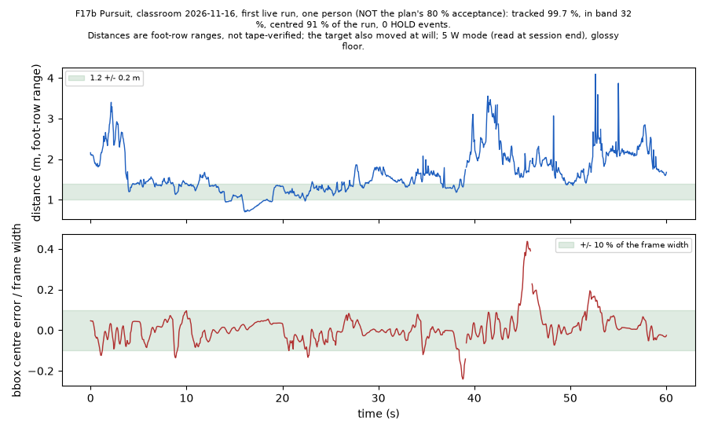

# HNHL cập nhật giữa kỳ ngày 16/11/2026

PR #124 đã được DQK approve và merge. Phiên này HNHL review và merge #125, #126, #127, đưa bằng chứng buổi lớp 16/11, F3/F17b, các chương của DQK và lịch video vào main. Các dòng dưới dùng log đã commit và ghi rõ những số liệu do DQK báo trong README. Snapshot kèm hash và công cụ tái lập nằm trong kho. [Snapshot](update-2026-11-16.json), [review](../reviews/2026-11-16.md).

## Lượt deployment thứ 7

`t2_1116_1` tới STANDBY sau 30,699 s. Log có 110 câu trả lời handshake đều in-view. DQK ghi tape cửa 2,93 m, nội thất 0,35 m, LOS thông và 0 va chạm. Robot bắt đầu cách board 0 khoảng 2,87 m, tower được đặt sau khi robot dừng. Tổng số lượt deployment được nhóm tính là 7. Summary dùng `manual_vantage` với vị trí nhập trước. Nghiệm thu map và thuật toán chọn vantage tự động của HNHL còn chờ sweep/world truth. [Log và điều kiện](../../DoanQuocKien/week-07/classroom_1116/README.md).

Handshake rehearsal có một lượt chấp nhận hợp lệ và một lượt từ chối hợp lệ. Những lần timeout, dùng reference cũ và lần quên xoay tower đều được giữ trong nguồn. Hàng handshake 10 accepts/10 rejects tiếp tục chờ đủ protocol.

## Pursuit và pose camera

Tính lại toàn bộ 1.181 dòng CSV với interval weight tối đa 0,25 s và mẫu cuối 0,05 s cho kết quả khớp summary.

| Chỉ số theo thời gian toàn lượt | Kết quả |
| :-- | --: |
| Thời gian lượt | 60,08 s |
| Có target được theo dõi | 99,7% |
| Cự ly nằm trong 1,2 ±0,2 m | 32,2% |
| Tâm bbox nằm trong ±10% chiều rộng ảnh | 91,1% |
| Sự kiện reacquire | 1 |
| Frame bị obstacle-blocked | 90 |
| Frame/sự kiện HOLD | 0 |

Tỷ lệ cự ly 32,2% dưới yêu cầu 80%. Cự ly được suy từ foot-row, target di chuyển tự do, một người trên sàn bóng. Tape truth theo thời gian còn thiếu. DQK ghi chế độ 5 W được đọc cuối buổi và mã robot trước audit được dùng lúc chạy. Lượt này có 0 sự kiện HOLD và chưa có giai đoạn đứng yên chủ động. [CSV](../../DoanQuocKien/week-07/classroom_1116/pursuit/pursuit_1116_1/log.csv), [summary](../../DoanQuocKien/week-07/classroom_1116/pursuit/pursuit_1116_1/summary.json).



Pose dùng cho pursuit có H=0,100 m, pitch xuống −8,00°, roll −2,16°, 45 marker frames và spread pitch 0,018°. Cần lấy pose đúng session khi tính khoảng cách trên sàn. Hai ảnh thiết bị F3 đã có. [Pose](../../../calib/camera_pose_self_1116_3.json), [F3 trước cửa](../../DoanQuocKien/week-07/figures/F3_devices_door_1116.png), [F3 với marker](../../DoanQuocKien/week-07/figures/F3_devices_marker_1116.png).

## Cập nhật face và an toàn từ DQK

DQK báo đăng ký lại 5 pose rồi chấm cùng clip, TAR DQK vẫn 0,930 với cùng 21 frame dưới 0,45. Kết quả này giữ nguyên quyết định tạm 0,45 và 2/3 mẫu cùng ID. CSV score của lần đăng ký lại còn ở local. Bộ ROC đã chấm từ CSV 14/11 tiếp tục là bằng chứng có thể tính lại trong kho.

Sau buổi chạy, DQK triển khai lại các file audit và kiểm tra e-stop với bánh xe nhấc khỏi sàn. Theo README, thả R1 cắt trong 10 ms và motors-zero sau mốc STOPPED 78 ms. Nút khác tương ứng 6 ms và 38 ms, mỗi trường hợp một lượt. Gói điều khiển dùng unsigned. Log thô của phép đo tối còn ở local. [Tường trình và mốc thời gian](../../DoanQuocKien/week-07/classroom_1116/README.md).

## Bàn giao và lịch còn lại

Chương 5/7 và appendix đã cập nhật trạng thái #124 merged. HNHL bổ sung docstring cho timestamp None/0 cùng regression constructor khi active target thiếu queue record, theo góp ý DQK trong review #124.

Theo quyết định nhóm ngày 16/11, các cảnh video còn lại chuyển sang thứ Năm 19/11, dựng bản cắt 20–21/11 và chốt video 22/11. Bản draft báo cáo vẫn ngày 18/11. Buổi 19/11 có cảnh Phase 2 với các thành viên theo fold whitelist, phần prompt/đặt camera/handshake/STANDBY và intruder. Dữ liệu thêm sau freeze được ghi ngày bổ sung. [Kế hoạch buổi 19/11](../../../docs/Classroom%20Session%202026-11-19.md).

D3/gallery, independent D5, body visibility/cross-camera, automatic map/vantage, precision accuracy RTX4050 và full door T1 còn chờ dữ liệu theo protocol. Motion fit và tower avoidance được DQK chuyển sang phần việc tiếp theo. #113 vẫn giữ head cũ và còn finding xóa D5/D2. Gói báo cáo của KR chờ sửa phần đó và đồng bộ số liệu mới.

Tái lập snapshot và kiểm tra từ repo root bằng môi trường HNHL.

```powershell
.venv/Scripts/python.exe -m tools.build_midterm_hnhl_nov16
.venv/Scripts/python.exe -m tools.check_midterm_hnhl
```
