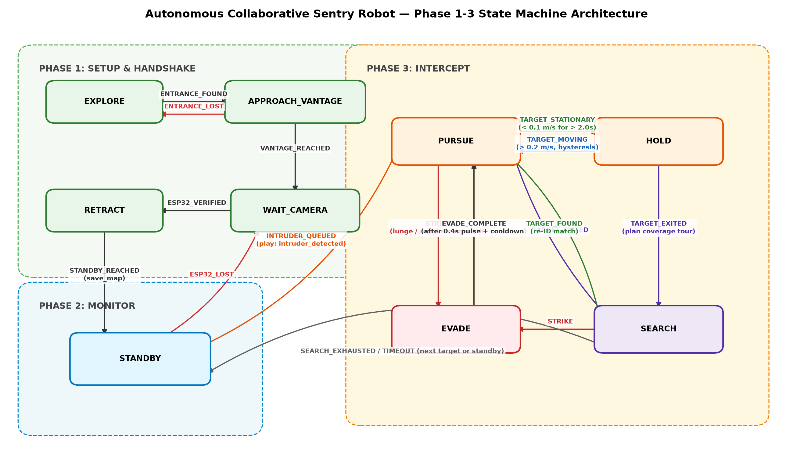

# Chương 6 — Hành vi và điều khiển

StateMachine nhận event có timestamp và trả Command(v, w, play, actions, target_id). Phase3Runner nối hàng đợi, hold detector và controller. Logic CPU tách khỏi socket/hardware để replay và kiểm thử xác định. [K2]

TargetQueue giữ FIFO và vector đã chuẩn hóa; target đang bám không bị người mới thay thế. TARGET_EXITED hoàn tất mục tiêu hiện tại; nếu còn người chờ thì SEARCH/reacquire, nếu hết thì STANDBY. Handoff reset observation, dwell/filter và controller, yêu cầu mẫu mới thuộc identity kế tiếp.

HoldDetector chiếu target local sang world theo pose robot, ước lượng vận tốc trên cửa sổ ngắn: vào HOLD khi speed<0,1 m/s đủ 2 s; thoát khi >0,2 m/s. Bù pose nhằm tránh báo đứng yên/di chuyển sai chỉ do robot xoay; drift odometry thực vẫn làm giới hạn kết quả.

Trong HOLD, v=0 và chỉ yaw recenter; PURSUE điều khiển cự ly mục tiêu 1,2 m và tránh vật cản khi có estimate hợp lệ. Lệnh tuân vùng chết bánh (dead=0,40), projector recheck miền hợp lệ; NaN/±Inf dừng trước saturation. STRIKE có logic preemption/xung 400 ms, còn thử tấn công robot ở sau giữa kỳ.

**Sửa review #101:** `observe_target()` và `step(target_pos=...)` cùng xử lý mỗi timestamp đúng một lần; mẫu stale/wrong-ID không tiến dwell. Motor dừng khi observation quá 0,25 s; gap>1 s hoặc detector TARGET_LOST giải phóng HOLD và đồng bộ mode, kể cả không có tick trong khoảng mất hình. [K2]

Mô phỏng closed-loop ghi HOLD tại 6,32 s, resume 8,26 s, zero translation trong HOLD, hai targets hoàn tất và không lệnh bất hợp lệ. Các thời điểm này thuộc kịch bản scripted, không phải thời gian đo trên JetBot. [K2]
