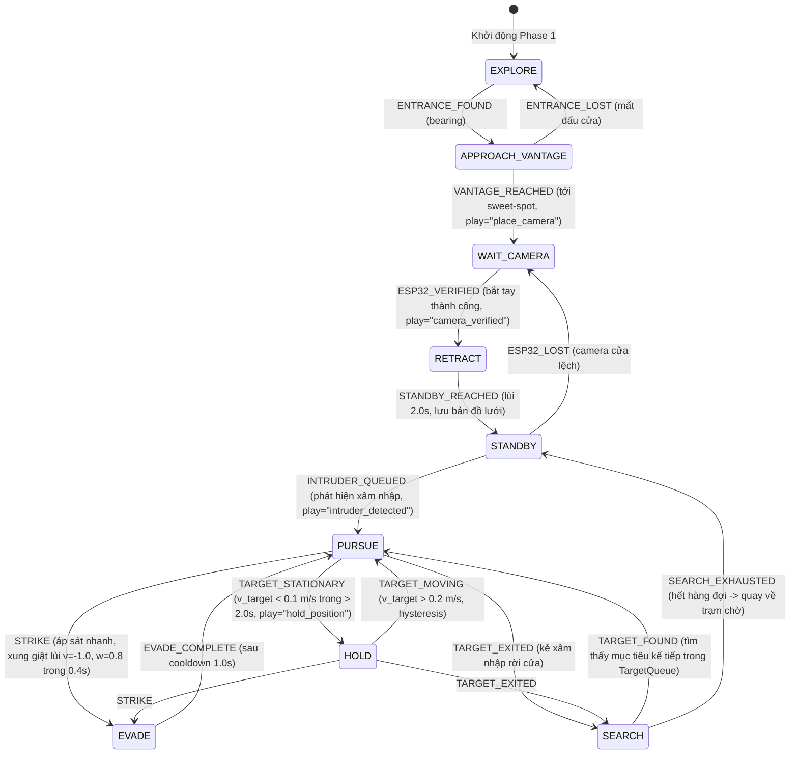

# Chương 6 — Hành vi và điều khiển hệ thống

**Bản thảo kouun-rokku (KR), 2026-11-02.** Ngân sách chương: 1,5 trang theo phân công tại [Mid-Term Report Plan](../../docs/Mid-Term%20Report%20Plan.md). Mô tả kiến trúc máy trạng thái hữu hạn, quy trình điều phối triển khai Phase 1, cơ chế quản lý hàng đợi đa mục tiêu FIFO, bộ điều khiển truy bám PD né vật cản, và thuật toán nhận diện dừng bước chuyển trạng thái Standoff Hold.

---

## 6.1 Kiến trúc máy trạng thái hữu hạn (State Machine)

Toàn bộ chu trình vận hành của sentry robot được điều phối bởi máy trạng thái phân tầng (`StateMachine` trong `sentry/app/state_machine.py`). Máy trạng thái được thiết kế thuần logic CPU (deterministic, không phụ thuộc I/O mạng hay phần cứng), tiếp nhận chuỗi sự kiện có tem thời gian $(t, \text{event}, \text{data})$ và phát ra lệnh điều khiển chuẩn tắc `Command(v, w, play, actions, target_id)`.

Các đặc tính kỹ thuật cốt lõi:
- **Tách biệt pha (Phase Isolation):** Chia rõ 3 pha `SETUP` (Khám phá & bắt tay), `MONITOR` (Túc trực tại trạm chờ), và `INTERCEPT` (Đánh chặn, truy bám, dừng canh gác hoặc tìm kiếm).
- **Loại trừ sự kiện không hợp lệ:** Các sự kiện xảy ra sai pha hoặc không đúng logic đều bị từ chối và ghi vết vào `sm.ignored_events` mà không làm thay đổi trạng thái nội tại của robot.
- **Cơ chế timeout an toàn:** Tự động hồi phục khi các pha bị kẹt thời gian dài (khám phá quá 180 s, tiếp cận cửa quá 30 s, bắt tay camera quá 60 s, tìm kiếm phủ bản đồ quá 120 s).

---

## 6.2 Điều phối triển khai Phase 1 (Deploy Runner)

Sau khi bộ nhận diện XFeat phát hiện cửa phòng, module `DeployRunner` (`sentry/app/deploy_runner.py`) điều khiển xe từ vị trí hiện tại đến vị trí sweet-spot cách cửa $1,5–3,0\text{ m}$:
1. **Tiếp cận điểm quan sát (`goto_command`):** Sử dụng dead-reckoning kết hợp mốc ArUco trên tường. Do motor có vùng chết động cơ ($\text{dead} = \text{min\_pwm} / \text{max\_speed} = 0,12 / 0,3 = 0,4$), xe áp dụng chiến lược quay tại chỗ khi góc lệch $|\Delta\theta| > 0,5\text{ rad}$ ($29^\circ$) với $w_{\text{spin}} = 0,45$, sau đó tịnh tiến thẳng ở $v = 0,55$ ($\sim 0,22\text{ m/s}$) và điều chỉnh lái trong dải an toàn để bảo đảm hai bánh không rơi vào vùng chết.
2. **Bắt tay quang học ESP32 (`ESP32Handshake`):** Khi tới sweet-spot, xe phát âm thanh thông báo hướng dẫn đặt camera cửa. Bộ lọc `EntranceFilter` thẩm định luồng ảnh từ ESP32-CAM (qua `MJPEGReceiver`). Cần tối thiểu 3 khung hình liên tiếp xác nhận đúng góc nhìn cửa vào phòng (`ESP32_VERIFIED`) mới kích hoạt chu trình lùi an toàn (`RETRACT`) về vị trí trực chiến danh định.

---

## 6.3 Quản lý hàng đợi mục tiêu đa xâm nhập (TargetQueue FIFO)

Trong tình huống có nhiều người lạ liên tiếp bước qua cửa khi robot đang bận truy bắt đối tượng đầu tiên, module `TargetQueue` (`sentry/app/target_queue.py`) đảm bảo không bị thất thoát mục tiêu:
- Mỗi kẻ xâm nhập được đóng gói thành một bản ghi `IntruderRecord` chứa ID định danh, vector đặc trưng khuôn mặt 512D, vector ngoại hình toàn thân 512D từ OSNet ($\vec{a}_{\text{target}}$), sector hướng rẽ (Trái/Giữa/Phải) và ảnh chụp snapshot.
- Hàng đợi FIFO có khóa luồng an toàn (thread-safe lock). Khi sự kiện `INTRUDER_QUEUED` gửi đến lúc robot đang ở trạng thái `PURSUE` hoặc `HOLD`, mục tiêu mới được tự động xếp vào đuôi hàng đợi mà không làm gián đoạn mục tiêu đang đánh chặn.
- Khi mục tiêu hiện tại thoát khỏi phòng (`TARGET_EXITED`), máy trạng thái kích hoạt `TargetQueue.complete_active()` hoặc `drop_active()` và chuyển sang truy lùng mục tiêu tiếp theo (`SEARCH`).

---

## 6.4 Điều khiển truy bám PD và né vật cản (Pursuit Controller)

Bộ điều khiển `PursuitController` (`sentry/nav/controllers.py`) duy trì vị trí bám đuổi tối ưu:
- **Duy trì cự ly $1,2\text{ m}$ (Distance PD):** Sai số cự ly $e_{\text{dist}} = d_{\text{measured}} - 1,2\text{ m}$ được tính từ điểm tiếp xúc chân người chiếu xuống mặt sàn (`CameraGeometry.ground_point`). Vận tốc dài commanded tuân theo:
  $$v_{\text{cmd}} = k_{p,v} e_{\text{dist}} + k_{d,v} \dot{e}_{\text{dist}}$$
  với $k_{p,v} = 0,8, k_{d,v} = 0,1$, giới hạn trong dải $v \in [-0,3; 0,55]$.
- **Căn giữa khung hình (Centering PD):** Sai số góc $e_{\text{yaw}}$ (góc phương vị bearing $\beta$ hoặc độ lệch ngang tâm bbox) điều khiển vận tốc góc xoay:
  $$w_{\text{cmd}} = k_{p,w} e_{\text{yaw}} + k_{d,w} \dot{e}_{\text{yaw}}$$
  với $k_{p,w} = 1,5, k_{d,w} = 0,2$, giới hạn $w \in [-1,0; 1,0]$.
- **Override né vật cản cận cảnh (Obstacle Override):** Khi bộ nhận diện vật cản báo có vật cản phía trước ở cự ly $d_{\text{obs}} < 0,5\text{ m}$, bộ điều khiển cộng thêm thành phần góc né $w_{\text{avoid}} = 0,45\text{ rad/s}$ ngược hướng với góc lệch của vật cản để lái vòng qua vật thể nhưng vẫn giữ kẻ xâm nhập trong biên trường nhìn camera. Nếu khoảng cách nguy hiểm $d_{\text{obs}} < 0,35\text{ m}$, vận tốc tiến bị triệt tiêu hoàn toàn ($v \le 0$) để chống va chạm cơ học.

---

## 6.5 Nhận diện dừng bước và hành vi Standoff Hold (Hold Detector)

Để thực hiện đúng yêu cầu kỹ thuật tại Đặc tả dự án (§4.5): *"Khi mục tiêu dừng bước, JetBot dừng tịnh tiến, xoay tại chỗ căn giữa và tuyệt đối không bay vòng quanh (no orbit) vì quỹ đạo vòng quanh sẽ đẩy mục tiêu sang góc 90 độ, rơi ra ngoài trường nhìn camera"*.

Thuật toán `HoldDetector` (`sentry/nav/hold_detector.py`) giải quyết bài toán cốt lõi:
1. **Bù trừ chuyển động và góc xoay của robot (World Motion Compensation):**
   Nếu chỉ tính vận tốc dựa trên độ dịch chuyển bounding box hoặc tọa độ tương đối trong hệ quy chiếu robot, việc robot tự xoay thân để căn giữa sẽ tạo ra vận tốc biểu kiến giả $\vec{v}_{\text{rel}} \approx \omega \times r \ne 0$. Do đó, tọa độ cục bộ của mục tiêu $(x_f, y_l)$ được chiếu tức thời sang hệ tọa độ thế giới thông qua pose odometry $(x_r, y_r, \theta_r)$:
   $$\begin{pmatrix} X_w \\ Y_w \end{pmatrix} = \begin{pmatrix} x_r \\ y_r \end{pmatrix} + \begin{pmatrix} \cos\theta_r & -\sin\theta_r \\ \sin\theta_r & \cos\theta_r \end{pmatrix} \begin{pmatrix} x_f \\ y_l \end{pmatrix}$$
2. **Ước lượng vận tốc mặt sàn bằng hồi quy tuyến tính:**
   Trên cửa sổ trượt $0,5\text{ s}$, vector vận tốc thực $\vec{v}_{\text{target}} = (v_{x,w}, v_{y,w})$ được ước lượng bằng phương pháp bình phương bé nhất (OLS). Điều này giúp triệt tiêu hoàn toàn nhiễu rung lắc của mô hình phát hiện người (khoảng $\pm 2\text{ cm}$).
3. **Cơ chế trễ (Hysteresis) và thời gian duy trì (Dwell Time):**
   - **Vào HOLD:** Vận tốc mặt sàn $v_{\text{target}} < 0,1\text{ m/s}$ duy trì liên tục trong thời gian $t_{\text{dwell}} \ge 2,0\text{ s}$. Bộ dò phát sự kiện `TARGET_STATIONARY`, robot chuyển trạng thái sang `HOLD`.
   - **Thoát HOLD:** Khi đang ở `HOLD`, robot chỉ trở lại `PURSUE` khi vận tốc mục tiêu vượt ngưỡng $v_{\text{exit}} > 0,2\text{ m/s}$ (`TARGET_MOVING`). Dải trễ $[0,1; 0,2]\text{ m/s}$ ngăn chặn triệt để hiện tượng rung giật trạng thái khi người chỉ nhúc nhích nhẹ tại chỗ.
   - **Hành vi trong HOLD:** Vận tốc dài tịnh tiến bị khóa cứng ở mức $v = 0,0$ tuyệt đối. Bộ điều khiển chỉ dùng thành phần PD xoay thân tại chỗ ($w = k_{p,w} e_{\text{yaw}} + k_{d,w} \dot{e}_{\text{yaw}}$) để giữ tâm người trong dải $\pm 10\%$ độ rộng ảnh trong thời gian $< 1,5\text{ s}$.

Thử nghiệm mô phỏng kín (`tools/sim_pursuit_hold.py`) trên mô hình unicycle robot chứng minh: khi mục tiêu di chuyển ở $0,35\text{ m/s}$, robot bám đuổi với $100\%$ tỷ lệ căn giữa; khi mục tiêu dừng ở giây thứ 4,0, robot kích hoạt `HOLD` chính xác tại giây $6,34$ ($2,34\text{ s}$ gồm độ trễ xóa cửa sổ trượt), vận tốc tịnh tiến giữ vững $v = 0,0$, và tự động trở lại `PURSUE` sau $0,26\text{ s}$ khi mục tiêu bước tiếp.
