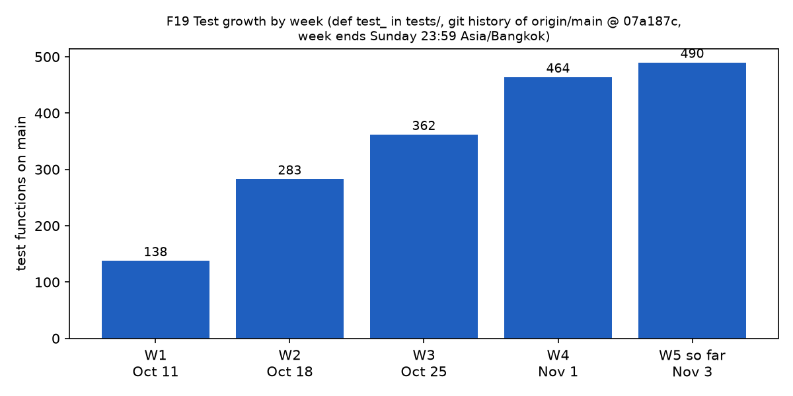
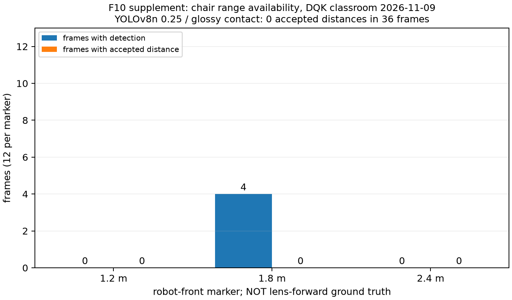

# Chương 7 — Kiểm thử và kết quả

## 7.1 Tầng kiểm thử và tái hiện

| Tầng | Điều kiện | Có thể kết luận |
| :-- | :-- | :-- |
| T0 | CPU, dữ liệu tổng hợp, fake transport, SimRobot | Logic hình học, contract, chuyển trạng thái, guards |
| T1 | Replay có nhãn/truth và protocol định trước | Accuracy/latency theo bộ dữ liệu và thiết bị ghi rõ |
| T2 | Robot/ESP32 thật, pin và điều kiện có kiểm soát | Hành vi vật lý đủ số lượt, không suy từ T0 |

Checkout sạch trên nhánh sau tích hợp `#130` và `#131` (mã commit, tree SHA và danh sách dependency xem trong `week-07/clean_checkout_pytest.log` và `week-07/validation.json`): toàn bộ suite CPU/replay pass không có lỗi ngoài các mục skip thiếu dữ liệu/weights/tùy chọn cài đặt và 4 test GPU/HIL bị loại trừ. Số test chỉ áp dụng cho đúng commit được log, không chứng nhận model/GPU hoặc phần cứng. Kết quả cũ 754/773 không dùng để chứng nhận bản sửa này. [K3]

Checkout sạch tuần 7 clone từ commit candidate được ghi riêng cùng tree SHA, Python/dependency versions, command, exit code và pytest output. Chỉ dùng môi trường package đã cài của máy; D5 và ZIP D2 vẫn tracked theo quyết định nhóm; không copy dữ liệu local bổ sung, weights hoặc `.venv` vào clone. Model/GPU environment được ghi riêng nếu thiếu; CPU/replay không chứng nhận full inference setup. [K3]

Checker gói nộp đọc **committed export** qua index tạm từ `git read-tree`, cùng pathspec với `git archive`. Dữ liệu phát triển vẫn tracked; data/team_data/recordings/weights chỉ bị loại khỏi ZIP. `--index` chỉ hỗ trợ pre-commit. Các path data/recordings/weights, secret filenames và model binaries bị từ chối. Checker theo tên file không phải kiểm toán nội dung hoặc lịch sử Git.

Gói ZIP lấy từ `git archive` của đúng commit, không chứa `.git`; manifest lưu SHA256 từng file. Test xác nhận workspace bẩn không lọt vào ZIP, dữ liệu tracked không bị xóa khi tạo ZIP, secret ngoài vùng loại vẫn làm HEAD fail, file output cũ không bị ghi đè. [K3]

<!-- pagebreak -->

## 7.2 Bảng đối soát nghiệm thu

| Hạng mục | Bằng chứng hiện có | Trạng thái so với gate |
| :-- | :-- | :-- |
| Video JetBot | 12/11: 19,4–19,6 FPS, p95 128 ms | Chưa đạt ≥20 FPS/≤50 ms; bằng chứng #108 |
| E-stop | Watchdog dry-run 305–315 ms; 12/11 R1 7 ms; 14/11 dry-run 35 ms, dongle 97 ms; 16/11 R1 10 ms/78 ms; gói unsigned | Chưa đo dừng cơ học; không suy ra full T2 |
| Fisheye / LiveTilt | RMS 0,83 px (52 ảnh); LiveTilt 0,5–6% tĩnh, 3–20% động | Fisheye đạt; LiveTilt một phần, chưa đủ ranging |
| DR + ArUco / T2 cửa | 7 lượt T2 cửa được tính; handshake 1 accept/1 reject | DR 98,3 cm chưa đạt; handshake chưa 10/10 |
| Khoảng cách ghế | 8/9 IDs, p90 20,91%; bộ mới 0/36 distance | Chưa p90≤20%/≥20 IDs/độc lập |
| D5/Wire | 307/90 cùng session; wire recall 0 | Dev-val, chưa independent T1/class gates |
| Face whitelist | Door 14/11: 822/877 genuine; 0/1754 impostor | 3 người/1 session; FAR gate đạt, TAR 95% chưa đạt |
| Re-ID/tracking | Backend parity/runtime replay; Sector 99,7% (T0) | Chưa gallery≥5/D3≥60 s/body-ID truth |
| Pursuit/HOLD | 16/11: tracked 99,7%, distance 32%, centred 91%, 0 HOLD | Không PASS: distance dưới 80%; HOLD chưa thử |
| Né tháp ESP32 | Steer riêng sát ~0,4 m; bám 120 s: 13 triggers, 12 xong, 1 active, tracked 67,2%, dải 9,2%, tâm 40%; detector tắt | Bổ sung 18/11 sau freeze; ping-pong, thiếu T1/T2 |
| GPU laptop | Scheduled 5060 19,65; 4050 19,23 FPS | Workload; door Hz<5, chưa dual-stream T1 |
| Edge live | 14,45 FPS/p95 153 ms ở 600 s | Chưa ≥20 FPS/≤100 ms/15 phút |
| Vòng đầy đủ | Module, Hold 2 s/Standoff v=0, event chain có test T0 | Chưa ≥4/5 không can thiệp |

Lượt 16/11: sàn glossy, robot được ghi 5 W theo nvpmodel đọc cuối buổi (giả định không đổi), code trước audit và control packets unsigned. Lượt 16/11 chưa có tower avoidance; bổ sung sau đóng băng 18/11 mới thử `TowerSteer` theo marker khi tắt detector vật cản tổng quát; gains DR vẫn tuần 2, fit theo sàn hoãn. Phase 2 live do Huỳnh Nguyễn Hoài Lộc chủ trì; pilot #115 gồm 3 authorized và 3 queued, segment coverage 50%, không đủ T1. [D16, D18, H7]

Không cộng các frame liên tiếp thành số lượt độc lập; không lấy error chỉ trên estimates tốt để bỏ missed objects. Kết luận hiện tại: các khối đã có mã và bằng chứng phát triển, nhưng các gate hệ thống quan trọng vẫn pending. Nguồn từng hàng: [registry](week-07/editor-sources.md), H1/H2/D13/D18/C1/C2/K2.
