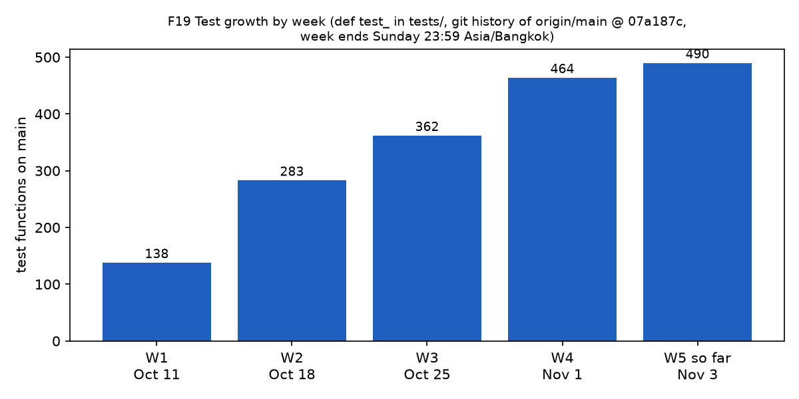
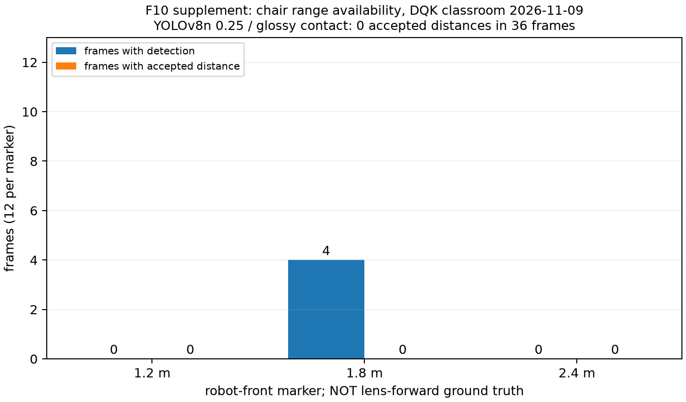

# Chương 7 — Kiểm thử và kết quả

## 7.1 Tầng kiểm thử và tái hiện

| Tầng | Điều kiện | Có thể kết luận |
| :-- | :-- | :-- |
| T0 | CPU, dữ liệu tổng hợp, fake transport, SimRobot | Logic hình học, contract, chuyển trạng thái, guards |
| T1 | Replay có nhãn/truth và protocol định trước | Accuracy/latency theo bộ dữ liệu và thiết bị ghi rõ |
| T2 | Robot/ESP32 thật, pin và điều kiện có kiểm soát | Hành vi vật lý đủ số lượt, không suy từ T0 |

PR #101 đã được sửa và kiểm tra: nhóm runner/controller/hold/state-machine/queue có 71 test PASS; toàn bộ CPU/replay trước đóng gói có 754 passed, 5 skipped, 4 deselected. Đó là kết quả commit fca0ea2, không mặc định là số test sau khi thêm tooling tuần 7. [K2]

Checkout sạch tuần 7 clone từ commit candidate được ghi riêng cùng tree SHA, Python/dependency versions, command, exit code và pytest output. Chỉ dùng môi trường package đã cài của máy; không copy raw datasets, weights hoặc `.venv` vào clone. Model/GPU environment được ghi riêng nếu thiếu; CPU/replay không chứng nhận full inference setup. [K3]

Checker gói nộp đọc **committed tree** bằng `git ls-tree`, không lấy index làm bằng chứng cho commit. `--index` chỉ hỗ trợ pre-commit. Các path data/recordings/weights, secret filenames và model binaries bị từ chối. Checker theo tên file không phải kiểm toán nội dung hoặc lịch sử Git.

Gói ZIP lấy từ `git archive` của đúng commit, không chứa `.git`; manifest lưu SHA256 từng file. Test xác nhận workspace bẩn không lọt vào ZIP, dữ liệu chỉ untrack ở index vẫn làm HEAD fail, file output cũ không bị ghi đè. [K3]

## 7.2 Bảng đối soát nghiệm thu

| Hạng mục | Bằng chứng hiện có | Trạng thái so với gate |
| :-- | :-- | :-- |
| Video JetBot | 12/11: 19,4–19,6 FPS, p95 128 ms | Chưa đạt ≥20 FPS/≤50 ms; DQK #108 |
| E-stop | Wheels-up: cắt điện median 7 ms | Chưa có thời gian dừng cơ học; không suy ra full T2 |
| Fisheye | RMS 0,83 px, 52 ảnh | Đạt ngưỡng fit; không chứng nhận toàn bộ ranging |
| DR + ArUco | Một lượt 14,5 cm / khoảng 3 m | Pending ≥5 lượt; thuần DR 98,3 cm chưa đạt |
| Khoảng cách ghế | 8/9 IDs, p90 20,91%; bộ mới 0/36 distance | Chưa p90≤20%/≥20 IDs/độc lập |
| D5/Wire | 307/90 cùng session; wire recall 0 | Dev-val, chưa independent T1/class gates |
| Face whitelist | Cafe: TAR82,99/FAR46,40%; mới: một người | Chưa TAR95%@FAR1%, thiếu impostors |
| Re-ID/tracking | Backend parity/runtime replay | Chưa gallery≥5/D3≥60 s/body-ID truth |
| Pursuit/HOLD | Mô phỏng PASS, live pilot có range bias | Chưa đủ physical step response/dwell/80% |
| GPU laptop | Scheduled 5060 19,65; 4050 19,23 FPS | Workload; door Hz<5, chưa dual-stream T1 |
| Edge live | 14,45 FPS/p95 153 ms ở 600 s | Chưa ≥20 FPS/≤100 ms/15 phút |
| Vòng đầy đủ | Các module và event chain có test | Chưa ≥4/5 không can thiệp |

Không cộng các frame liên tiếp thành số lượt độc lập; không lấy error chỉ trên estimates tốt để bỏ missed objects. Kết luận hiện tại: các khối đã có mã và bằng chứng phát triển, nhưng các gate hệ thống quan trọng vẫn pending. Nguồn từng hàng: [registry](week-07/editor-sources.md), H1/H2/D13/C1/C2/K2.
