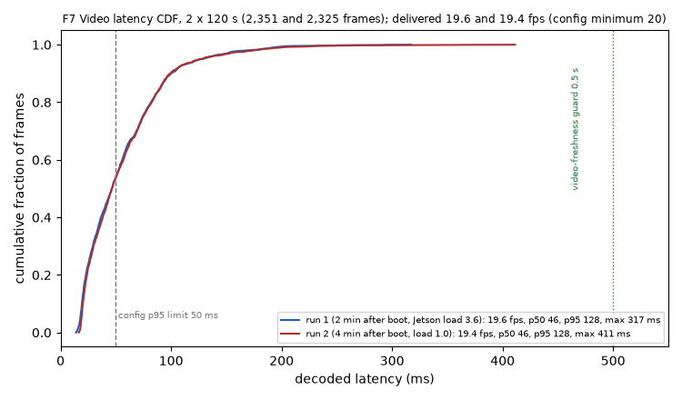
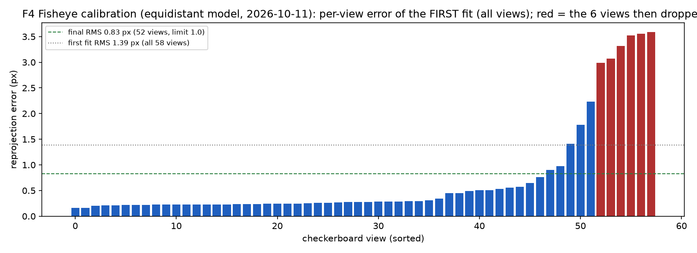
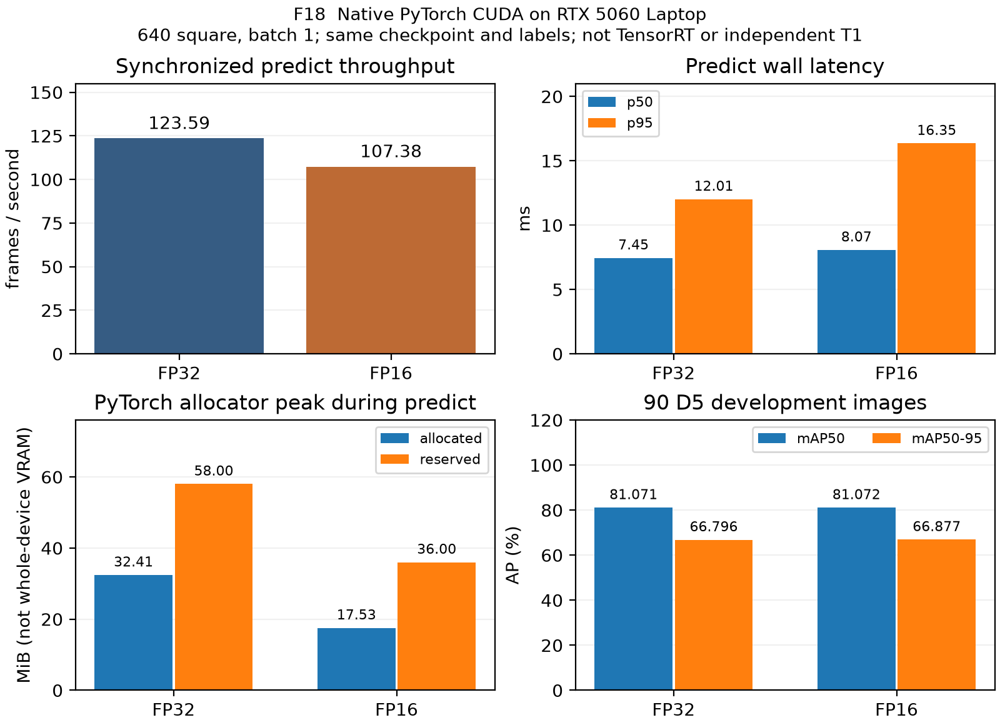
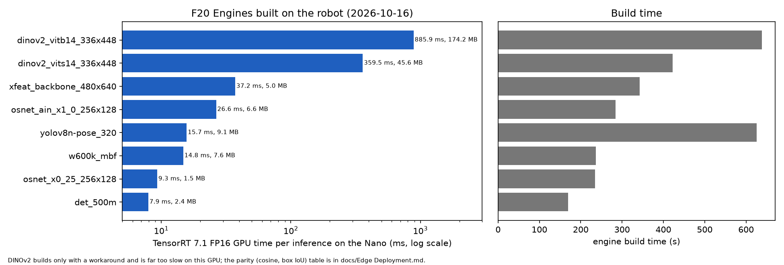
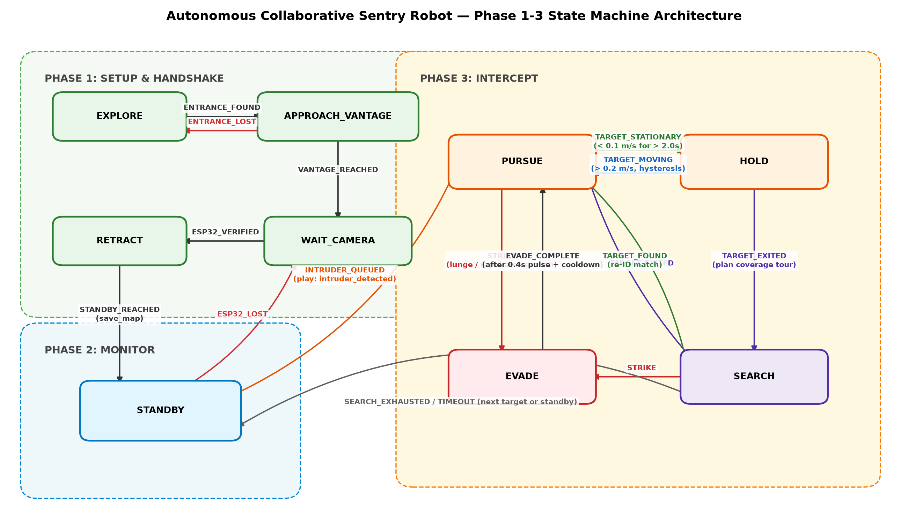
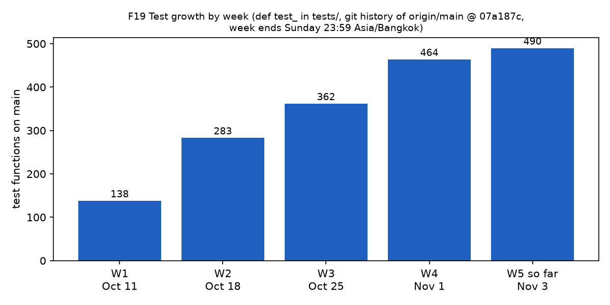
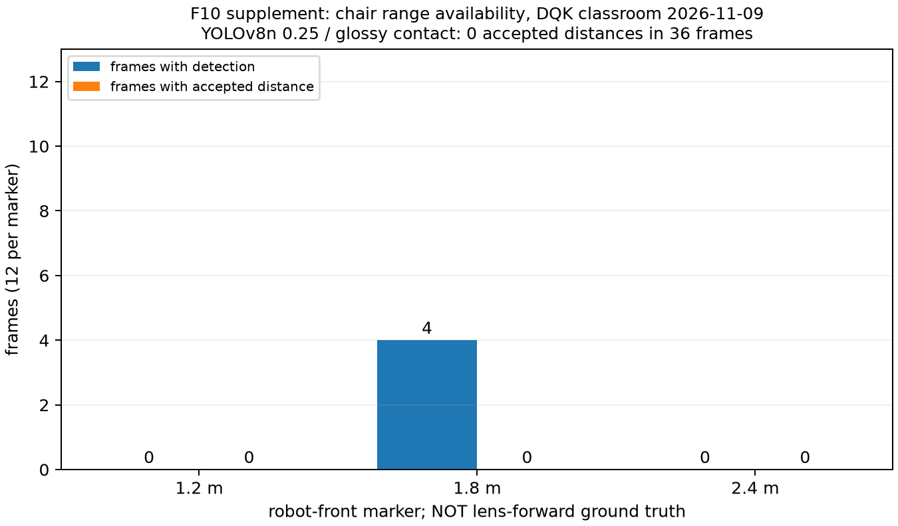

# Chương 1 — Giới thiệu

**Autonomous Collaborative Sentry Robot — CS532**

Báo cáo giữa kỳ • DQK / HNHL / KR • Bản tổng hợp ngày 14/11/2026

**Mục tiêu:** phối hợp một robot di động và một camera cố định tại cửa để phát hiện người chưa được cho phép, tiếp cận họ ở cự ly an toàn và giữ cảnh giới khi họ đứng yên. Ứng dụng hướng tới phòng học hoặc phòng làm việc có một cửa vào, với người vận hành giám sát và quyền dừng robot bằng tay cầm.

## 1.1 Bài toán và ba pha

| Pha | Đầu vào | Xử lý và đầu ra dự kiến |
| :-- | :-- | :-- |
| 1. Triển khai | Video robot, tham chiếu cửa, hiệu chuẩn | Tìm cửa, chọn điểm quan sát, yêu cầu đặt ESP32, xác minh và lùi về chờ |
| 2. Giám sát | Luồng ESP32 tại cửa, whitelist | Xác thực khuôn mặt, tạo hồ sơ người lạ với appearance/sector, đưa vào FIFO |
| 3. Đánh chặn | Video robot, mục tiêu đang hoạt động | PURSUE → HOLD; tìm lại người mất dấu; xử lý người tiếp theo |

Đầu ra phần mềm là trạng thái, lời nhắc âm thanh, hồ sơ mục tiêu và lệnh vận tốc (v, w). Laptop giữ mô hình thị giác và điều phối; JetBot thu hình và chạy động cơ; ESP32 cung cấp góc nhìn tại cửa. Khả năng tự hành được giới hạn bởi độ tin cậy khoảng cách vật cản và định vị không encoder.

## 1.2 Phạm vi đã triển khai

Đã có các module truyền hình/điều khiển, định vị dead reckoning–ArUco, nhận diện cửa, face/re-ID/tracking, hàng đợi, máy trạng thái và bộ điều khiển bám/giữ vị trí. KR đã nối chuỗi Phase 2 → Phase 3 và kiểm thử CPU/mô phỏng; các lượt robot hiện có là thử có giám sát, chưa chứng minh vòng đầy đủ không can thiệp. Né tấn công và coverage search trên robot là mục tiêu sau giữa kỳ.

**Phạm vi số liệu:** kết quả laptop RTX 5060, laptop RTX 4050 và Jetson được ghi riêng. Dữ liệu pilot, dev-val, mô phỏng và thử robot không được dùng thay nhau để nghiệm thu. Số liệu nguồn PR #108 được lưu kèm commit và SHA256, ghi là owner-reported/unmerged; không đưa code PR #108 vào gói này. [S0, D13]

**Tình trạng bàn giao:** đây là bản editor có PDF để review; chốt nội dung theo lịch 18–22/11 và nộp 23/11. Các phép đo còn thiếu được giữ là pending trong chương 7–8.

<!-- pagebreak -->

# Chương 2 — Kiến thức và phương pháp đã nghiên cứu

## 2.1 Phương pháp được dùng trong hệ thống

| Công trình | Kiến thức áp dụng | Vị trí trong dự án |
| :-- | :-- | :-- |
| Kannala & Brandt, TPAMI 2006 | Mô hình camera fisheye | Hiệu chuẩn/undistort trước chiếu tia mặt sàn |
| Garrido-Jurado et al., Pattern Recognition 2014 | Mốc ArUco | Tư thế camera và hiệu chỉnh định vị |
| Collins & Bartoli, IJCV 2014 | IPPE cho mặt phẳng | PnP marker vuông, loại nghiệm sai |
| Siegwart et al., MIT Press 2011 | Động học robot vi sai | Unicycle, dead reckoning, sai số odometry |
| Fischler & Bolles, CACM 1981 | RANSAC | Homography, kiểm tra hình học cửa |
| Potje et al., CVPR 2024 | XFeat | Đặc trưng cục bộ để ghép cửa |
| Oquab et al., TMLR 2024 | DINOv2 | Descriptor cửa khi khác camera tham chiếu |
| Deng et al., CVPR 2019; Chen et al., CCBR 2018 | ArcFace / MobileFaceNets | Face embedding và so whitelist |
| Zhou et al., ICCV 2019 / TPAMI 2021 | OSNet / OSNet-AIN | Re-ID giữa góc cửa và robot |
| Zhang et al., ECCV 2022 | ByteTrack | Liên kết detection confidence cao/thấp |
| Cristian, Distributed Computing 1989 | Clock synchronization | Echo RTT, so timestamp video |
| Hart et al., IEEE TSSC 1968 | A* | Nối viewpoint trên occupancy grid; phần robot còn dự kiến |

## 2.2 Lựa chọn và giới hạn

ORB được dùng làm baseline của bài so nhận diện cửa trước khi chọn XFeat. Homography cung cấp kiểm tra hình học và bearing nhưng không tự cho khoảng cách cửa khi thiếu tỷ lệ metric. DINOv2 hỗ trợ tham chiếu khác camera, với chi phí tính toán lớn hơn.

YOLOv8 là công cụ phần mềm phát hiện đối tượng; fine-tune D5 điều chỉnh cho góc nhìn thấp, nhưng không loại được phản chiếu sàn. SegFormer-B0/ORG là thí nghiệm phát hiện tiếp xúc/free-space, chưa được nhận làm detector mặc định. Những lựa chọn này được đánh giá bằng dữ liệu và các thất bại cụ thể trong chương 5.

ByteTrack ID biểu diễn track, không đồng nghĩa danh tính người. Tính tương đương backend trên quỹ đạo tổng hợp khác với re-ID rank-1 hoặc số ID-switch/phút trên video người thật. Định vị cũng tách kiểm thử hình học với sai số vật lý do sàn, pin và gá camera.

**Thư mục tham khảo đã đối chiếu:** [Mid-Term Report Plan, mục 2](../docs/Mid-Term%20Report%20Plan.md), [phương pháp HNHL](HuynhNguyenHoaiLoc/midterm/chapter-05-current.md) và các bản thảo nguồn trong [registry editor](kouun-rokku/week-07/editor-sources.md). Tên công trình ở bảng giữ đúng phạm vi đã đọc và áp dụng; coverage/A* chưa được trình bày như kết quả robot.

<!-- pagebreak -->

# Chương 3 — Kiến trúc hệ thống

## 3.1 Phân chia thiết bị

Laptop Windows 11 với RTX 4050 6 GB là cấu hình mục tiêu; HNHL dùng RTX 5060 8 GB để phát triển và đo riêng. Laptop chạy detector, pose, face, OSNet, XFeat/DINOv2, hàng đợi và máy trạng thái; phát lời nhắc qua loa laptop. Robot không có loa trong cấu hình hiện hành.

JetBot dùng Jetson Nano 4 GB, Ubuntu 18.04/Python 3.6. Chế độ chính chỉ capture/nén ảnh và thực thi vận tốc từ laptop. `common/` và `jetson/` được giữ tương thích Python 3.6, độc lập môi trường laptop. Chế độ TensorRT trên robot là phần mở rộng đã benchmark riêng, chưa thay kiến trúc chính.

ESP32-CAM đặt tại cửa. OV2640 có JPEG phần cứng và HTTP MJPEG; GC2145 dùng luồng ô ảnh UDP. Phần ảnh vào được xử lý trên laptop; handoff appearance không gửi vector sang JetBot.


## 3.2 Giao diện giữa các module

Perception trả detection, embedding, tọa độ tương đối và timestamp. Queue giữ identity cùng appearance/sector. StateMachine xử lý sự kiện; Phase3Runner gọi controller và chiếu lệnh về miền hợp lệ của bộ trộn bánh. Transport gửi (v, w) tới JetBot, không chạy model trên đường điều khiển.

Mô hình phân tách cho phép replay bằng cùng API logic mà không có motor. Kiểm thử đó chứng minh contract và chuỗi sự kiện, không chứng minh độ trễ hai camera thật, độ chính xác identity hay độ an toàn vật lý.

**Nguồn:** cấu trúc mã đã tích hợp PR #101; DQK chương 3 ngày 13/11 [D13]. Những tool mới trong PR #108 chỉ được mô tả như bằng chứng nhánh tác giả, chưa là mã được bàn giao ở nhánh tuần 7.

<!-- pagebreak -->

## 3.3 Liên kết, timestamp và an toàn

| Đường truyền | Cấu hình | Dữ liệu và giới hạn |
| :-- | :-- | :-- |
| JetBot → laptop | ZeroMQ 5555, JPEG q60 VGA | Chỉ lấy frame mới nhất; phụ thuộc chất lượng Wi-Fi |
| Laptop → JetBot | UDP 5556, khoảng 30 Hz | Lệnh chuẩn hóa (v, w); watchdog khi ngừng nhận |
| Đồng bộ đồng hồ | UDP echo 5557 | Lọc RTT nhỏ nhất; độ trễ video cần hiệu chỉnh đồng hồ |
| ESP32 → laptop | MJPEG hoặc tile UDP | Luồng cửa riêng, không coi timing profiler là live dual-stream |

Thiết kế ưu tiên 5 GHz cho JetBot nhưng DQK ghi các lượt gần đây dùng hotspot điện thoại 2,4 GHz. Hai lượt video 120 s ngày 12/11, robot cạnh laptop: median decode latency 46 ms, p95 128 ms, p99 192–199 ms; nhận 19,6/19,4 FPS. Cả FPS và p95 chưa đạt ngưỡng ≥20 FPS/p95≤50 ms. Đây là kết quả khác phép đo 53 ms của tuần 1. [D13]



Dead-man/e-stop yêu cầu vũ trang bằng Start và giữ R1; thả R1 hoặc nút khác thì dừng. Watchdog danh định 300 ms. DQK đo wheels-up ngày 12/11: 16 lần thả R1 cắt điện motor median 7 ms (5–11 ms); năm lần nút khác 7–8 ms. Đó là timestamp điện trên Jetson, chưa gồm độ trễ không dây tay cầm hay thời gian dừng cơ học. [D13]

Các sửa SIGTERM, rate limiter và tool tiếp cận mới thuộc PR #108 chưa được nhận vào gói mã này. Quy trình chạy thật vẫn cần pin, khoảng sàn trống, R1 và e-stop; bản báo cáo không suy từ kiểm thử CPU sang chứng nhận phần cứng.

<!-- pagebreak -->

# Chương 4 — Robot, hiệu chuẩn và định vị

Camera fisheye 160° có lens cao 0,100 m. Intrinsics OpenCV được khớp từ 52 ảnh checkerboard còn lại sau loại ảnh lỗi: RMS 0,83 px. Chiều cao đo bằng thước, không tối ưu lại từ dữ liệu để làm giảm sai số. [C1]



Khoảng cách sàn dựa vào ray sau undistort và pose theo session. Sai số một pixel xấp xỉ d²×0,0033/H: khoảng 0,11 m ở 1,8 m và 0,19 m ở 2,4 m với H=0,100 m. Bbox bottom nằm thấp hơn chân 3–7 px; thiếu contact hoặc phản chiếu phải trả unknown thay vì dùng khoảng cách giả. Camera đổi pitch sau khi nhấc robot, nên `self_pose` trước mỗi lượt là yêu cầu vận hành. [D13, H1]

Robot không encoder; IMU đã lắp nhưng hỏng/tạm hoãn. Dead reckoning tích phân mô hình vi sai có vùng chết; ArUco sửa pose khi marker hợp lệ. Độ lệch chạy thẳng thay đổi theo sàn, pin và mức lệnh, không thể dùng một drift cố định cho mọi buổi. DQK báo 13 lượt trong 11–12/11 dao động −16 đến +59°/m; đây là nguồn nhánh #108, không được dùng thay phép hiệu chuẩn trong `calib/motion.json`. [D13]


Một lượt có sửa ArUco đạt 14,5 cm sau khoảng 3 m, thuần DR lệch 98,3 cm. Chưa đủ năm lượt T2; thuần DR chưa đạt ngưỡng 40 cm. Kết quả tiếp cận cửa mới của DQK là một cửa/ngày và còn phụ thuộc đo thước, không chứng minh tự định vị toàn phòng. [C2, D13]

<!-- pagebreak -->

# Chương 5 — Nhận thức thị giác và tối ưu

## 5.1 Vật cản, contact và bản đồ

Pipeline YOLO phát hiện bbox, ước lượng điểm tiếp xúc rồi chiếu xuống mặt sàn. Bbox cắt mép, contact không rõ hoặc phản chiếu không giải được thì từ chối khoảng cách. FREE trong occupancy grid chỉ đến từ footprint/seen-floor đã xác nhận; UNKNOWN vẫn chặn đường và line-of-sight. Vantage cần reachable, clearance và vị trí cửa/world truth. Chưa có sweep đủ truth để nghiệm thu F11. [H1]


Median/p90 relative error của các ID có estimate là 5,34%/20,91%; ba vị trí held-out là 5,37%/17,11%. P90 tổng vượt 20%, chưa đủ ≥20 IDs và điều kiện độc lập. Bộ ghế glossy 09/11 có 0/36 khoảng cách hợp lệ; không diễn giải thành sai số bằng không. [H1, H2]

D5 có 397 ảnh, split 307 train/90 dev-val cùng phòng/session và đã dùng chọn checkpoint/input. YOLOv8n-640 đạt mAP50 khoảng 0,810, leg recall 0,960, wire recall 0; chưa nghiệm thu recall từng class hoặc empty-floor alarms. 12 wire masks mới là annotation pilot. [H1]

ORG/SegFormer-B0: trên ruler D1 24 vật, configured tìm 1/24, obstacle-route 8/24, free-space 6/24. Median error 0,041 m chỉ trên tám vật tìm được. Glare, ghế và missing objects vẫn là thất bại; không nhận mô hình làm default chỉ vì subset có error thấp. Width fallback của ghế là proposal một loại ghế, chưa tích hợp detector. [H2, D13]

## 5.2 Nhận diện cửa

XFeat + RANSAC kiểm tra hình học; DINOv2 hỗ trợ reference khác camera. Ngưỡng phải được hiệu chuẩn bằng negative sweep theo cửa. F12 so baseline ORB với XFeat/DINOv2; kết quả nhận cửa không chứng minh door range hoặc bắt tay đủ 10/10 đặt lại camera. [K1]

<!-- pagebreak -->

## 5.3 Whitelist, re-ID và tracking

SCRFD/MobileFaceNet tạo face embedding 512D chuẩn hóa; so maximum cosine với whitelist, ngưỡng hiện hành 0,45. D2 cafe pilot có 125 face frames, 21 entries, ba người: TAR 82,99%, FAR 46,40%. Queries liên tiếp tương quan, nhãn tự động cần review; chưa đạt TAR≥95% tại FAR≤1%. [H1]


Camera opt4 và guided enrollment trong thử DQK ngày 13/11 cho mặt rộng 68–91 px ở 3,0–1,8 m. Một người nhìn thẳng có 100% frame vượt 0,45, nhưng chưa có impostor scores để tính FAR; không gọi đây là TAR/FAR của hệ thống. Firmware và tool enrollment nguồn còn ở nhánh riêng. [D13]

OSNet-AIN x1.0 và x0.25 đều chạy, nhưng 23 body crops hiện chưa tạo được gallery/query hợp lệ; thiếu gallery ở 2/3 người. Gate vẫn là ≥5 identities, rank-1≥85%; chưa có F14 đủ điều kiện. [H1]

ByteTrack dùng chuyển động/IoU và detection confidence thấp để nối track. Khóa/re-lock appearance cần cùng architecture, weight hash, preprocessing, cosine/margin và xác nhận qua hai frame. Vector/queue/tracker chạy trên laptop; JetBot nhận (v, w). Mất dấu/mơ hồ không được xem track ID là identity. [H1, K1]

Vendor ByteTrack đạt 407/407 synthetic ID agreement với backend tham chiếu, là T0 parity. Replay 822 frame D2 chứng minh runtime, chưa có body-ID truth/timestamp chuẩn để nghiệm thu ≤1 ID-switch/phút trên D3 ≥60 s, hai người. [H1, K1]

<!-- pagebreak -->

## 5.4 Ngân sách GPU trên laptop

Profiler nạp detector, OSNet, pose, face và cửa; có synthetic body/face padding khi thiếu detection, lập lịch tuần tự và sampled NVML. Kết quả workload không gồm đủ transport/control và hai camera thật, cũng không đo accuracy. DINO FP16, các Torch model khác FP32. Giới hạn VRAM 5,5 GB decimal khác 5,5 GiB. [H1, D13]

| Thiết bị / workload | FPS | p95 ms | Peak GiB / door Hz |
| :-- | --: | --: | :-- |
| RTX 5060, all mỗi frame | 12,72 | 90,75 | 0,939 / không schedule |
| RTX 5060, door scheduled | 19,65 | 87,62 | 0,939 / 4,52 |
| RTX 4050, all mỗi frame | 9,20 | 138,05 | 0,894 / không schedule |
| RTX 4050, door scheduled | 19,23 | 121,36 | 0,890 / 4,61 |

Dòng RTX 4050 lấy từ JSON tại commit 054d2adc, PR #108, không còn ghi là chưa đo combined workload. Cờ `t1_accepted`/`target_rtx4050_verified` trong nguồn vẫn false. Hai GPU có điều kiện/power khác nhau, chưa phải so sánh có kiểm soát. Scheduled FPS vượt 15 nhưng door thực chưa 5 Hz; không tự coi toàn pipeline realtime đã đạt. [D13]



Cùng 90 ảnh dev-val, batch 1, mỗi precision process riêng: FP32/FP16 đạt 123,59/107,38 FPS, p95 12,01/16,35 ms; Torch allocated 32,41/17,53 MiB; mAP50 81,071%/81,072%. FP16 giảm allocator nhưng chậm hơn lần này; không kết luận FP16 tốt hơn nói chung. Timing gồm predict/preprocess/NMS và kiểm tra dtype, không gồm disk/video/control; chưa TensorRT hay independent accuracy. [H1]

<!-- pagebreak -->

## 5.5 Chuyển đổi và triển khai Jetson Nano

Model xuất ONNX trên laptop, xây TensorRT 7.1.3 FP16 trên Nano, batch 1/fixed shape. Nguồn 16/10 cho GPU time YOLOv8n-320 14,8 ms (FP32 20,7), pose 15,7 ms, OSNet x0.25 9,3 ms, AIN 26,6 ms; DINOv2-S 359,5 ms nên giữ trên laptop. Đây là latency model, không phải FPS cả vòng. [D13, E1]



SCRFD Resize opset 11 tạo sai khác trên TensorRT 7.1; DQK thay nearest-neighbor 2× bằng grouped ConvTranspose. Stock-model cosine gần 1 không chứng nhận custom D5 hoặc re-ID độc lập. D5 ONNX parity laptop có 90/90 count, 294 reference boxes ghép IoU≥0,9; khác nghiệm thu accuracy/edge. [H1, E1]

| Bench Nano | FPS | p95 capture-to-result |
| :-- | --: | --: |
| 16/10, không người, stage B | 20,00 | 51,1 ms |
| 13/11, có người, stage B 60 s | 19,75 | 89,2 ms |
| 13/11, cửa ESP32 thật, 60 s | 17,7 / 17,1 | 118,5 / 123,9 ms |
| 13/11, cửa thật, người ngồi 600 s | 14,45 | 153,0 ms |

Lượt dài 600 s có RAM khoảng 2,13 GB, GPU tối đa 38,5°C, pin khoảng 11,96→11,72 V; vẫn chưa đủ 15 phút. Edge gate ≥20 FPS/p95≤100 ms chưa đạt với người và ESP32 thật. Lượt 16/10 không người/ảnh cửa tĩnh không thay kết quả mới. Các số 13/11 là owner evidence nhánh #108, không có motor/e-stop trong vòng benchmark. [D13]

<!-- pagebreak -->

# Chương 6 — Hành vi và điều khiển

StateMachine nhận event có timestamp và trả Command(v, w, play, actions, target_id). Phase3Runner nối hàng đợi, hold detector và controller. Logic CPU tách khỏi socket/hardware để replay và kiểm thử xác định. [K2]



TargetQueue giữ FIFO và vector đã chuẩn hóa; target đang bám không bị người mới thay thế. TARGET_EXITED hoàn tất mục tiêu hiện tại; nếu còn người chờ thì SEARCH/reacquire, nếu hết thì STANDBY. Handoff reset observation, dwell/filter và controller, yêu cầu mẫu mới thuộc identity kế tiếp.

HoldDetector chiếu target local sang world theo pose robot, ước lượng vận tốc trên cửa sổ ngắn: vào HOLD khi speed<0,1 m/s đủ 2 s; thoát khi >0,2 m/s. Bù pose nhằm tránh báo đứng yên/di chuyển sai chỉ do robot xoay; drift odometry thực vẫn làm giới hạn kết quả.

Trong HOLD, v=0 và chỉ yaw recenter; PURSUE điều khiển cự ly mục tiêu 1,2 m và tránh vật cản khi có estimate hợp lệ. Lệnh tuân vùng chết bánh (dead=0,40), projector recheck miền hợp lệ; NaN/±Inf dừng trước saturation. STRIKE có logic preemption/xung 400 ms, còn thử tấn công robot ở sau giữa kỳ.

**Sửa review #101:** `observe_target()` và `step(target_pos=...)` cùng xử lý mỗi timestamp đúng một lần; mẫu stale/wrong-ID không tiến dwell. Motor dừng khi observation quá 0,25 s; gap>1 s hoặc detector TARGET_LOST giải phóng HOLD và đồng bộ mode, kể cả không có tick trong khoảng mất hình. [K2]

Mô phỏng closed-loop ghi HOLD tại 6,32 s, resume 8,26 s, zero translation trong HOLD, hai targets hoàn tất và không lệnh bất hợp lệ. Các thời điểm này thuộc kịch bản scripted, không phải thời gian đo trên JetBot. [K2]

<!-- pagebreak -->

# Chương 7 — Kiểm thử và kết quả

## 7.1 Tầng kiểm thử và tái hiện

| Tầng | Điều kiện | Có thể kết luận |
| :-- | :-- | :-- |
| T0 | CPU, dữ liệu tổng hợp, fake transport, SimRobot | Logic hình học, contract, chuyển trạng thái, guards |
| T1 | Replay có nhãn/truth và protocol định trước | Accuracy/latency theo bộ dữ liệu và thiết bị ghi rõ |
| T2 | Robot/ESP32 thật, pin và điều kiện có kiểm soát | Hành vi vật lý đủ số lượt, không suy từ T0 |

PR #101 đã được sửa và kiểm tra: nhóm runner/controller/hold/state-machine/queue có 71 test PASS; toàn bộ CPU/replay trước đóng gói có 754 passed, 5 skipped, 4 deselected. Đó là kết quả commit fca0ea2, không mặc định là số test sau khi thêm tooling tuần 7. [K2]

Checkout sạch tuần 7 clone từ commit candidate được ghi riêng cùng tree SHA, Python/dependency versions, command, exit code và pytest output. Chỉ dùng môi trường package đã cài của máy; không copy raw datasets, weights hoặc `.venv` vào clone. Model/GPU environment được ghi riêng nếu thiếu; CPU/replay không chứng nhận full inference setup. [K3]



Checker gói nộp đọc **committed tree** bằng `git ls-tree`, không lấy index làm bằng chứng cho commit. `--index` chỉ hỗ trợ pre-commit. Các path data/recordings/weights, secret filenames và model binaries bị từ chối. Checker theo tên file không phải kiểm toán nội dung hoặc lịch sử Git.

Gói ZIP lấy từ `git archive` của đúng commit, không chứa `.git`; manifest lưu SHA256 từng file. Test xác nhận workspace bẩn không lọt vào ZIP, dữ liệu chỉ untrack ở index vẫn làm HEAD fail, file output cũ không bị ghi đè. [K3]

<!-- pagebreak -->

## 7.2 Bảng đối soát nghiệm thu

| Hạng mục | Bằng chứng hiện có | Trạng thái so với gate |
| :-- | :-- | :-- |
| Video JetBot | 12/11: 19,4–19,6 FPS, p95 128 ms | Chưa đạt ≥20 FPS/≤50 ms; DQK #108 |
| E-stop | Wheels-up: cắt điện median 7 ms | Chưa có thời gian dừng cơ học; không suy ra full T2 |
| Fisheye | RMS 0,83 px, 52 ảnh | Đạt ngưỡng fit; không chứng nhận toàn bộ ranging |
| DR + ArUco | Một lượt 14,5 cm / khoảng 3 m | Pending ≥5 lượt; thuần DR 98,3 cm chưa đạt |
| Khoảng cách ghế | 8/9 IDs, p90 20,91%; bộ mới 0/36 distance | Chưa p90≤20%/≥20 IDs/độc lập |
| D5/Wire | 307/90 cùng session; wire recall 0 | Dev-val, chưa independent T1/class gates |
| Face whitelist | Cafe: TAR82,99/FAR46,40%; mới: một người | Chưa TAR95%@FAR1%, thiếu impostors |
| Re-ID/tracking | Backend parity/runtime replay | Chưa gallery≥5/D3≥60 s/body-ID truth |
| Pursuit/HOLD | Mô phỏng PASS, live pilot có range bias | Chưa đủ physical step response/dwell/80% |
| GPU laptop | Scheduled 5060 19,65; 4050 19,23 FPS | Workload; door Hz<5, chưa dual-stream T1 |
| Edge live | 14,45 FPS/p95 153 ms ở 600 s | Chưa ≥20 FPS/≤100 ms/15 phút |
| Vòng đầy đủ | Các module và event chain có test | Chưa ≥4/5 không can thiệp |



Không cộng các frame liên tiếp thành số lượt độc lập; không lấy error chỉ trên estimates tốt để bỏ missed objects. Kết luận hiện tại: các khối đã có mã và bằng chứng phát triển, nhưng các gate hệ thống quan trọng vẫn pending. Nguồn từng hàng: [registry](kouun-rokku/week-07/editor-sources.md), H1/H2/D13/C1/C2/K2.

<!-- pagebreak -->

# Chương 8 — Kết quả kỳ vọng và kế hoạch

## 8.1 Mốc bàn giao

| Mốc | Kết quả cần có | Chủ trì |
| :-- | :-- | :-- |
| 16/11 | Đóng thí nghiệm giữa kỳ, chốt hình/nhãn nguồn | Cả nhóm |
| 18/11 | Bản draft chung và video cut theo kế hoạch | KR editor; DQK video |
| 19–20/11 | Owner kiểm số liệu, review nội bộ, PR freeze | Cả nhóm |
| 21–23/11 | Tag main sau review, PDF/video final, nộp 23/11 | Cả nhóm |
| Tuần 8–9 | Evasion, reaction-time, coverage path theo gate | Chủ sở hữu từng module |
| Tuần 10–13 | Search trên robot, loop nhiều người, stress và buffer | Cả nhóm |

Kỳ vọng vòng đầy đủ ≥4/5 không can thiệp, tìm T2 ≥4/5, search exhaustion 3/3 không va chạm. Các con số là mục tiêu, chưa phải kết quả. `r_det` 3,0 m vẫn là placeholder phải đo. Bất kỳ phần nào chưa làm ổn ở thời điểm freeze đều ghi in progress, không hạ ngưỡng để chạy kịp báo cáo. [S0]

## 8.2 Rủi ro và việc tiếp tục

- **Sàn bóng:** contact ghế không giải được; cần held-out floor/chair/empty-floor controls và rule fallback đã freeze. ORG hoặc width cue chưa là model mặc định.
- **Pose/motion:** camera gá xê dịch, drift đổi theo sàn/pin/lệnh; mỗi lượt đo lại pose, giữ phạm vi thử có giám sát và kiểm pin.
- **Face/re-ID:** guided enrollment cải thiện genuine scores nhưng còn impostors, gallery/body-ID truth; quyết định ngưỡng/model thuộc perception owner.
- **Video/edge:** latency và FPS chưa đạt trong điều kiện mới; cần đo đủ protocol, không lấy benchmark không người để thay thế.
- **Tích hợp:** Phase 2 live và graded T2 chưa đủ; dùng replay có nhãn trong video khi thiếu cảnh thật, không trình bày như robot đã chạy.
- **Bàn giao mã:** cây hiện tại bỏ dữ liệu riêng/default password, nhưng lịch sử cũ còn archive/credential. ZIP không chứa lịch sử; publish/rewrite history và tag `midterm` trên main cần quy trình chốt của nhóm.

Bản tuần 7 hoàn thiện công việc editor và gói review từ những nguồn hiện có. Nó không tạo thay thí nghiệm vật lý, chữ ký owner hay lịch sử đã được làm sạch. PDF hiện tại là snapshot review, video cuối được cập nhật khi DQK bàn giao. [D13, K3]

<!-- pagebreak -->

# Phụ lục A — Mã nguồn, tái hiện và nguồn

## A.1 Module / owner / tests

| Module | Owner | Kiểm tra chính |
| :-- | :-- | :-- |
| StateMachine, TargetQueue, Phase3Runner | KR | state_machine, target_queue, phase3_runner |
| HoldDetector, controllers | KR / DQK | hold_detector, controllers; T0 |
| Localization, wheel model | KR / DQK | localization, wheel_model; T2 chưa đủ |
| Entrance / sector / audio | KR / DQK | entrance, sector, audio |
| Obstacle, face, re-ID, tracker | HNHL | obstacle, face, reid, tracker; gates T1 riêng |
| Net / clock / streams | HNHL / KR | camera_pub, clock_sync, mjpeg_rx |
| Jetson / ESP32 / motor interlocks | DQK / KR | estop, jetson_espcam; HIL riêng |
| Report / package tools | KR | midterm_package, page audit, PDF pages |

## A.2 Tái hiện

Cài môi trường theo `docs/Setup.md`. CPU/replay trên Linux có test-only winsound shim trong `tools/run_cpu_tests.py`; không thay âm thanh production. Logs ghi interpreter và packages. Report export cần `requirements-report.txt` và DejaVu Sans.

```text
python tools/check_env.py --cpu-ok
python -m tools.run_cpu_tests
python -m tools.render_midterm_report
python -m tools.check_midterm_page_budget --pdf reports/midterm_report.pdf
python -m tools.check_midterm_package --ref HEAD
python -m tools.build_midterm_package --ref HEAD --out /tmp/submission.zip
```

Repo: https://github.com/DoanQuocKien/Autonomous-Collaborative-Sentry-Robot . Nhánh review: `kouun-rokku/w07-midterm-package`, gồm fix #101. Tag `midterm` trên main chờ freeze/review theo lịch; gói có thể xây từ commit đã ghi trong manifest. Video: chưa có URL cuối; [shot list và cách quay replay](kouun-rokku/midterm-appendix-a.md).

## A.3 Chỉ mục bằng chứng

S0: `docs/Implementation Plan.md`, `docs/Mid-Term Report Plan.md`. C1/C2: `calib/camera.json`, báo cáo dead-reckoning 24/10. K1/K2: KR tuần 4–6, parity/hold/replay/review #101. K3: `reports/kouun-rokku/week-07/` (checkout sạch và package). H1/H2: HNHL `midterm/chapter-05-current.md`, addenda 05/11 và 11/11. E1: `docs/Edge Deployment.md`. D13: snapshot DQK commit 054d2adc (PR #108 còn mở), gồm chapters/README/GPU/edge JSON và hình. Registry kèm SHA256: `reports/kouun-rokku/week-07/editor-sources.md` / `sources/provenance.json`.
