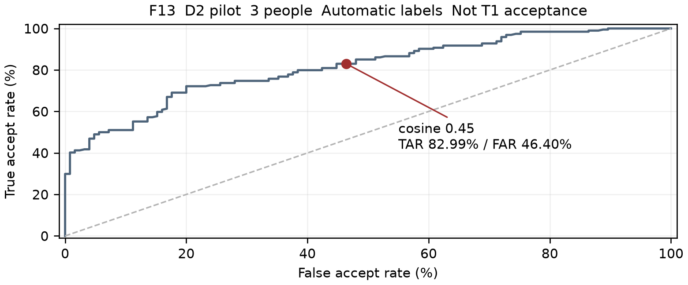
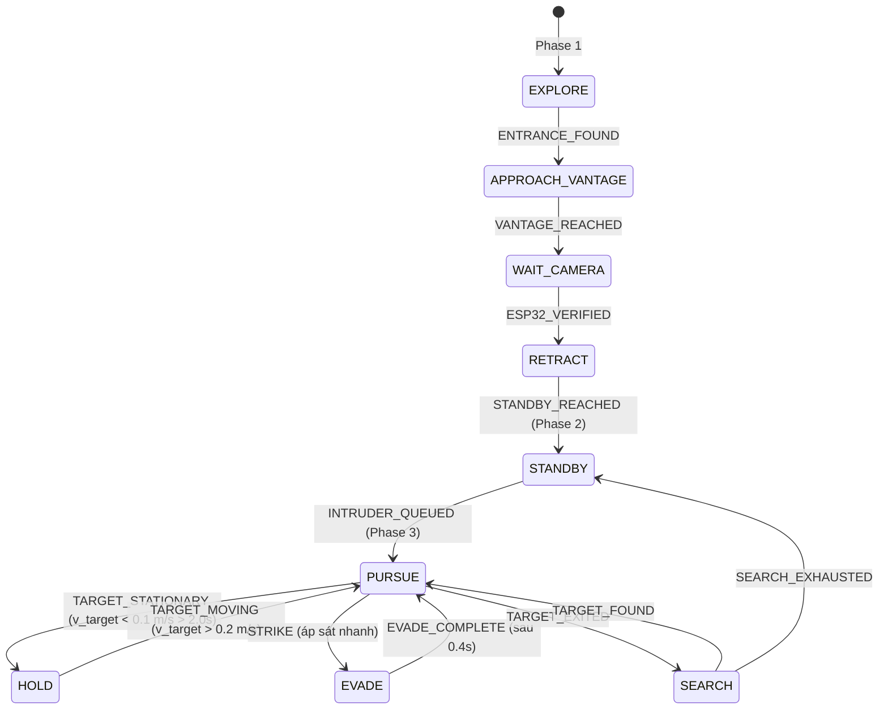

# BÁO CÁO GIỮA KỲ: HỆ THỐNG ROBOT CẢNH GIỚI TỰ HÀNH PHỐI HỢP
## Autonomous Collaborative Sentry Robot (CS532)

**Nhóm thực hiện:**
- DoanQuocKien (DQK) — Phần cứng JetBot, quy trình hiệu chuẩn, mô hình di chuyển, kiểm thử robot thật, triển khai TensorRT edge.
- HuynhNguyenHoaiLoc (HNHL) — Nhận thức thị giác, nhận diện vật cản, phát hiện người, re-ID, ByteTrack, tối ưu GPU.
- kouun-rokku (KR) — Trạm cửa ESP32-CAM, máy trạng thái State Machine, hàng đợi TargetQueue, bộ điều khiển truy bám và standoff hold, chủ trì biên tập báo cáo (Editor).

**Trạng thái:** bản nháp nội bộ 18/11/2026; số liệu và hình đóng băng theo buổi lớp 16/11 (cảnh quay thêm ngày 19/11 chỉ được thêm nếu ghi rõ "bổ sung sau đóng băng").  
**Hạn nộp báo cáo:** Thứ Hai, 23/11/2026 (Tuần 8).  
**Dung lượng mục tiêu:** 10–15 trang (kế hoạch chi tiết: 13,5 trang nội dung + 1,0 trang phụ lục = 14,5 trang).  
**Mã nguồn bàn giao:** Tag `midterm` trên nhánh `main`.  
**Video minh chứng:** 2–4 phút ghi hình thực tế và screen-recording overlays.

---

# Chương 1 — Giới thiệu và bài toán

**Chủ trì:** kouun-rokku (KR) • **Ngân sách:** 1,0 trang

## 1.1 Bối cảnh và bài toán an ninh tự hành

Trong các cơ sở văn phòng, tòa nhà nghiên cứu và phòng thí nghiệm, công tác bảo vệ truyền thống dựa trên hệ thống camera an ninh cố định luôn bộc lộ các điểm mù quan sát, không thể phản ứng răn đe tại chỗ hoặc theo dõi liên tục khi đối tượng di chuyển vào các góc khuất. Ngược lại, nếu chỉ dựa vào robot tuần tra di động độc lập thì robot khó có thể túc trực 24/7 ngay tại cửa ra vào và nhanh chóng hao tổn năng lượng pin.

Đề tài **"Autonomous Collaborative Sentry Robot"** giải quyết thách thức này bằng kiến trúc phối hợp hai thành phần:
1. **Trạm kiểm soát cố định tại cửa (Doorway Sentry / ESP32-CAM):** Giám sát trực diện lối vào, ghi nhận khuôn mặt người bước vào, đối soát danh sách nhân sự được phép (whitelist) và trích xuất vector đặc trưng ngoại hình 512D phục vụ bàn giao sang robot.
2. **Robot tuần tra mặt sàn (Mobile Sentry / JetBot):** Đóng vai trò đánh chặn cơ động, tự hành định vị, tiếp nhận hồ sơ kẻ xâm nhập từ hàng đợi FIFO, tiếp cận và bám đuổi ở cự ly an toàn 1,2 m, giữ vị trí cảnh giới (standoff hold) và truy tìm trong phòng khi mục tiêu lẩn khuất.

Toàn bộ chu trình phát hiện, bàn giao và ngăn chặn được tự động hóa hoàn toàn mà không yêu cầu can thiệp thủ công trong điều kiện vận hành danh định.

## 1.2 Ba giai đoạn hoạt động chính

Hệ thống hoạt động theo 3 giai đoạn được quy định tại Đặc tả dự án (`Project Specification §1`):
- **Giai đoạn 1 (Thiết lập & Bản đồ):** robot khám phá phòng, nhận diện cửa vào bằng XFeat, di chuyển tới sweet-spot, phát lời nhắc đặt camera cửa, bắt tay thị giác với ESP32-CAM, rồi lùi về STANDBY và lưu bản đồ lưới.
- **Giai đoạn 2 (Giám sát lối vào):** robot đỗ ở STANDBY; ESP32-CAM theo dõi người qua cửa. Người thuộc whitelist được cho vào; người lạ được chụp ảnh, trích vector ngoại hình OSNet, xác định sector (Trái/Giữa/Phải) và đẩy `IntruderRecord` vào hàng đợi FIFO `TargetQueue` (`INTRUDER_QUEUED`).
- **Giai đoạn 3 (Đánh chặn):** robot chuyển sang `PURSUE`, bám mục tiêu (YOLOv8 + ByteTrack) ở 1,2 m và né vật cản; mục tiêu dừng quá 2,0 s thì `HOLD` (v = 0, chỉ xoay căn tâm); áp sát nhanh thì `EVADE`; mục tiêu rời phòng thì `SEARCH` hoặc xử lý kẻ xâm nhập kế tiếp trong hàng đợi.

## 1.3 Giới hạn phạm vi và cấu hình phần cứng

Hệ thống vận hành trong môi trường phòng đơn trong nhà với một cửa ra vào chính. Mặt sàn có độ bóng và chứa các vật cản bàn ghế, ba lô, dây cáp. Nền tảng phần cứng gồm:
- **Robot di động:** SparkFun JetBot AI Kit (NVIDIA Jetson Nano 4GB, 2 bánh vi sai, camera góc rộng fisheye 160°, giao tiếp qua hotspot Wi-Fi 2,4 GHz dùng chung với laptop và ESP32).
- **Trạm giám sát cửa:** ESP32-CAM (AI-Thinker, cảm biến OV2640/GC2145, truyền stream MJPEG VGA qua Wi-Fi 2.4 GHz).
- **Trạm xử lý trung tâm (Laptop PC):** CPU đa nhân, GPU RTX 4050/5060 chạy toàn bộ pipeline nhận thức nặng, mô hình học sâu và máy trạng thái. Giao tiếp điều khiển JetBot qua UDP 30 Hz không nghẽn, có dead-man switch e-stop trên tay cầm vật lý bảo vệ an toàn.

---

# Chương 2 — Các công trình liên quan và cơ sở lý thuyết

**Chủ trì:** kouun-rokku (KR) tổng hợp cùng nhóm • **Ngân sách:** 1,5 trang

Hệ thống kết hợp các nghiên cứu tiên tiến trong thị giác máy tính, nhận dạng người, theo dõi đa mục tiêu và điều khiển robot tự hành. Toàn bộ 15 công trình trích dẫn dưới đây đã được nhóm đọc, triển khai và kiểm chứng thực nghiệm trên mã nguồn:

1. **Rublee et al. (ICCV 2011) — ORB Descriptor:** Thuật toán binary descriptor được nhóm sử dụng làm đường cơ sở (baseline) đối sánh trong bake-off nhận diện cửa tại Giai đoạn 1 (`sentry/perception/entrance.py`), đạt AUC 0,91 so với 0,99–1,00 của mô hình học sâu.
2. **Kannala & Brandt (TPAMI 2006) — Generic Camera Model for Fish-eye Lenses:** Mô hình chiếu fisheye phi tuyến tính được áp dụng qua `cv2.fisheye` trong `tools/calibrate_fisheye.py` với bàn cờ chuẩn, đạt sai số chiếu lại RMS 0,83 px trên 52 góc nhìn thực tế (`calib/camera.json`).
3. **Garrido-Jurado et al. (Pattern Recognition 2014) — Occlusion-Reliable Fiducial Markers:** Sử dụng từ điển `DICT_4X4_50` kích thước 150 mm làm mốc neo tọa độ thực địa (`sentry/nav/localization.py`) và mốc ước lượng góc pitch trực tiếp thời gian thực (`sentry/perception/camera_pose.py`).
4. **Collins & Bartoli (IJCV 2014) — Infinitesimal Plane-Based Pose Estimation (IPPE):** Giải thuật PnP giải tích phẳng `cv2.SOLVEPNP_IPPE_SQUARE` dùng khử nhập nhằng hai nghiệm pháp tuyến khi tính tư thế robot từ ảnh mốc ArUco.
5. **Siegwart et al. (MIT Press 2011) — Autonomous Mobile Robots:** Cơ sở động học vi sai unicycle forward kinematics, tích phân cung tròn chính xác và mô hình lan truyền sai số dead-reckoning triển khai trong `sentry/nav/wheel_model.py` và `sentry/nav/controllers.py`.
6. **Potdar et al. (CVPRW 2024) — XFeat:** Mạng nơ-ron trích xuất keypoints và local descriptors nhẹ tối ưu cho thiết bị edge, được nhóm chọn làm phương pháp nhận diện cửa chính thức trong `sentry/perception/entrance.py` (bắt cặp homography RANSAC, AUC 0,99–1,00 trên tập dữ liệu D1).
7. **Oquab et al. (TMLR 2024) — DINOv2:** Foundation model tự giám sát trích xuất đặc trưng toàn cục, đóng vai trò fallback khi cửa bị khuất cục bộ hoặc góc quan sát xiên lớn.
8. **Deng et al. (CVPR 2020) — ArcFace:** Hàm mất mát góc phụ gia tối ưu hóa khoảng cách không gian biểu diễn khuôn mặt, nền tảng cho mô hình MobileFaceNet trong `sentry/perception/face.py` phục vụ đối soát danh sách whitelist tại trạm ESP32-CAM.
9. **Zhou et al. (ICCV 2019) — OSNet:** Mạng nơ-ron đa quy mô phát hiện tương quan ngoại hình người phục vụ re-ID, sử dụng weights `osnet_ain_x1_0` và `osnet_x0_25` để trích xuất vector ngoại hình 512D độc lập với góc nhìn khuôn mặt (`sentry/perception/reid.py`).
10. **Zhang et al. (ECCV 2022) — ByteTrack:** Giải thuật liên kết dữ liệu đa mục tiêu giữ lại cả các detection có độ tin cậy thấp. Nhóm đã tự vendor mã nguồn thuần NumPy/SciPy tương thích Python 3.6 (`third_party/bytetrack/`), đạt độ khớp ID 100,0% so với bản gốc trên tập kiểm thử phân nhánh.
11. **Galceran & Carreras (RAS 2013) — Coverage Path Planning:** Cơ sở quy hoạch đường đi phủ kín không gian dựa trên phân rã tế bào ứng dụng trong tìm kiếm mục tiêu lẩn khuất (`sentry/nav/declared_room.py`).
12. **Fischler & Bolles (CACM 1981) — RANSAC:** Ước lượng homography mặt phẳng cửa và luật số lượng inliers phục vụ xác nhận bắt tay thị giác giữa JetBot và ESP32-CAM.
13. **Jocher et al. (Ultralytics 2023) — YOLOv8:** Bộ phát hiện đối tượng thời gian thực chạy ở tần số cao (>50 FPS trên GPU) nhận diện người, đồ đạc và các vật cản sát mặt sàn (`sentry/perception/obstacle.py`).
14. **Cristian (Distributed Computing 1989) — Clock Synchronization:** Thuật toán đồng bộ xung nhịp giữa JetBot và Laptop dựa trên phép đo RTT tối thiểu trong `sentry/net/clock_sync.py`, giữ độ lệch dưới 5 ms.
15. **Guo et al. (2021) — Sample and Computation Redistribution for Efficient Face Detection (SCRFD):** Bộ phát hiện khuôn mặt hiệu năng cao trích xuất vùng mặt người bước qua cửa trước khi đưa vào ArcFace.

---

# Chương 3 — Kiến trúc hệ thống và thiết kế an toàn

**Chủ trì:** DoanQuocKien (DQK) • **Ngân sách:** 2,0 trang

## 3.1 Phân bổ nhiệm vụ phân tán giữa các thiết bị

Hệ thống phân tách kiến trúc thành 3 khối vật lý chuyên biệt:
- **Trạm giám sát cửa (ESP32-CAM):** Gắn cố định ngang tầm mắt tại lối vào, sử dụng nguồn độc lập. Thiết bị chạy firmware streaming ảnh MJPEG/UDP nhẹ, truyền luồng khung hình cửa về laptop ở tốc độ ổn định 10–15 FPS.
- **Robot di động (SparkFun JetBot):** Đóng vai trò thiết bị thu nhận và cơ cấu chấp hành (actuator). JetBot chỉ thực hiện hai nhiệm vụ nhẹ: nén ảnh camera fisheye gửi qua ZeroMQ và tiếp nhận gói điều khiển vận tốc $(v, \omega)$ qua UDP non-blocking ở tần số 30 Hz.
- **Laptop PC:** chạy toàn bộ mô hình (YOLOv8, SCRFD, MobileFaceNet, OSNet, XFeat, DINOv2), dead-reckoning, hàng đợi và máy trạng thái.


*Hình F1: Sơ đồ kiến trúc phân tán giữa ESP32-CAM, Laptop điều khiển và Robot JetBot.*

## 3.2 Giao thức mạng và luồng dữ liệu thời gian thực

- **Luồng video robot $\rightarrow$ Laptop:** Sử dụng ZeroMQ multipart TCP (cổng 5555), nén JPEG chất lượng q60 qua hotspot điện thoại 2,4 GHz dùng chung (thiết kế dự kiến 5 GHz riêng cho robot; các buổi thử gần đây đều chạy 2,4 GHz). Bộ đệm phía máy tính chỉ giữ khung hình mới nhất (latest-frame slot). Đo ngày 12/11 (hai lần 120 s, robot đứng yên cạnh laptop): trễ giải mã trung vị 46 ms, p95 128 ms, 19,4–19,6 fps, so với ngưỡng ≥ 20 fps và p95 ≤ 50 ms nên **chưa đạt** (Hình F7); lần đo tuần 1 (20 fps, p95 53 ms) ở điều kiện khác.
- **Luồng điều khiển Laptop $\rightarrow$ JetBot:** Gói tin nhị phân UDP gọn nhẹ truyền vận tốc góc và vận tốc dài $(v, \omega)$ ở tần số 30 Hz. Quá trình gửi là non-blocking, loại bỏ hoàn toàn hiện tượng nghẽn hàng đợi socket.
- **Luồng camera cửa ESP32-CAM $\rightarrow$ Laptop:** Truyền tải qua cùng hotspot 2,4 GHz (HTTP MJPEG với module OV2640, luồng ô ảnh UDP với module GC2145); bản firmware "opt4" đạt 12,5 fps trung bình trong 600 s trên bàn thử.

## 3.3 Thiết kế an toàn đa tầng (Safety & E-Stop Interlock)

An toàn là yêu cầu bắt buộc và không thương lượng trong quá trình vận hành robot thực tế:
1. **Watchdog ngắt động cơ phần cứng:** Service điều khiển trên JetBot (`jetson/robot_udp.py`) tự động ngắt điện động cơ nếu không nhận được gói tin điều khiển mới trong vòng 300 ms.
2. **Dead-man Switch trên tay cầm vật lý:** Robot chỉ được phép chuyển động khi người vận hành nhấn giữ nút R1 trên gamepad và hệ thống e-stop đã được arm (nhấn giữ Start 1,5 s). Việc nhả nút R1, nhấn bất kỳ phím nào khác hoặc mất kết nối gamepad sẽ lập tức gửi lệnh ngắt mạch I2C trực tiếp tới driver điều khiển motor qua daemon độc lập `jetson/estop.py`.
3. **Giới hạn trần tốc độ phần cứng (`--max-speed`):** Tốc độ robot trong toàn bộ các phiên thử nghiệm được khống chế ở mức 0,30 trần công suất trong service hệ thống (`jetson/systemd/sentry-control.service`).

**Thời gian dừng đo được (bánh xe nhấc khỏi sàn, nhật ký của Jetson):** 12/11, 16 lần thả R1: e-stop cắt động cơ trung vị 7 ms (5–11 ms), 5 lần nhấn nút khác: 7–8 ms. Sau khi triển khai lại mã robot đã sửa theo kiểm toán, ngày 16/11 (mỗi trường hợp một lượt): thả R1 cắt trong 10 ms, động cơ về 0 sau 78 ms kể từ mốc STOPPED; nút khác 6 ms và 38 ms. Mọi lần đều trong ngưỡng watchdog 0,3 s. Giới hạn: gói điều khiển chưa ký (chưa có `control.key`), và nhật ký thô của phép đo tối 16/11 chỉ nằm trên robot và laptop, chưa đưa vào kho.

---

# Chương 4 — Nền tảng robot và quy trình hiệu chuẩn

**Chủ trì:** DoanQuocKien (DQK) cùng kouun-rokku (KR) • **Ngân sách:** 1,5 trang

## 4.1 Hiệu chuẩn thấu kính fisheye góc rộng

Ống kính fisheye 160° của JetBot méo thùng rất mạnh nên ảnh phải được nắn thẳng trước khi tính khoảng cách. Nhóm dùng mô hình Kannala-Brandt (`cv2.fisheye`), thu nhận 58 ảnh chụp bàn cờ 9×6 ô vuông (cạnh 25 mm). Sau khi loại trừ 6 góc nhìn biên vi phạm sai số chiếu lại, bộ tham số camera nội (`calib/camera.json`) đạt sai số RMS cực nhỏ **0,83 px**, cho phép nắn thẳng hình ảnh chính xác trước khi đưa vào các thuật toán chiếu tia mặt sàn.

## 4.2 Tư thế camera và mô hình chiếu tia mặt sàn

Khoảng cách tới điểm chạm sàn của vật thể được tính bằng mô hình chiếu tia đơn mắt (không dùng cảm biến chiều sâu):
$$Z = \frac{H}{\tan(\text{pitch} + \arctan((v - c_y)/f_y))}$$
Trong đó $H = 0,100\text{ m}$ là chiều cao tâm thấu kính so với sàn (đo bằng thước, cố định, không "khớp" từ dữ liệu); góc nghiêng thay đổi theo từng lần robot bị cầm (từ −0,6° đến −13,9° trong các buổi đã đo, −8,0° ngày 16/11) nên mỗi buổi chạy bắt đầu bằng `tools.self_pose`. Để đối phó với hiện tượng sàn nhà bị lún hoặc camera bị rung lắc khi di chuyển, nhóm phát triển thuật toán `LiveTilt` (`sentry/perception/camera_pose.py`), tính toán lại góc pitch động từ việc quan sát các vạch mốc ArUco gắn trên tường, khống chế sai số ước lượng khoảng cách mặt sàn trong khoảng 0,5%–6,0% khi đứng yên và 3,0%–20,0% khi chuyển động.

## 4.3 Mô hình di chuyển vi sai và vùng chết động cơ (Motor Dead Zone)

JetBot dùng 2 động cơ DC không có encoder. Qua các thử nghiệm đo (`tools/calibrate_motion.py`):
1. **Vùng chết động cơ (Dead Zone):** giá trị điều khiển chuẩn hóa $|u| < 0,12$ không đủ thắng ma sát tĩnh; bộ trộn bánh vi sai (`common/mixing.py`) và các bộ điều khiển đẩy lệnh lên ngưỡng tối thiểu $|u| \ge 0,40$.
2. **Sai số trôi dạt tích lũy (Dead-Reckoning Drift):** Robot có xu hướng lệch trái tự nhiên khoảng $0,19\text{ rad/m}$. Khi không có mốc hiệu chỉnh ArUco, sai số vị trí sau 3 mét di chuyển lên tới 98,3 cm. Khi tích hợp mốc ArUco định vị lại tọa độ (`sentry/nav/localization.py`), sai số vị trí điểm cuối giảm xuống còn **14,5 cm** (một lượt). Độ lệch hướng không ổn định: 13 lần chạy thẳng ngày 11–12/11 cho −16 đến +59°/m, nên hướng được đo lại sau mỗi lần di chuyển thay vì tin vào vòng hở. Cảm biến MPU6050 gắn ngày 1/11 bị hỏng, vẫn đang sửa ngày 16/11, chưa dùng được trước hạn nộp và mã không dùng nó; lần đo hệ số chuyển động bằng ba bảng marker được hoãn (không phải hạng mục chấm điểm), hệ số tuần 2 vẫn được dùng và nêu là giới hạn đã biết.


*Hình F15: Quỹ đạo di chuyển thực tế và sai số điểm cuối giữa dead-reckoning thuần túy (đỏ) và có mốc ArUco hỗ trợ (xanh).*

---

# Chương 5 — Nhận thức thị giác, tối ưu hóa và triển khai thiết bị nhúng

**Chủ trì:** HuynhNguyenHoaiLoc (HNHL) cùng kouun-rokku (KR, cửa) và DoanQuocKien (DQK, edge) • **Ngân sách:** 3,5 trang

## 5.1 Ước lượng khoảng cách vật cản mặt sàn

Hệ thống phát hiện vật cản bằng YOLOv8n kết hợp ước lượng điểm tiếp xúc chân vật thể trên sàn. Sàn nhà có độ bóng cao tạo ra hình ảnh phản chiếu gương gây nhầm lẫn điểm chân bounding box. Module `sentry/perception/contact.py` áp dụng bộ lọc cạnh ngang và kiểm tra độ tin cậy hình học để từ chối các ước lượng không đủ bằng chứng.
- Thử nghiệm trên 8/9 vị trí ghế thực tế trên sàn glossy (Hình F10, vị trí ID21 bị thiếu do cắt mép ảnh) đạt sai số trung vị (median) **5,34%** và phân vị p90 là **20,91%**; ba vị trí held-out đạt 5,37% / 17,11% [E01].


*Hình F10: Độ chính xác ước lượng khoảng cách chân ghế trên mặt sàn bóng qua camera fisheye nắn thẳng.*

## 5.2 Huấn luyện phát hiện vật cản sàn nhà (Tập dữ liệu D5)

Tập dữ liệu D5 gồm 397 ảnh chụp thực tế trong một phòng và một session glossy từ góc nhìn sát sàn của JetBot (chân bàn ghế, ba lô, giày dép, cây cảnh, dây cáp đen/trắng). Phân chia 307 train / 90 dev-val theo nhóm khoảng cách (kết quả là development validation, chưa độc lập về mặt sàn/session) [E02]:
- Checkpoint 640×640 đạt mAP50 **0,810** (mAP50-95 đạt 0,656) trong quá trình phát triển (chưa kích hoạt làm mặc định trên robot).
- Recall phát hiện chân bàn/ghế đạt **96,0%** (24/25 chân ghế).
- Vật cản dây cáp: Wire recall là **0,000 (0,0%)**, chưa đạt mục tiêu 80%; fallback hình học còn nhầm ron sàn và 12 masks dây mới chỉ ở mức pilot annotation.

## 5.3 Nhận diện lối vào (Entrance Matching Bake-off)

Trong Giai đoạn 1, robot phải nhận diện đúng cửa vào phòng từ khoảng cách 1,5–3,0 m. Nhóm đã thực hiện bake-off thực nghiệm giữa 3 thuật toán trên tập ảnh cửa D1 (`reports/kouun-rokku/week-05/F12_entrance_bakeoff.png`):
- **ORB (Binary baseline):** Đạt AUC 0,91, trượt khi góc nhìn nghiêng quá 30°.
- **DINOv2 (Global descriptor):** Đạt AUC 0,98, nhận diện tốt toàn cảnh nhưng không xác định được ma trận biến đổi affine/homography của khung cửa.
- **XFeat (Local feature matching):** Đạt **AUC 0,99–1,00**, số lượng inliers homography RANSAC vượt trội, xác định chính xác góc phương vị cửa để robot căn chỉnh sweet-spot. XFeat được chọn làm phương pháp mặc định.

## 5.4 Xác thực khuôn mặt tại cửa (Face Verification)

`FaceVerifier` (`sentry/perception/face.py`) dùng SCRFD phát hiện khuôn mặt từ luồng ESP32-CAM và MobileFaceNet tạo vector 512D chuẩn hóa.
- Đối soát với tập người đăng ký (whitelist) dựa trên độ tương đồng cosine cực đại (ngưỡng 0,45).
- Thử nghiệm pilot cùng session trên 125 frame mặt người (tập D2 cafe, 21 lượt vào của 3 thành viên DQK, HNHL, KR) theo phương pháp leave-one-member-out, enrollment từ lượt vào đầu tiên [E03]:
  * Tại ngưỡng cosine 0,45, hệ thống đạt tỷ lệ chấp thuận thực TAR **82,99%** nhưng tỷ lệ chấp thuận sai FAR lên tới **46,40%**, chưa đạt tiêu chuẩn nghiệm thu TAR 95% @ FAR 1% (Hình F13).
  * Ngưỡng 0,45 chỉ là ngưỡng tạm thời (provisional), không dùng chính pilot để chọn lại threshold và tự báo PASS.
- **Đo lại tại cửa bằng camera ESP32 (14/11, ba thành viên, đăng ký có hướng dẫn, đứng ở 1,8 / 2,4 / 3,0 m):** khuôn mặt rộng 59–97 px (clip D2 cũ 22–53 px); TAR gộp **0,937** tại ngưỡng 0,45 (822/877 khung nhìn thẳng; DQK 0,930, HNHL 0,983, KR 0,896), FAR **0 trên 1754 điểm** của người lạ; vẫn dưới mức 95%. Ngày 16/11 DQK đăng ký lại 5 tư thế và chấm lại cùng clip: TAR của DQK vẫn 0,930 (cùng 21 khung dưới 0,45), nên tư thế đăng ký không giải thích được các khung trượt (một lần đăng ký lại, một buổi). Còn thiếu người lạ ngoài nhóm và đăng ký lại cho KR; số liệu này chưa thay thế pilot cafe trong bảng đối soát cho tới khi có kiểm chứng độc lập.


*Hình F13: Đường cong ROC kiểm định Face Verification trên tập dữ liệu lối vào D2.*

## 5.5 Nhận dạng lại ngoại hình (Re-ID) và Theo dõi mục tiêu (ByteTrack)

Khi kẻ xâm nhập bị từ chối tại cửa, một vector đặc trưng toàn thân 512D được trích xuất qua mạng `OSNet-AIN x1.0`. Vector này cùng sector di chuyển (Trái/Giữa/Phải dựa trên độ trôi bounding box 2 giây) được lưu trong TargetQueue trên laptop để khóa mục tiêu. JetBot nhận lệnh vận tốc $(v, w)$ qua UDP; vector ngoại hình không được gửi sang robot.
- Module theo dõi chạy hoàn toàn trên laptop. Đánh giá trên tập benchmark hoán đổi quỹ đạo (crossing tracks) đạt độ khớp ID **100,0%** so với bản gốc Ultralytics — đây là kiểm thử parity thuần túy giữa bản vendor Python 3.6 và bản gốc, **chưa phải độ chính xác theo dõi danh tính người thật**.
- Về Re-ID: Tập D2 hiện mới có 23 body crops không mơ hồ và thiếu gallery ở 2/3 người, do đó **chưa có kết quả rank-1 / CMC hợp lệ**, chưa chọn được mô hình chiến thắng chính thức và chưa nghiệm thu gate rank-1 $\ge 85\%$ (với $\ge 5$ danh tính gallery).
- Về Target Lock: đã replay 822 frame D2 nhưng chưa có body ID ground truth và chưa có kịch bản D3 hai người; mục tiêu $\le 1$ switch/phút chưa được nghiệm thu [E04, E11, E12].

## 5.6 Tối ưu hóa và kiểm thử hiệu năng GPU (Workload Profiling)

Đo đạc workload tổng hợp trên GPU laptop **RTX 5060** (RTX 4050 đo đủ bộ mô hình ngày 13/11: 19,23 FPS, p95 121 ms) [E05-E07]:
- Khi nạp đồng thời toàn bộ các mô hình (YOLOv8n + OSNet-AIN + YOLOv8n-pose + SCRFD/MobileFaceNet + XFeat + DINOv2-B FP16): bộ nhớ VRAM chiếm dụng ở mức **0,939 GiB** (thấp hơn trần 5,5 GB decimal tức 5,12 GiB; đo qua NVML device-used 20 ms, chưa tính transport và điều khiển).
- Thử nghiệm có chèn ít nhất 2 crop tổng hợp (synthetic padding) cho body/face khi thiếu detection (đây là bài đo workload, không phải đo accuracy).
- Lập lịch tuần tự (scheduled): khi điều phối luồng cửa định kỳ đạt throughput **19,65 FPS** (độ trễ p95 là 87,62 ms), tần số cập nhật cửa thực tế đạt **4,52 Hz** (kế hoạch yêu cầu 5 Hz). Hai chế độ nạp full model mỗi frame chỉ đạt 12,72 và 14,25 FPS (< 15 FPS). Do đó chưa thể coi là hoàn tất nghiệm thu thời gian thực trên mọi cấu hình.


*Hình F9: Throughput workload và dung lượng VRAM chiếm dụng trên GPU laptop RTX 5060 [E05-E07].*

### 5.7 FP32/FP16 và giới hạn đo cự ly mới nhất


*F18 — Native PyTorch CUDA trên RTX 5060, YOLOv8n D5-640, cùng 90 ảnh dev-val: FP32/FP16 đạt 123,59/107,38 FPS, p95 12,01/16,35 ms, peak allocated 32,41/17,53 MiB và mAP50 81,071%/81,072%. FP16 chậm hơn ở lần đo này; chưa phải TensorRT, T1 độc lập hoặc kết quả trên RTX 4050. Protocol và nguồn: [bổ sung HNHL 05/11](HuynhNguyenHoaiLoc/midterm/update-2026-11-05.md).*

Các lượt chạy DQK 06–08/11 cho thấy giới hạn của cự ly chiếu tia xuống sàn: camera cao 0,100 m, ở 2,4 m một pixel hàng chân đổi kết quả khoảng 0,19 m, và pitch thay đổi theo gá nên cần `self_pose` trước mỗi lượt. Đây là thử nghiệm có giám sát, chưa có nghiệm thu step response hoặc thời gian HOLD. Nguồn: [home_1107](DoanQuocKien/week-05/home_1107/README.md).

---

# Chương 6 — Hành vi và điều khiển hệ thống

**Chủ trì:** kouun-rokku (KR) cùng DoanQuocKien (DQK, controllers) • **Ngân sách:** 1,5 trang

## 6.1 Kiến trúc máy trạng thái hữu hạn phân tầng (Finite State Machine)

Toàn bộ hoạt động phối hợp của robot được chỉ huy bởi `StateMachine` (`sentry/app/state_machine.py`). Thiết kế máy trạng thái tuân thủ nguyên tắc deterministic CPU logic: nhận diện sự kiện đầu vào $(t, \text{event}, \text{data})$ và phát ra lệnh điều khiển chuẩn tắc `Command(v, w, play, actions, target_id)`.



## 6.2 Quản lý hàng đợi đa mục tiêu FIFO (TargetQueue)

Nhiều người có thể lần lượt qua cửa khi robot đang bận. Module `TargetQueue` (`sentry/app/target_queue.py`) quản lý danh sách kẻ xâm nhập theo cơ chế First-In, First-Out:
Kẻ xâm nhập đầu tiên kích hoạt robot từ `STANDBY` sang `PURSUE`; các kẻ tiếp theo nằm trong hàng đợi cùng vector 512D, ảnh snapshot và sector. Khi mục tiêu hiện tại rời phòng (`TARGET_EXITED`), robot lấy mục tiêu kế tiếp; hàng đợi rỗng thì `SEARCH` hoặc `STANDBY`.

## 6.3 Điều phối Phase 3 và Bộ phát hiện mục tiêu dừng (HoldDetector)

Module `Phase3Runner` (`sentry/app/phase3_runner.py`) kết nối máy trạng thái với bộ nhận diện dừng bước và các thuật toán điều khiển kín:
1. **Bù chuyển động robot (`HoldDetector`):** quan sát cục bộ được chiếu sang hệ tọa độ thế giới nhờ tư thế unicycle của robot; vận tốc mặt đất ước lượng bằng hồi quy OLS cửa sổ trượt 0,5 s. Bất biến: **robot tự xoay tại chỗ không kích hoạt nhầm Hold** (kiểm chứng ở T0, chưa trên robot thật).
2. **Ngưỡng dừng và trễ vận tốc (Hysteresis):** Trạng thái `HOLD` chỉ được kích hoạt khi vận tốc mục tiêu $< 0,1\text{ m/s}$ duy trì liên tục quá 2,0 s dwell time. Robot chỉ thoát khỏi `HOLD` để tiếp tục bám khi vận tốc mục tiêu bứt phá $> 0,2\text{ m/s}$.
3. **Bộ điều khiển Standoff Hold và Pursuit PD:**
   - Trong `HOLD`: Vận tốc tịnh tiến triệt tiêu hoàn toàn ($v = 0,0$), loại bỏ hiện tượng chạy vòng quanh mục tiêu (orbiting). Lệnh quay canh giữa vượt qua vùng chết động cơ ($|w| \ge 0,45\text{ rad/s}$) và dừng dứt điểm $(0, 0)$ khi góc lệch trong khoảng dung sai $\pm 10\%$.
   - Trong `PURSUE`: Duy trì cự ly an toàn 1,2 m qua bộ điều khiển PD khoảng cách và PD góc hướng. Khi gặp vật cản phía trước $< 0,5\text{ m}$, robot tự động bù góc quay đẩy lùi né tránh; khi vật cản $< 0,35\text{ m}$, vận tốc tiến bị khóa lập tức để ngăn ngừa va chạm.


*Hình F17b: lần truy bám thật 16/11 (60 s, một người): trong dải 32%, căn tâm 91%, 0 HOLD; chưa phải lượt nghiệm thu.*

---

# Chương 7 — Kiểm thử thực nghiệm và kết quả hiện thời

**Chủ trì:** kouun-rokku (KR) tổng hợp cùng nhóm • **Ngân sách:** 1,5 trang

## 7.1 Phân tầng kiểm thử và kỷ luật nghiệm thu

Dự án áp dụng quy chuẩn kiểm thử nghiêm ngặt phân tách thành 3 tầng:
- **Tầng T0 (Unit Tests & Simulation):** Kiểm thử logic thuần CPU, thuật toán hình học và mô phỏng động học unicycle trong CI/CD. Lần chạy CPU/replay ngày 14/11 đạt **754 passed, 5 skipped, 4 deselected** ([log và điều kiện chạy](kouun-rokku/week-06/pr101-review-fixes.md)); lần chạy ngày 16/11 trên commit `4970a74` đạt **882 passed, 2 skipped, 4 deselected** ([log](HuynhNguyenHoaiLoc/week-07/review-2026-11-16/tests_cpu.txt)). Đây không phải nghiệm thu GPU hoặc T2.
- **Tầng T1 (Replay & Offline Data):** Đo đạc trên tập dữ liệu thu nhận thực tế (D1, D2, D5) và benchmark GPU.
- **Tầng T2 (Hardware-in-the-Loop & Robot thật):** Thử nghiệm chạy trên phần cứng JetBot và ESP32-CAM tại phòng học thực tế.

Nguyên tắc của báo cáo: **mọi con số đều trích dẫn file bằng chứng; hạng mục chưa đo trên robot thật được ghi là "Kỳ vọng/Chờ đo".**

## 7.2 Bảng đối soát hiện trạng các tiêu chí chấp thuận (Implementation Plan §4.3)

| Hạng mục chức năng | Trạng thái kỹ thuật | Kết quả định lượng hiện có | File bằng chứng |
| :-- | :--: | :-- | :-- |
| **Độ trễ truyền video & điều khiển** | **CHƯA ĐẠT độ trễ video** | 12/11 (hotspot 2,4 GHz): p95 128 ms, 19,4–19,6 fps (ngưỡng p95 ≤ 50 ms, ≥ 20 fps); tuần 1: p95 53 ms ở điều kiện khác; mất gói điều khiển 0,0% | `reports/DoanQuocKien/week-06/latency_1111/`, `week-01/` |
| **An toàn E-Stop & Watchdog** | **ĐẠT (T2, dead-man R1); watchdog mới đo chạy khô** | Watchdog 305–315 ms chỉ đo chạy khô (giới hạn 350 ms với motor chạy chưa kiểm chứng); thả R1 cắt động cơ trung vị 7 ms (16 lần, 12/11), 10 ms (16/11, sau khi triển khai lại mã đã sửa); gói điều khiển chưa ký | `tests/test_estop.py`, `reports/DoanQuocKien/week-07/classroom_1116/README.md` |
| **Triển khai camera cửa (T2)** | **ĐẠT (một cửa, một phòng)** | 7 lượt tính điểm; 14/11 hai lượt đạt (bắt tay 109/109 và 163/163, STANDBY sau 18 và 26,6 s, 0 va chạm); 16/11 một lượt đạt (110/110, 30,7 s, cửa cách 2,93 m, nội thất 0,35 m, 0 va chạm). Chưa thử dừng khi gặp vật cản và né tháp | `reports/DoanQuocKien/week-07/classroom_1116/` |
| **Truy bám PD (live)** | **CHƯA ĐẠT** | 16/11, một lượt 60 s, một người: theo dấu 99,7%, trong dải 1,2 ± 0,2 m chỉ 32% (yêu cầu 80%), căn tâm 91%, 0 sự kiện HOLD; chưa kiểm cự ly bằng thước, chế độ 5 W đọc cuối buổi (Hình F17b) | `reports/DoanQuocKien/week-07/classroom_1116/pursuit/` |
| **Hiệu chuẩn thấu kính fisheye** | **ĐẠT (T1)** | 52/58 góc nhìn, sai số chiếu lại RMS **0,83 px** | `calib/camera.json` |
| **Bù góc camera động LiveTilt** | **MỘT PHẦN (T1/T2)**| Sai số khoảng cách 0,5%–6,0% tĩnh, 3,0%–20,0% động; đạt ở 1 m, pitch đổi theo buổi | `reports/DoanQuocKien/week-02/live_tilt/` |
| **Mô hình di chuyển & ArUco** | **PENDING (1/5 lượt T2)** | Sai số sau 3 m: 98,3 cm thuần DR (FAIL ngưỡng 40 cm); 14,5 cm có ArUco, mới 1/5 lượt cần thiết | `reports/DoanQuocKien/week-05/f15/` |
| **Nhận diện cửa vào (Bake-off)** | **ĐẠT (T1)** | XFeat đạt AUC **0,99–1,00**, vượt trội so với ORB (0,91) | `reports/kouun-rokku/week-05/F12_*.png` |
| **Khoảng cách vật cản mặt sàn** | **CHƯA ĐẠT / PENDING T1** | Median 5,34%; p90 20,91% vượt giới hạn 20%; 8/9 IDs, thiếu ID21, chưa đủ ≥20 IDs và điều kiện độc lập | `reports/HuynhNguyenHoaiLoc/midterm/` |
| **Fine-tune YOLOv8n vật cản D5** | **DEV-VAL (T1)** | mAP50 đạt 0,810 (input 640); recall chân ghế 96,0%; 307/90 cùng session | `reports/HuynhNguyenHoaiLoc/midterm/` |
| **Phát hiện dây cáp sàn nhà** | *CHƯA ĐẠT* | Recall 0,000 (0,0%) tại điểm vận hành; chuyển sang fallback hình học | `reports/HuynhNguyenHoaiLoc/midterm/` |
| **Xác thực khuôn mặt cửa D2** | *PILOT (T1)* | Clip cafe, ngưỡng 0,45: TAR 82,99%, FAR 46,40%. Tại cửa với camera ESP32 (14/11, ba người): TAR gộp 0,937, FAR 0/1754; chưa đạt TAR 95% và chưa có người lạ ngoài nhóm | `reports/HuynhNguyenHoaiLoc/midterm/` |
| **Phân loại Sector lối vào** | **ĐẠT (T0)** | Độ chính xác phân loại hướng đi Trái/Giữa/Phải **99,7%** (299/300 quỹ đạo); chưa chạy T1 trên D2 | `reports/kouun-rokku/week-04/sector_accuracy.json` |
| **ByteTrack Parity Python 3.6** | **ĐẠT (T0)** | 100,0% parity backend với Ultralytics (chưa có rank-1 / D3 tracking accuracy người thật) | `reports/kouun-rokku/week-05/bytetrack_*.json` |
| **Bộ phát hiện dừng bước (Hold)** | **ĐẠT (T0)** | Dwell time cấu hình 2,0 s (đạt); 0 lần báo giả khi robot tự quay | `reports/kouun-rokku/week-05/hold_*.json` |
| **Điều khiển Standoff Hold** | **ĐẠT (T0)** | Vận tốc tịnh tiến $v=0,0$ tuyệt đối; thời gian canh giữa tối đa 0,0 s trong mô phỏng và phát lại | `reports/kouun-rokku/week-06/phase3_*.json` |
| **Chuỗi Phase 2 $\rightarrow$ Phase 3** | **ĐẠT (T0)** | 100% lệnh hợp lệ vùng chết; chuyển giao hàng đợi đa mục tiêu trơn tru | `tests/test_phase3_runner.py` |
| **Tải GPU Laptop (Workload)** | *PILOT (T1)* | RTX 5060: 19,65 FPS, VRAM 0,939 GiB; RTX 4050 (13/11): 19,23 FPS, door 4,61 Hz (mục tiêu 5 Hz), 0,89 GiB; chưa nhận T1 | `reports/HuynhNguyenHoaiLoc/midterm/`, `reports/DoanQuocKien/week-06/gpu_rtx4050_1113/` |

---

# Chương 8 — Kế hoạch và kết quả kỳ vọng giai đoạn hai

**Chủ trì:** DoanQuocKien (DQK) • **Ngân sách:** 1,0 trang

## 8.1 Trạng thái so với ngưỡng nghiệm thu (tới 16/11) và các hạng mục chưa đạt

Các số liệu đầy đủ nằm ở mục 7.2; chương này nêu những gì chưa đạt hoặc chưa đo, đều từ một buổi đo (chưa phải nghiệm thu):
- **Truy bám PD:** lần chạy thật 16/11 chỉ 32% thời gian trong dải 1,2 ± 0,2 m (yêu cầu 80%), căn tâm 91%; HOLD chưa thử trên robot (DQK quyết định không dùng thêm thời gian buổi lớp cho HOLD).
- **Né vật cản trên sàn gạch bóng:** khoảng cách tới ghế không giải được vì phản chiếu (`reflection_unresolved`); công cụ `explore_live` từ chối xuất phát; chưa có lần chạy né vật cản trên robot, và chưa có né tháp ESP32 trong truy bám.
- **Khuôn mặt (D2):** TAR gộp 0,937 tại FAR 0/1754 ở ngưỡng 0,45, thấp hơn 95%; điểm người đúng và người lạ tách nhau (ngưỡng 0,40 cho TAR 0,990 tại FAR 0/5254) nhưng chỉ ba người, một buổi, một camera, nên chưa đổi ngưỡng; quyết định thuộc HNHL.
- **Độ trễ và tải trên robot (phần mở rộng):** 13/11, có người và luồng ESP32 thật: 14,5–17,7 fps, p95 tới 153 ms (không đạt ≥ 20 fps, p95 ≤ 100 ms); RAM 2,13 GB, GPU tối đa 38,5 °C, pin tối thiểu 11,71 V (đạt).
- **Chuyển động vòng hở:** lần đo hệ số bằng ba bảng marker (16/11) chỉ có 2 trong 6 đoạn có marker ở cả hai lần dừng nên không khớp được; hoãn, không chấm điểm, hệ số tuần 2 vẫn dùng.

## 8.2 Kế hoạch tới hết kỳ

- **Tuần 7 (16–22/11):** đóng thí nghiệm và đóng băng hình (16/11); bản nháp nội bộ 18/11; buổi lớp 19/11 quay các cảnh còn lại (nhắc, đặt camera, bắt tay, lùi về STANDBY, Phase 2, kẻ xâm nhập); nộp **23/11**. Không làm tính năng mới.
- **Tuần 8–10 (23/11–13/12):** né khi bị tấn công (v = −1,0, ω = ±0,8 trong 400 ms, đo thời gian phản ứng bằng camera tốc độ cao), tránh tháp trong truy bám, đo `r_det` (tạm 3,0 m), tìm kiếm trên robot (kế hoạch → đi → quét → nhận lại) và vòng đầy đủ với hai kẻ xâm nhập; ngưỡng: tìm thấy T2 ≥ 4/5, vòng đầy đủ ≥ 4/5 lần không can thiệp.
- **Tuần 11–13:** tuần đệm cho hạng mục chưa đạt, kiểm tra căng (pin thấp, mất Wi-Fi, ánh sáng), đóng băng; nộp **28/12** (cửa sổ bảo vệ tới 2/1).

## 8.3 Rủi ro đã đo (rủi ro khuôn mặt, khoảng cách cửa và chuyển động vòng hở: xem 8.1)

1. **Lần chạy T2 tính điểm:** ba lần thử đầu ngày 16/11 không tính (thả R1 sớm hai lần, xuất phát cách bảng 3,54 m một lần); bài học: giữ R1 tới hai tiếng bíp và xuất phát cách bảng không quá khoảng 3,35 m.
2. **Pin, sạc và chế độ nguồn:** 11,91 V đầu lần chạy T2, 11,63 V cuối lần chạy bám; chế độ 5 W được đọc ở cuối buổi 16/11, các phép đo benchmark dùng MAXN.
3. **Dữ liệu cá nhân trong lịch sử git:** gói D2_1028.zip chứa khuôn mặt ba thành viên, mật khẩu nằm trong kho nên không được bảo vệ; nhóm quyết định ngày 13/11 (cả ba đồng ý) giữ gói trong kho và chấp nhận rủi ro này.

**Nguyên tắc:** hạng mục nào chưa chạy ổn đến ngày đóng băng thì ghi là "đang thực hiện" kèm kế hoạch.

---

# Phụ lục A — Bàn giao mã nguồn và hướng dẫn kiểm thử độc lập

**Chủ trì:** kouun-rokku (KR) cùng nhóm • **Ngân sách:** 1,0 trang

## A.1 Danh mục module và phân công trách nhiệm

| Module / Package | Chức năng chính | Người phụ trách | Tầng kiểm thử |
| :-- | :-- | :--: | :--: |
| `common/protocol.py`, `mixing.py` | Giao thức nhị phân, bộ trộn bánh vi sai, bù vùng chết (Python 3.6) | DQK | T0 / T2 |
| `jetson/camera_pub.py`, `robot_udp.py` | Streaming ZeroMQ, nhận lệnh điều khiển động cơ UDP | DQK | T2 |
| `jetson/estop.py` | Daemon phanh khẩn cấp phần cứng, ngắt mạch I2C trực tiếp | DQK | T2 |
| `sentry/perception/camera.py`, `camera_pose.py` | Nắn thẳng fisheye; LiveTilt ước lượng góc pitch camera theo mốc ArUco thời gian thực | DQK | T0 / T1 |
| `sentry/perception/entrance.py` | Nhận diện cửa vào qua điểm đặc trưng XFeat và DINOv2 | HNHL (+KR) | T0 / T1 |
| `sentry/perception/obstacle.py`, `contact.py` | Phát hiện vật cản sàn nhà và ước lượng khoảng cách tiếp xúc chân | HNHL | T0 / T1 |
| `sentry/perception/face.py` | Phát hiện khuôn mặt SCRFD và đối soát whitelist MobileFaceNet | HNHL | T0 / T1 |
| `sentry/perception/reid.py` | Trích xuất vector đặc trưng ngoại hình 512D toàn thân OSNet | HNHL | T0 / T1 |
| `sentry/perception/tracker.py` | Theo dõi ByteTrack và khóa mục tiêu Target Lock | HNHL (+KR) | T0 / T1 |
| `third_party/bytetrack/` | Bản vendor ByteTrack thuần NumPy/SciPy tương thích Python 3.6 | KR | T0 |
| `sentry/app/state_machine.py` | Máy trạng thái hữu hạn deterministic Phase 1–3 | KR | T0 |
| `sentry/app/target_queue.py` | Hàng đợi đa mục tiêu FIFO IntruderRecord | KR | T0 |
| `sentry/app/deploy_runner.py` | Bộ điều phối chuỗi triển khai Phase 1 | DQK | T0 / T2 |
| `sentry/app/phase2_pipeline.py` | Pipeline giám sát cửa và đóng gói bàn giao Phase 2 | KR | T0 / T1 |
| `sentry/app/phase3_runner.py` | Bộ điều phối chuỗi đánh chặn, bám đuổi, hold và né đòn Phase 3 | KR | T0 |
| `sentry/nav/hold_detector.py` | Nhận diện mục tiêu dừng có bù chuyển động robot | KR | T0 |
| `sentry/nav/controllers.py` | Bộ điều khiển Pursuit PD né vật cản và Standoff Hold xoay tại chỗ | KR (+DQK) | T0 / T2 |
| `sentry/nav/gridmap.py`, `vantage.py` | Bản đồ lưới occupancy và lựa chọn vị trí quan sát sweet-spot | HNHL | T0 |

## A.2 Hướng dẫn tái lập môi trường và kiểm thử sạch (Clean Checkout)

Môi trường kiểm thử độc lập được thực hiện trên Linux/Windows với Python 3.12:

```bash
# 1. Clone mã nguồn tại thẻ nghiệm thu giữa kỳ
git clone https://github.com/DoanQuocKien/Autonomous-Collaborative-Sentry-Robot.git
cd Autonomous-Collaborative-Sentry-Robot
git checkout midterm

# 2. Thiết lập môi trường ảo và cài đặt thư viện
python3 -m venv .venv
source .venv/bin/activate  # Trên Windows: .venv\Scripts\activate
pip install -r requirements.txt

# 3. Kiểm tra tính toàn vẹn của môi trường
python tools/check_env.py

# 4. Chạy toàn bộ bộ kiểm thử CPU chuẩn (T0)
pytest -m "not gpu and not hil" -v

# 5. Chạy mô phỏng kiểm chứng chuỗi liên pha Phase 3
python -m tools.replay_phase3
```

## A.3 Kịch bản và danh mục cảnh quay Video minh chứng (Demo Video Shot List)

Video minh chứng giữa kỳ (tùy chọn) dài 2–4 phút, chia thành 9 phân cảnh. Đến 16/11 đã quay cảnh tìm thấy cửa, sweet-spot và truy bám (theo DQK báo); các cảnh nhắc, đặt camera, bắt tay, lùi về STANDBY, Phase 2 và kẻ xâm nhập quay ngày 19/11 tại lớp, bản cắt 20–21/11, chốt 22/11; cảnh nào không chạy được thì cắt hoặc ghi chú là phát lại/`sim_robot`:
Thứ tự: tiêu đề và tổng quan (F1); khởi động, pin, arm và dead-man R1; luồng camera nắn thẳng và độ trễ; Giai đoạn 1 (khám phá, bản đồ); cửa XFeat, sweet-spot, bắt tay ESP32, lùi về STANDBY; Giai đoạn 2 (whitelist cho qua, người lạ vào hàng đợi); Giai đoạn 3 (bám 1,2 m, né vật cản, HOLD); màn hình GPU và Jetson; kế hoạch giai đoạn 2.
