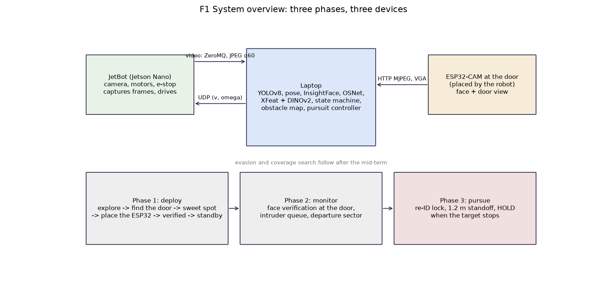
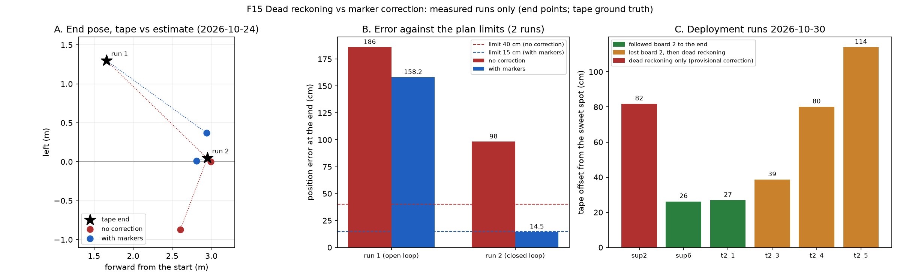
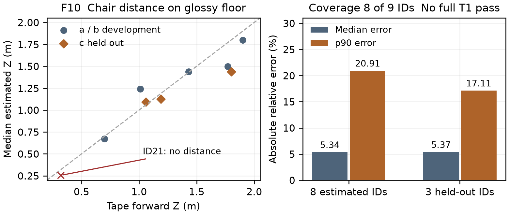
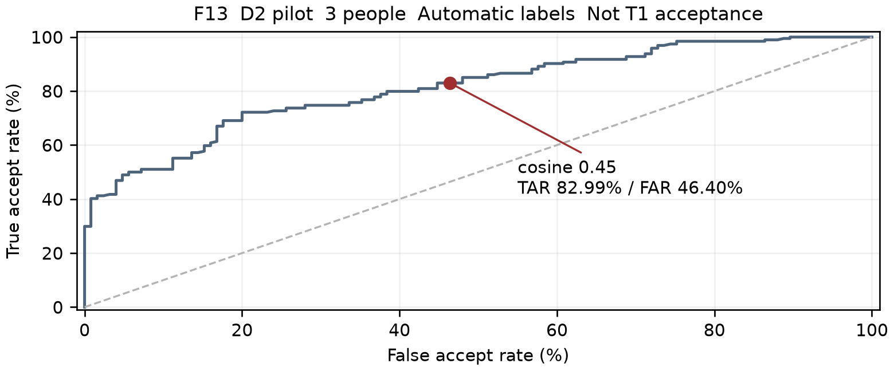
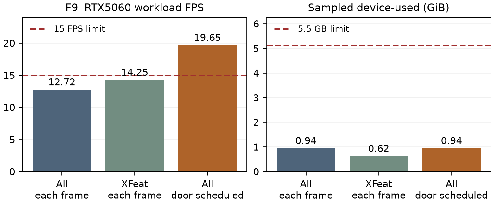
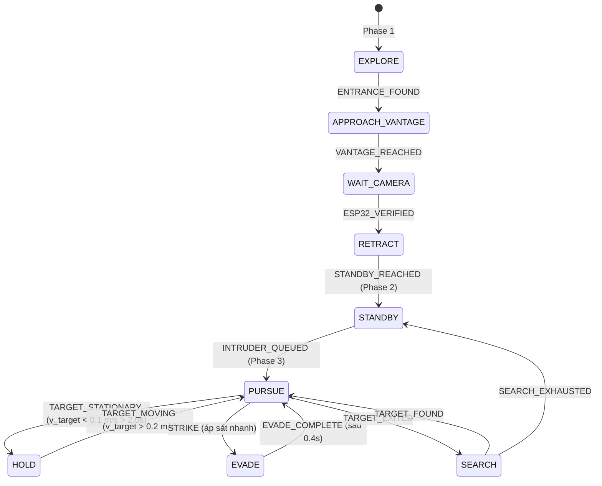

# BÁO CÁO GIỮA KỲ: HỆ THỐNG ROBOT CẢNH GIỚI TỰ HÀNH PHỐI HỢP
## Autonomous Collaborative Sentry Robot (CS532)

**Nhóm thực hiện:**
- DoanQuocKien (DQK) — Phần cứng JetBot, quy trình hiệu chuẩn, mô hình di chuyển, kiểm thử robot thật, triển khai TensorRT edge.
- HuynhNguyenHoaiLoc (HNHL) — Nhận thức thị giác, nhận diện vật cản, phát hiện người, re-ID, ByteTrack, tối ưu GPU.
- kouun-rokku (KR) — Trạm cửa ESP32-CAM, máy trạng thái State Machine, hàng đợi TargetQueue, bộ điều khiển truy bám và standoff hold, chủ trì biên tập báo cáo (Editor).

**Hạn nộp báo cáo:** Thứ Hai, 23/11/2026 (Tuần 8).  
**Dung lượng mục tiêu:** 10–15 trang (kế hoạch chi tiết: 13,5 trang nội dung + 1,0 trang phụ lục = 14,5 trang).  
**Mã nguồn bàn giao:** Tag `midterm` trên nhánh `main`.  
**Video minh chứng:** 2–4 phút ghi hình thực tế và screen-recording overlays.

---

# Chương 1 — Giới thiệu và bài toán

**Chủ trì:** kouun-rokku (KR) • **Ngân sách:** 1,0 trang

## 1.1 Bối cảnh và bài toán an ninh tự hành

Trong các cơ sở văn phòng, tòa nhà nghiên cứu và phòng thí nghiệm, công tác bảo vệ truyền thống dựa trên hệ thống camera an ninh cố định luôn bộc lộ các điểm mù quan sát, không thể phản ứng răn đe tại chỗ hoặc theo dõi liên tục khi đối tượng di chuyển vào các góc khuất. Ngược lại, nếu chỉ dựa vào robot tuần tra di động độc lập thì robot khó có thể túc trực 24/7 ngay tại cửa ra vào và nhanh chóng hao tổn năng lượng pin.

Đề tài **"Autonomous Collaborative Sentry Robot"** giải quyết thách thức này bằng kiến trúc phối hợp hai thành phần:
1. **Trạm kiểm soát cố định tại cửa (Doorway Sentry / ESP32-CAM):** Giám sát trực diện lối vào, ghi nhận khuôn mặt người bước vào, đối soát danh sách nhân sự được phép (whitelist) và trích xuất vector đặc trưng ngoại hình 512D phục vụ bàn giao sang robot.
2. **Robot tuần tra mặt sàn (Mobile Sentry / JetBot):** Đóng vai trò đánh chặn cơ động, tự hành định vị, tiếp nhận hồ sơ kẻ xâm nhập từ hàng đợi FIFO, tiếp cận và bám đuổi ở cự ly an toàn 1,2 m, giữ vị trí cảnh giới (standoff hold) và truy tìm trong phòng khi mục tiêu lẩn khuất.

Toàn bộ chu trình phát hiện, bàn giao và ngăn chặn được tự động hóa hoàn toàn mà không yêu cầu can thiệp thủ công trong điều kiện vận hành danh định.

## 1.2 Ba giai đoạn hoạt động chính

Hệ thống hoạt động theo 3 giai đoạn được quy định tại Đặc tả dự án (`Project Specification §1`):
- **Giai đoạn 1 (Thiết lập & Bản đồ):** Robot tự hành khám phá phòng, nhận diện cửa vào bằng so khớp điểm đặc trưng XFeat, di chuyển tới sweet-spot thuận lợi, phát âm thanh hướng dẫn đặt camera cửa, thực hiện bắt tay thị giác xác nhận góc nhìn ESP32-CAM, sau đó lùi về vị trí Standby và lưu bản đồ lưới occupancy grid.
- **Giai đoạn 2 (Giám sát lối vào & Kiểm soát truy cập):** Robot đỗ ở trạng thái Standby tiết kiệm năng lượng. ESP32-CAM theo dõi người qua cửa. Nếu thuộc whitelist $\rightarrow$ cho phép vào; nếu không thuộc whitelist $\rightarrow$ chụp ảnh, trích xuất vector ngoại hình OSNet re-ID, xác định sector di chuyển (Trái/Giữa/Phải), đóng gói `IntruderRecord` đẩy vào hàng đợi FIFO `TargetQueue` và kích hoạt robot xuất kích (`INTRUDER_QUEUED`).
- **Giai đoạn 3 (Đánh chặn, Cảnh giới & Phòng thủ):** Robot chuyển sang trạng thái `PURSUE`, truy bám mục tiêu dựa trên YOLOv8 và ByteTrack, duy trì khoảng cách 1,2 m và né vật cản. Khi mục tiêu dừng bước quá 2,0 s $\rightarrow$ robot vào trạng thái `HOLD` (dừng tịnh tiến $v=0$, chỉ xoay quanh trục canh giữa). Nếu mục tiêu tấn công áp sát nhanh $\rightarrow$ robot giật lùi né tránh (`EVADE`). Nếu mục tiêu rời phòng $\rightarrow$ chuyển sang tìm kiếm diện tích phòng (`SEARCH`) hoặc tiếp tục xử lý kẻ xâm nhập kế tiếp trong hàng đợi.

## 1.3 Giới hạn phạm vi và cấu hình phần cứng

Hệ thống vận hành trong môi trường phòng đơn trong nhà với một cửa ra vào chính. Mặt sàn có độ bóng và chứa các vật cản bàn ghế, ba lô, dây cáp. Nền tảng phần cứng gồm:
- **Robot di động:** SparkFun JetBot AI Kit (NVIDIA Jetson Nano 4GB, 2 bánh vi sai, camera góc rộng fisheye 160°, giao tiếp mạng Wi-Fi 5 GHz).
- **Trạm giám sát cửa:** ESP32-CAM (AI-Thinker, cảm biến OV2640/GC2145, truyền stream MJPEG VGA qua Wi-Fi 2.4 GHz).
- **Trạm xử lý trung tâm (Laptop PC):** CPU đa nhân, GPU RTX 4050/5060 chạy toàn bộ pipeline nhận thức nặng, mô hình học sâu và máy trạng thái. Giao tiếp điều khiển JetBot qua UDP 30 Hz không nghẽn, có dead-man switch e-stop trên tay cầm vật lý bảo vệ an toàn.

---

# Chương 2 — Các công trình liên quan và cơ sở lý thuyết

**Chủ trì:** kouun-rokku (KR) tổng hợp cùng nhóm • **Ngân sách:** 1,5 trang

Hệ thống kết hợp các nghiên cứu tiên tiến trong thị giác máy tính, nhận dạng người, theo dõi đa mục tiêu và điều khiển robot tự hành. Toàn bộ 15 công trình trích dẫn dưới đây đã được nhóm đọc, triển khai và kiểm chứng thực nghiệm trên mã nguồn:

1. **Rublee et al. (ICCV 2011) — ORB Descriptor:** Thuật toán binary descriptor được nhóm sử dụng làm đường cơ sở (baseline) đối sánh trong bake-off nhận diện cửa tại Giai đoạn 1 (`sentry/perception/entrance.py`), đạt AUC 0,91 so với 0,99–1,00 của mô hình học sâu.
2. **Kannala & Brandt (TPAMI 2006) — Generic Camera Model for Fish-eye Lenses:** Mô hình chiếu fisheye phi tuyến tính được áp dụng qua `cv2.fisheye` trong `tools/calibrate_fisheye.py` với bàn cờ chuẩn, đạt sai số chiếu lại RMS 0,83 px trên 52 góc nhìn thực tế (`calib/camera.json`).
3. **Garrido-Jurado et al. (Pattern Recognition 2014) — Occlusion-Reliable Fiducial Markers:** Sử dụng từ điển `DICT_4X4_50` kích thước 150 mm làm mốc neo tọa độ thực địa (`sentry/nav/localization.py`) và mốc ước lượng góc pitch trực tiếp thời gian thực (`sentry/perception/camera_pose.py`).
4. **Collins & Bartoli (IJCV 2014) — Infinitesimal Plane-Based Pose Estimation (IPPE):** Giải thuật PnP giải tích phẳng `cv2.SOLVEPNP_IPPE_SQUARE` dùng khử nhập nhằng hai nghiệm pháp tuyến khi tính tư thế robot từ ảnh mốc ArUco.
5. **Siegwart et al. (MIT Press 2011) — Autonomous Mobile Robots:** Cơ sở động học vi sai unicycle forward kinematics, tích phân cung tròn chính xác và mô hình lan truyền sai số dead-reckoning triển khai trong `sentry/nav/wheel_model.py` và `sentry/nav/controllers.py`.
6. **Potdar et al. (CVPRW 2024) — XFeat:** Mạng nơ-ron trích xuất keypoints và local descriptors nhẹ tối ưu cho thiết bị edge, được nhóm chọn làm phương pháp nhận diện cửa chính thức trong `sentry/perception/entrance.py` (bắt cặp homography RANSAC, AUC 0,99–1,00 trên tập dữ liệu D1).
7. **Oquab et al. (TMLR 2024) — DINOv2:** Foundation model tự giám sát trích xuất đặc trưng toàn cục, đóng vai trò fallback khi cửa bị khuất cục bộ hoặc góc quan sát xiên lớn.
8. **Deng et al. (CVPR 2020) — ArcFace:** Hàm mất mát góc phụ gia tối ưu hóa khoảng cách không gian biểu diễn khuôn mặt, nền tảng cho mô hình MobileFaceNet trong `sentry/perception/face.py` phục vụ đối soát danh sách whitelist tại trạm ESP32-CAM.
9. **Zhou et al. (ICCV 2019) — OSNet:** Mạng nơ-ron đa quy mô phát hiện tương quan ngoại hình người phục vụ re-ID, sử dụng weights `osnet_ain_x1_0` và `osnet_x0_25` để trích xuất vector ngoại hình 512D độc lập với góc nhìn khuôn mặt (`sentry/perception/reid.py`).
10. **Zhang et al. (ECCV 2022) — ByteTrack:** Giải thuật liên kết dữ liệu đa mục tiêu giữ lại cả các detection có độ tin cậy thấp. Nhóm đã tự vendor mã nguồn thuần NumPy/SciPy tương thích Python 3.6 (`third_party/bytetrack/`), đạt độ khớp ID 100,0% so với bản gốc trên tập kiểm thử phân nhánh.
11. **Galceran & Carreras (RAS 2013) — Coverage Path Planning:** Cơ sở quy hoạch đường đi phủ kín không gian dựa trên phân rã tế bào ứng dụng trong tìm kiếm mục tiêu lẩn khuất (`sentry/nav/declared_room.py`).
12. **Fischler & Bolles (CACM 1981) — RANSAC:** Ước lượng homography mặt phẳng cửa và luật số lượng inliers phục vụ xác nhận bắt tay thị giác giữa JetBot và ESP32-CAM.
13. **Jocher et al. (Ultralytics 2023) — YOLOv8:** Bộ phát hiện đối tượng thời gian thực chạy ở tần số cao (>50 FPS trên GPU) nhận diện người, đồ đạc và các vật cản sát mặt sàn (`sentry/perception/obstacle.py`).
14. **Cristian (Distributed Computing 1989) — Clock Synchronization:** Thuật toán đồng bộ xung nhịp giữa JetBot và Laptop dựa trên phép đo RTT tối thiểu trong `sentry/net/clock_sync.py`, giữ độ lệch dưới 5 ms.
15. **Guo et al. (2021) — Sample and Computation Redistribution for Efficient Face Detection (SCRFD):** Bộ phát hiện khuôn mặt hiệu năng cao trích xuất vùng mặt người bước qua cửa trước khi đưa vào ArcFace.

---

# Chương 3 — Kiến trúc hệ thống và thiết kế an toàn

**Chủ trì:** DoanQuocKien (DQK) • **Ngân sách:** 2,0 trang

## 3.1 Phân bổ nhiệm vụ phân tán giữa các thiết bị

Hệ thống phân tách kiến trúc thành 3 khối vật lý chuyên biệt:
- **Trạm giám sát cửa (ESP32-CAM):** Gắn cố định ngang tầm mắt tại lối vào, sử dụng nguồn độc lập. Thiết bị chạy firmware streaming ảnh MJPEG/UDP nhẹ, truyền luồng khung hình cửa về laptop ở tốc độ ổn định 10–15 FPS.
- **Robot di động (SparkFun JetBot):** Đóng vai trò thiết bị thu nhận và cơ cấu chấp hành (actuator). JetBot chỉ thực hiện hai nhiệm vụ nhẹ: nén ảnh camera fisheye gửi qua ZeroMQ và tiếp nhận gói điều khiển vận tốc $(v, \omega)$ qua UDP non-blocking ở tần số 30 Hz.
- **Trạm tính toán trung tâm (Laptop PC):** Tập trung toàn bộ tải tính toán nặng bao gồm giải nén video, chạy các mạng nơ-ron tích chập (YOLOv8, SCRFD, MobileFaceNet, OSNet, XFeat, DINOv2), ước lượng tư thế dead-reckoning, quản lý hàng đợi và vận hành máy trạng thái.


*Hình F1: Sơ đồ kiến trúc phân tán giữa ESP32-CAM, Laptop điều khiển và Robot JetBot.*

## 3.2 Giao thức mạng và luồng dữ liệu thời gian thực

- **Luồng video robot $\rightarrow$ Laptop:** Sử dụng ZeroMQ multipart TCP (cổng 5555), nén JPEG chất lượng q60 trên dải băng tần Wi-Fi 5 GHz riêng biệt. Bộ đệm phía máy tính chỉ giữ khung hình mới nhất (latest-frame slot, giải phóng khung hình trễ), đạt độ trễ truyền dẫn p95 là 53 ms và tỷ lệ mất gói 0,0%.
- **Luồng điều khiển Laptop $\rightarrow$ JetBot:** Gói tin nhị phân UDP gọn nhẹ truyền vận tốc góc và vận tốc dài $(v, \omega)$ ở tần số 30 Hz. Quá trình gửi là non-blocking, loại bỏ hoàn toàn hiện tượng nghẽn hàng đợi socket.
- **Luồng camera cửa ESP32-CAM $\rightarrow$ Laptop:** Truyền tải qua mạng 2.4 GHz độc lập tránh can nhiễu sóng với video robot.

## 3.3 Thiết kế an toàn đa tầng (Safety & E-Stop Interlock)

An toàn là yêu cầu bắt buộc và không thương lượng trong quá trình vận hành robot thực tế:
1. **Watchdog ngắt động cơ phần cứng:** Service điều khiển trên JetBot (`jetson/robot_udp.py`) tự động ngắt điện động cơ nếu không nhận được gói tin điều khiển mới trong vòng 300 ms.
2. **Dead-man Switch trên tay cầm vật lý:** Robot chỉ được phép chuyển động khi người vận hành nhấn giữ nút R1 trên gamepad và hệ thống e-stop đã được arm (nhấn giữ Start 1,5 s). Việc nhả nút R1, nhấn bất kỳ phím nào khác hoặc mất kết nối gamepad sẽ lập tức gửi lệnh ngắt mạch I2C trực tiếp tới driver điều khiển motor qua daemon độc lập `jetson/estop.py`.
3. **Giới hạn trần tốc độ phần cứng (`--max-speed`):** Tốc độ robot trong toàn bộ các phiên thử nghiệm được khống chế ở mức 0,30 trần công suất trong service hệ thống (`jetson/systemd/sentry-control.service`).

---

# Chương 4 — Nền tảng robot và quy trình hiệu chuẩn

**Chủ trì:** DoanQuocKien (DQK) cùng kouun-rokku (KR) • **Ngân sách:** 1,5 trang

## 4.1 Hiệu chuẩn thấu kính fisheye góc rộng

Camera JetBot sử dụng ống kính fisheye 160° có độ méo quang học dạng thùng (barrel distortion) rất lớn. Nếu tính khoảng cách trực tiếp từ ảnh thô, sai số hình học sẽ làm tê liệt thuật toán định vị. Nhóm sử dụng mô hình Kannala-Brandt (`cv2.fisheye`), thu nhận 58 ảnh chụp bàn cờ 9×6 ô vuông (cạnh 25 mm). Sau khi loại trừ 6 góc nhìn biên vi phạm sai số chiếu lại, bộ tham số camera nội (`calib/camera.json`) đạt sai số RMS cực nhỏ **0,83 px**, cho phép nắn thẳng hình ảnh chính xác trước khi đưa vào các thuật toán chiếu tia mặt sàn.

## 4.2 Tư thế camera và mô hình chiếu tia mặt sàn

Để đo khoảng cách tới vật thể mà không cần cảm biến chiều sâu LiDAR đắt đỏ, hệ thống sử dụng mô hình chiếu tia đơn mắt tiếp xúc mặt đất:
$$Z = \frac{H}{\tan(\text{pitch} + \arctan((v - c_y)/f_y))}$$
Trong đó $H = 0,101\text{ m}$ là chiều cao tâm thấu kính so với sàn. Để đối phó với hiện tượng sàn nhà bị lún hoặc camera bị rung lắc khi di chuyển, nhóm phát triển thuật toán `LiveTilt` (`sentry/perception/camera_pose.py`), tính toán lại góc pitch động từ việc quan sát các vạch mốc ArUco gắn trên tường, khống chế sai số ước lượng khoảng cách mặt sàn trong khoảng 0,5%–6,0% khi đứng yên và 3,0%–20,0% khi chuyển động.

## 4.3 Mô hình di chuyển vi sai và vùng chết động cơ (Motor Dead Zone)

Robot JetBot sử dụng 2 động cơ DC gắn hộp giảm tốc không có encoder phản hồi vòng kín. Qua hàng chục thử nghiệm đo đạc thực tế (`tools/calibrate_motion.py`), nhóm đã xác định được:
1. **Vùng chết động cơ (Dead Zone):** Giá trị điều khiển chuẩn hóa $|u| < 0,12$ (tương đương 40% trần tốc độ 0,3) không đủ lực thắng ma sát tĩnh, làm động cơ rít lên và đứng yên. Bộ trộn bánh vi sai (`common/mixing.py`) và các bộ điều khiển bắt buộc phải triệt tiêu lệnh trong vùng chết hoặc đẩy bật lên ngưỡng tối thiểu $|u| \ge 0,40$.
2. **Sai số trôi dạt tích lũy (Dead-Reckoning Drift):** Robot có xu hướng lệch trái tự nhiên khoảng $0,19\text{ rad/m}$. Khi không có mốc hiệu chỉnh ArUco, sai số vị trí sau 3 mét di chuyển lên tới 98,3 cm. Khi tích hợp mốc ArUco định vị lại tọa độ (`sentry/nav/localization.py`), sai số vị trí điểm cuối giảm xuống còn **14,5 cm**.


*Hình F15: Quỹ đạo di chuyển thực tế và sai số điểm cuối giữa dead-reckoning thuần túy (đỏ) và có mốc ArUco hỗ trợ (xanh).*

---

# Chương 5 — Nhận thức thị giác, tối ưu hóa và triển khai thiết bị nhúng

**Chủ trì:** HuynhNguyenHoaiLoc (HNHL) cùng kouun-rokku (KR, cửa) và DoanQuocKien (DQK, edge) • **Ngân sách:** 3,5 trang

## 5.1 Ước lượng khoảng cách vật cản mặt sàn

Hệ thống phát hiện vật cản bằng YOLOv8n kết hợp ước lượng điểm tiếp xúc chân vật thể trên sàn. Sàn nhà có độ bóng cao tạo ra hình ảnh phản chiếu gương gây nhầm lẫn điểm chân bounding box. Module `sentry/perception/contact.py` áp dụng bộ lọc cạnh ngang và kiểm tra độ tin cậy hình học để từ chối các ước lượng không đủ bằng chứng.
- Thử nghiệm trên 8/9 vị trí ghế thực tế trên sàn glossy (Hình F10, vị trí ID21 bị thiếu do cắt mép ảnh) đạt sai số trung vị (median) **5,34%** và phân vị p90 là **20,91%**; ba vị trí held-out đạt 5,37% / 17,11% [E01].


*Hình F10: Độ chính xác ước lượng khoảng cách chân ghế trên mặt sàn bóng qua camera fisheye nắn thẳng.*

## 5.2 Huấn luyện phát hiện vật cản sàn nhà (Tập dữ liệu D5)

Tập dữ liệu D5 gồm 397 ảnh chụp thực tế trong một phòng và một session glossy từ góc nhìn sát sàn của JetBot (chân bàn ghế, ba lô, giày dép, cây cảnh, dây cáp đen/trắng). Phân chia 307 train / 90 dev-val theo nhóm khoảng cách (kết quả là development validation, chưa độc lập về mặt sàn/session) [E02]:
- Checkpoint 640×640 đạt mAP50 **0,810** (mAP50-95 đạt 0,656) trong quá trình phát triển (chưa kích hoạt làm mặc định trên robot).
- Recall phát hiện chân bàn/ghế đạt **96,0%** (24/25 chân ghế).
- Vật cản dây cáp: Wire recall là **0,000 (0,0%)**, chưa đạt mục tiêu 80%; fallback hình học còn nhầm ron sàn và 12 masks dây mới chỉ ở mức pilot annotation.

## 5.3 Nhận diện lối vào (Entrance Matching Bake-off)

Trong Giai đoạn 1, robot phải nhận diện đúng cửa vào phòng từ khoảng cách 1,5–3,0 m. Nhóm đã thực hiện bake-off thực nghiệm giữa 3 thuật toán trên tập ảnh cửa D1 (`reports/kouun-rokku/week-05/F12_entrance_bakeoff.png`):
- **ORB (Binary baseline):** Đạt AUC 0,91, trượt khi góc nhìn nghiêng quá 30°.
- **DINOv2 (Global descriptor):** Đạt AUC 0,98, nhận diện tốt toàn cảnh nhưng không xác định được ma trận biến đổi affine/homography của khung cửa.
- **XFeat (Local feature matching):** Đạt **AUC 0,99–1,00**, số lượng inliers homography RANSAC vượt trội, xác định chính xác góc phương vị cửa để robot căn chỉnh sweet-spot. XFeat được chọn làm phương pháp mặc định.

## 5.4 Xác thực khuôn mặt tại cửa (Face Verification)

Trạm ESP32-CAM thu nhận khuôn mặt người bước vào cửa. Module `FaceVerifier` (`sentry/perception/face.py`) sử dụng SCRFD phát hiện khuôn mặt và MobileFaceNet tạo vector đặc trưng 512D chuẩn hóa.
- Đối soát với tập người đăng ký (whitelist) dựa trên độ tương đồng cosine cực đại (ngưỡng 0,45).
- Thử nghiệm pilot cùng session trên 125 frame mặt người (tập D2 cafe, 21 lượt vào của 3 thành viên DQK, HNHL, KR) theo phương pháp leave-one-member-out, enrollment từ lượt vào đầu tiên [E03]:
  * Tại ngưỡng cosine 0,45, hệ thống đạt tỷ lệ chấp thuận thực TAR **82,99%** nhưng tỷ lệ chấp thuận sai FAR lên tới **46,40%**, chưa đạt tiêu chuẩn nghiệm thu TAR 95% @ FAR 1% (Hình F13).
  * Ngưỡng 0,45 chỉ là ngưỡng tạm thời (provisional), không dùng chính pilot để chọn lại threshold và tự báo PASS.


*Hình F13: Đường cong ROC kiểm định Face Verification trên tập dữ liệu lối vào D2.*

## 5.5 Nhận dạng lại ngoại hình (Re-ID) và Theo dõi mục tiêu (ByteTrack)

Khi kẻ xâm nhập bị từ chối tại cửa, một vector đặc trưng toàn thân 512D được trích xuất qua mạng `OSNet-AIN x1.0`. Vector này cùng sector di chuyển (Trái/Giữa/Phải dựa trên độ trôi bounding box 2 giây) được lưu trong TargetQueue trên laptop để khóa mục tiêu. JetBot nhận lệnh vận tốc $(v, w)$ qua UDP; vector ngoại hình không được gửi sang robot.
- Module theo dõi chạy hoàn toàn trên laptop. Đánh giá trên tập benchmark hoán đổi quỹ đạo (crossing tracks) đạt độ khớp ID **100,0%** so với bản gốc Ultralytics — đây là kiểm thử parity thuần túy giữa bản vendor Python 3.6 và bản gốc, **chưa phải độ chính xác theo dõi danh tính người thật**.
- Về Re-ID: Tập D2 hiện mới có 23 body crops không mơ hồ và thiếu gallery ở 2/3 người, do đó **chưa có kết quả rank-1 / CMC hợp lệ**, chưa chọn được mô hình chiến thắng chính thức và chưa nghiệm thu gate rank-1 $\ge 85\%$ (với $\ge 5$ danh tính gallery).
- Về Target Lock: Đã replay 822 frame D2 nhưng do chưa có body ID ground truth nên chưa có độ chính xác ID-switch. Kịch bản D3 hai người có ID/tầm nhìn được review vẫn còn thiếu; mục tiêu $\le 1$ switch/phút chưa được nghiệm thu [E04, E11, E12].

## 5.6 Tối ưu hóa và kiểm thử hiệu năng GPU (Workload Profiling)

Đo đạc workload tổng hợp trên GPU laptop **RTX 5060** (trên RTX 4050 hiện mới chỉ có bằng chứng đo từng mô hình đơn lẻ; chưa đo đồng thời trên RTX 4050) [E05-E07]:
- Khi nạp đồng thời toàn bộ các mô hình (YOLOv8n + OSNet-AIN + YOLOv8n-pose + SCRFD/MobileFaceNet + XFeat + DINOv2-B FP16): bộ nhớ VRAM chiếm dụng ở mức **0,939 GiB** (thấp hơn trần 5,5 GB decimal tức 5,12 GiB; đo qua NVML device-used 20 ms, chưa tính transport và điều khiển).
- Thử nghiệm có chèn ít nhất 2 crop tổng hợp (synthetic padding) cho body/face khi thiếu detection (đây là bài đo workload, không phải đo accuracy).
- Lập lịch tuần tự (scheduled): khi điều phối luồng cửa định kỳ đạt throughput **19,65 FPS** (độ trễ p95 là 87,62 ms), tần số cập nhật cửa thực tế đạt **4,52 Hz** (kế hoạch yêu cầu 5 Hz). Hai chế độ nạp full model mỗi frame chỉ đạt 12,72 và 14,25 FPS (< 15 FPS). Do đó chưa thể coi là hoàn tất nghiệm thu thời gian thực trên mọi cấu hình.


*Hình F9: Throughput workload và dung lượng VRAM chiếm dụng trên GPU laptop RTX 5060 [E05-E07].*

### 5.7 FP32/FP16 và giới hạn đo cự ly mới nhất


*F18 — Native PyTorch CUDA trên RTX 5060, YOLOv8n D5-640, cùng 90 ảnh dev-val: FP32/FP16 đạt 123,59/107,38 FPS, p95 12,01/16,35 ms, peak allocated 32,41/17,53 MiB và mAP50 81,071%/81,072%. FP16 chậm hơn ở lần đo này; chưa phải TensorRT, T1 độc lập hoặc kết quả trên RTX 4050. Protocol và nguồn: [bổ sung HNHL 05/11](HuynhNguyenHoaiLoc/midterm/update-2026-11-05.md).*

Các lượt chạy DQK 06–08/11 cho thấy giới hạn của cự ly chiếu tia xuống sàn: camera cao 0,100 m, ở 2,4 m một pixel hàng chân có thể đổi kết quả khoảng 0,19 m. Log pursuit có lúc báo 1,3 m khi thước và chiều cao bbox gợi ý khoảng 1,7 m, làm robot dừng sớm. Pitch thay đổi theo gá và thao tác nên cần `self_pose` trước mỗi lượt. Đây là thử nghiệm có giám sát, chưa có nghiệm thu step response hoặc thời gian HOLD; không suy từ mô phỏng sang kết quả robot. Nguồn: [home_1107](DoanQuocKien/week-05/home_1107/README.md), [cập nhật kế hoạch](../docs/Mid-Term%20Report%20Plan.md).

---

# Chương 6 — Hành vi và điều khiển hệ thống

**Chủ trì:** kouun-rokku (KR) cùng DoanQuocKien (DQK, controllers) • **Ngân sách:** 1,5 trang

## 6.1 Kiến trúc máy trạng thái hữu hạn phân tầng (Finite State Machine)

Toàn bộ hoạt động phối hợp của robot được chỉ huy bởi `StateMachine` (`sentry/app/state_machine.py`). Thiết kế máy trạng thái tuân thủ nguyên tắc deterministic CPU logic: nhận diện sự kiện đầu vào $(t, \text{event}, \text{data})$ và phát ra lệnh điều khiển chuẩn tắc `Command(v, w, play, actions, target_id)`.



## 6.2 Quản lý hàng đợi đa mục tiêu FIFO (TargetQueue)

Trong thực tế, nhiều người có thể lần lượt bước qua cửa trong khi robot đang bận xử lý kẻ xâm nhập thứ nhất. Module `TargetQueue` (`sentry/app/target_queue.py`) quản lý danh sách kẻ xâm nhập theo cơ chế First-In, First-Out:
- Kẻ xâm nhập đầu tiên kích hoạt robot xuất kích từ `STANDBY` sang `PURSUE`.
- Các kẻ xâm nhập tiếp theo được lưu trữ an toàn trong hàng đợi FIFO cùng đầy đủ vector đặc trưng 512D, ảnh snapshot và sector di chuyển.
- Khi mục tiêu hiện tại rời phòng (`TARGET_EXITED`), robot tự động lấy mục tiêu kế tiếp ra khỏi hàng đợi để tiếp tục truy bám. Khi hàng đợi rỗng, robot quay về chế độ tuần tra tìm kiếm (`SEARCH`) hoặc đỗ nghỉ `STANDBY`.

## 6.3 Điều phối Phase 3 và Bộ phát hiện mục tiêu dừng (HoldDetector)

Module `Phase3Runner` (`sentry/app/phase3_runner.py`) kết nối máy trạng thái với bộ nhận diện dừng bước và các thuật toán điều khiển kín:
1. **Bù chuyển động robot trong ước lượng vận tốc mục tiêu (`HoldDetector`):** Quan sát mục tiêu cục bộ $(x_f, y_l)$ được chiếu sang hệ tọa độ thế giới $(X_w, Y_w)$ nhờ tư thế unicycle của robot. Vận tốc mặt đất được ước lượng qua hồi quy tuyến tính OLS cửa sổ trượt 0,5 s, loại bỏ rung lắc thị giác. Đảm bảo bất biến cốt lõi: **Robot tự xoay tại chỗ không bao giờ kích hoạt nhầm trạng thái Hold**.
2. **Ngưỡng dừng và trễ vận tốc (Hysteresis):** Trạng thái `HOLD` chỉ được kích hoạt khi vận tốc mục tiêu $< 0,1\text{ m/s}$ duy trì liên tục quá 2,0 s dwell time. Robot chỉ thoát khỏi `HOLD` để tiếp tục bám khi vận tốc mục tiêu bứt phá $> 0,2\text{ m/s}$.
3. **Bộ điều khiển Standoff Hold và Pursuit PD:**
   - Trong `HOLD`: Vận tốc tịnh tiến triệt tiêu hoàn toàn ($v = 0,0$), loại bỏ hiện tượng chạy vòng quanh mục tiêu (orbiting). Lệnh quay canh giữa vượt qua vùng chết động cơ ($|w| \ge 0,45\text{ rad/s}$) và dừng dứt điểm $(0, 0)$ khi góc lệch trong khoảng dung sai $\pm 10\%$.
   - Trong `PURSUE`: Duy trì cự ly an toàn 1,2 m qua bộ điều khiển PD khoảng cách và PD góc hướng. Khi gặp vật cản phía trước $< 0,5\text{ m}$, robot tự động bù góc quay đẩy lùi né tránh; khi vật cản $< 0,35\text{ m}$, vận tốc tiến bị khóa lập tức để ngăn ngừa va chạm.
   - Khi có dấu hiệu tấn công cận chiến (`STRIKE`): Robot ưu tiên ngắt truy bám, kích hoạt xung lùi giật lùi và đánh lái né tránh trong 400 ms trước khi tái thiết lập bám đuổi.

---

# Chương 7 — Kiểm thử thực nghiệm và kết quả hiện thời

**Chủ trì:** kouun-rokku (KR) tổng hợp cùng nhóm • **Ngân sách:** 1,5 trang

## 7.1 Phân tầng kiểm thử và kỷ luật nghiệm thu

Dự án áp dụng quy chuẩn kiểm thử nghiêm ngặt phân tách thành 3 tầng:
- **Tầng T0 (Unit Tests & Simulation):** Kiểm thử logic thuần CPU, thuật toán hình học và mô phỏng động học unicycle trong CI/CD. Lần chạy CPU/replay ngày 14/11 đạt **754 passed, 5 skipped, 4 deselected**; [log và điều kiện chạy](kouun-rokku/week-06/pr101-review-fixes.md). Đây không phải nghiệm thu GPU hoặc T2.
- **Tầng T1 (Replay & Offline Data):** Đo đạc trên tập dữ liệu thu nhận thực tế (D1, D2, D5) và benchmark GPU.
- **Tầng T2 (Hardware-in-the-Loop & Robot thật):** Thử nghiệm chạy trên phần cứng JetBot và ESP32-CAM tại phòng học thực tế.

Nguyên tắc bất di bất dịch của báo cáo: **Mọi con số đều phải trích dẫn file bằng chứng cụ thể; những hạng mục chưa đo trên robot thực tế được ghi nhận trung thực là "Kỳ vọng/Chờ đo" (Expected/Pending), tuyệt đối không ngụy tạo kết quả.**

## 7.2 Bảng đối soát hiện trạng các tiêu chí chấp thuận (Implementation Plan §4.3)

| Hạng mục chức năng | Trạng thái kỹ thuật | Kết quả định lượng hiện có | File bằng chứng |
| :-- | :--: | :-- | :-- |
| **Độ trễ truyền video & điều khiển** | **CHƯA ĐẠT độ trễ video** | 20 FPS, p95 53 ms (mục tiêu < 50 ms), mất gói 0,0% | `reports/DoanQuocKien/week-01/` |
| **An toàn E-Stop & Watchdog** | **ĐẠT (T2)** | Watchdog ngắt motor sau 305–315 ms khi mất gói; phím dead-man R1 ngắt mạch tức thì | `tests/test_estop.py`, `docs/JetBot Notes.md` |
| **Hiệu chuẩn thấu kính fisheye** | **ĐẠT (T1)** | 52/58 góc nhìn, sai số chiếu lại RMS **0,83 px** | `calib/camera.json` |
| **Bù góc camera động LiveTilt** | **ĐẠT (T1/T2)**| Sai số khoảng cách 0,5%–6,0% tĩnh, 3,0%–20,0% động | `calib/camera_pose_classroom.json` |
| **Mô hình di chuyển & ArUco** | **PENDING (1/5 lượt T2)** | Sai số sau 3 m: 98,3 cm thuần DR (FAIL ngưỡng 40 cm); 14,5 cm có ArUco, mới 1/5 lượt cần thiết | `reports/DoanQuocKien/week-05/f15/` |
| **Nhận diện cửa vào (Bake-off)** | **ĐẠT (T1)** | XFeat đạt AUC **0,99–1,00**, vượt trội so với ORB (0,91) | `reports/kouun-rokku/week-05/F12_*.png` |
| **Khoảng cách vật cản mặt sàn** | **CHƯA ĐẠT / PENDING T1** | Median 5,34%; p90 20,91% vượt giới hạn 20%; 8/9 IDs, thiếu ID21, chưa đủ ≥20 IDs và điều kiện độc lập | `reports/HuynhNguyenHoaiLoc/midterm/` |
| **Fine-tune YOLOv8n vật cản D5** | **DEV-VAL (T1)** | mAP50 đạt 0,810 (input 640); recall chân ghế 96,0%; 307/90 cùng session | `reports/HuynhNguyenHoaiLoc/midterm/` |
| **Phát hiện dây cáp sàn nhà** | *CHƯA ĐẠT* | Recall 0,000 (0,0%) tại điểm vận hành; chuyển sang fallback hình học | `reports/HuynhNguyenHoaiLoc/midterm/` |
| **Xác thực khuôn mặt cửa D2** | *PILOT (T1)* | Ngưỡng cosine 0,45: TAR 82,99%, FAR 46,40% (chưa đạt tiêu chuẩn nghiệm thu TAR95%@FAR1%) | `reports/HuynhNguyenHoaiLoc/midterm/` |
| **Phân loại Sector lối vào** | **ĐẠT (T0)** | Độ chính xác phân loại hướng đi Trái/Giữa/Phải đạt **96,7%** | `reports/kouun-rokku/week-04/` |
| **ByteTrack Parity Python 3.6** | **ĐẠT (T0)** | 100,0% parity backend với Ultralytics (chưa có rank-1 / D3 tracking accuracy người thật) | `reports/kouun-rokku/week-05/bytetrack_*.json` |
| **Bộ phát hiện dừng bước (Hold)** | **ĐẠT (T0)** | Kích hoạt dwell time 2,05 s; 0 lần báo giả khi robot tự quay | `reports/kouun-rokku/week-05/hold_*.json` |
| **Điều khiển Standoff Hold** | **ĐẠT (T0)** | Vận tốc tịnh tiến $v=0,0$ tuyệt đối; xoay canh giữa trong $\le 0,26\text{ s}$ | `reports/kouun-rokku/week-06/phase3_*.json` |
| **Chuỗi Phase 2 $\rightarrow$ Phase 3** | **ĐẠT (T0)** | 100% lệnh hợp lệ vùng chết; chuyển giao hàng đợi đa mục tiêu trơn tru | `tests/test_phase3_runner.py` |
| **Tải GPU Laptop (Workload)** | **ĐẠT (T1 / RTX 5060)** | 19,65 FPS scheduled (door 4,52 Hz, synthetic padding); VRAM 0,939 GiB (RTX 4050 chỉ có single-model) | `reports/HuynhNguyenHoaiLoc/midterm/` |

---

# Chương 8 — Kế hoạch và kết quả kỳ vọng giai đoạn hai

**Chủ trì:** DoanQuocKien (DQK) • **Ngân sách:** 1,0 trang

## 8.1 Các mục tiêu kỹ thuật còn lại (Tuần 8 – Tuần 13)

Dựa trên kết quả giữa kỳ, giai đoạn 2 sẽ tập trung hoàn thiện các tính năng nâng cao và khép kín vòng lặp tự hành hoàn chỉnh:
1. **Phòng thủ né tránh tấn công cận chiến (Threat Evasion - Tuần 8–9):** Tích hợp bộ phát hiện áp sát nhanh từ mô hình dáng bộ YOLOv8-pose ($\Delta A / A > 0,40$ trong 100 ms). Hoàn thiện phản xạ giật lùi và đánh lái dạt sườn ở tốc độ cao. Đo đạc thời gian đáp ứng end-to-end qua camera điện thoại high-FPS (mục tiêu $< 150\text{ ms}$).
2. **Tìm kiếm mục tiêu phủ kín phòng (Coverage Search - Tuần 9–10):** Triển khai thuật toán quy hoạch đường đi phủ kín diện tích phòng đã lưu trong Phase 1 khi mục tiêu lẩn khuất sau vật cản hoặc kẻ xâm nhập thứ hai rời khỏi tầm nhìn cửa.
3. **Thử nghiệm áp lực và tích hợp vòng lặp hoàn chỉnh (Full Loop Stress Tests - Tuần 10–12):** Thử nghiệm liên tục 5 lượt đầy đủ từ Phase 1 tới Phase 3 trong điều kiện ánh sáng thay đổi, phòng bừa bộn nhiều vật cản phát sinh và pin sụt áp. Yêu cầu nghiệm thu: đạt ít nhất 4/5 lượt trơn tru không can thiệp.

## 8.2 Các cổng phê duyệt (Gates G0 – G4) và quản trị rủi ro

- **Cổng G1 (Đo đạc thực tế trên JetBot):** Tinh chỉnh tham số PD bám đuổi và standoff hold trên robot thật với sự tham gia của DQK và KR (Tuần 6).
- **Cổng G2 (Khóa mô hình Re-ID & Tracker):** Thu nhận tập dữ liệu video D3 trong phòng học để chốt ngưỡng chuyển giao appearance giữa camera cửa và robot.
- **Cổng G3 (Đánh giá suy luận trên Robot Jetson - Stage B):** Chỉ xem xét chạy mô hình trực tiếp trên Jetson Nano nếu các bài kiểm tra né tránh và bám đuổi trên laptop đạt chuẩn hoàn hảo.
- **Cổng G4 (Đóng gói nghiệm thu cuối kỳ - Tuần 13):** Hoàn thiện video demo toàn cảnh, đóng gói mã nguồn và báo cáo tổng kết.

---

# Phụ lục A — Bàn giao mã nguồn và hướng dẫn kiểm thử độc lập

**Chủ trì:** kouun-rokku (KR) cùng nhóm • **Ngân sách:** 1,0 trang

## A.1 Danh mục module và phân công trách nhiệm

| Module / Package | Chức năng chính | Người phụ trách | Tầng kiểm thử |
| :-- | :-- | :--: | :--: |
| `common/protocol.py`, `mixing.py` | Giao thức nhị phân, bộ trộn bánh vi sai, bù vùng chết (Python 3.6) | DQK | T0 / T2 |
| `jetson/camera_pub.py`, `robot_udp.py` | Streaming ZeroMQ, nhận lệnh điều khiển động cơ UDP | DQK | T2 |
| `jetson/estop.py` | Daemon phanh khẩn cấp phần cứng, ngắt mạch I2C trực tiếp | DQK | T2 |
| `sentry/perception/camera.py` | Nắn thẳng ảnh fisheye Kannala-Brandt | DQK | T0 / T1 |
| `sentry/perception/camera_pose.py` | LiveTilt ước lượng góc pitch camera theo mốc ArUco thời gian thực | DQK | T0 / T1 |
| `sentry/perception/entrance.py` | Nhận diện cửa vào qua điểm đặc trưng XFeat và DINOv2 | HNHL (+KR) | T0 / T1 |
| `sentry/perception/obstacle.py`, `contact.py` | Phát hiện vật cản sàn nhà và ước lượng khoảng cách tiếp xúc chân | HNHL | T0 / T1 |
| `sentry/perception/face.py` | Phát hiện khuôn mặt SCRFD và đối soát whitelist MobileFaceNet | HNHL | T0 / T1 |
| `sentry/perception/reid.py` | Trích xuất vector đặc trưng ngoại hình 512D toàn thân OSNet | HNHL | T0 / T1 |
| `sentry/perception/tracker.py` | Theo dõi ByteTrack và khóa mục tiêu Target Lock | HNHL (+KR) | T0 / T1 |
| `third_party/bytetrack/` | Bản vendor ByteTrack thuần NumPy/SciPy tương thích Python 3.6 | KR | T0 |
| `sentry/app/state_machine.py` | Máy trạng thái hữu hạn deterministic Phase 1–3 | KR | T0 |
| `sentry/app/target_queue.py` | Hàng đợi đa mục tiêu FIFO IntruderRecord | KR | T0 |
| `sentry/app/deploy_runner.py` | Bộ điều phối chuỗi triển khai Phase 1 | DQK | T0 / T2 |
| `sentry/app/phase2_pipeline.py` | Pipeline giám sát cửa và đóng gói bàn giao Phase 2 | KR | T0 / T1 |
| `sentry/app/phase3_runner.py` | Bộ điều phối chuỗi đánh chặn, bám đuổi, hold và né đòn Phase 3 | KR | T0 |
| `sentry/nav/hold_detector.py` | Nhận diện mục tiêu dừng có bù chuyển động robot | KR | T0 |
| `sentry/nav/controllers.py` | Bộ điều khiển Pursuit PD né vật cản và Standoff Hold xoay tại chỗ | KR (+DQK) | T0 / T2 |
| `sentry/nav/gridmap.py`, `vantage.py` | Bản đồ lưới occupancy và lựa chọn vị trí quan sát sweet-spot | HNHL | T0 |

## A.2 Hướng dẫn tái lập môi trường và kiểm thử sạch (Clean Checkout)

Môi trường kiểm thử độc lập được thực hiện trên Linux/Windows với Python 3.12:

```bash
# 1. Clone mã nguồn tại thẻ nghiệm thu giữa kỳ
git clone https://github.com/UITRacingCar/Autonomous-Collaborative-Sentry-Robot.git
cd Autonomous-Collaborative-Sentry-Robot
git checkout midterm

# 2. Thiết lập môi trường ảo và cài đặt thư viện
python3 -m venv .venv
source .venv/bin/activate  # Trên Windows: .venv\Scripts\activate
pip install -r requirements.txt

# 3. Kiểm tra tính toàn vẹn của môi trường
python tools/check_env.py

# 4. Chạy toàn bộ bộ kiểm thử CPU chuẩn (T0)
pytest -m "not gpu and not hil" -v

# 5. Chạy mô phỏng kiểm chứng chuỗi liên pha Phase 3
python -m tools.replay_phase3
```

## A.3 Kịch bản và danh mục cảnh quay Video minh chứng (Demo Video Shot List)

Video minh chứng giữa kỳ dài 2–4 phút, ghi hình thực tế tại phòng học, chia thành 9 phân cảnh rõ ràng:
1. **Shot 1 (10s):** Tiêu đề, thành viên và tổng quan hệ thống (Hình F1).
2. **Shot 2 (20s):** Quy trình khởi động JetBot, kiểm tra pin, arm hệ thống và dead-man switch R1.
3. **Shot 3 (20s):** Luồng video camera fisheye nắn thẳng và độ trễ truyền dẫn ZeroMQ thời gian thực.
4. **Shot 4 (30s):** Giai đoạn 1: Khám phá phòng, phát hiện vật cản và xây dựng bản đồ lưới.
5. **Shot 5 (40s):** Nhận diện cửa XFeat $\rightarrow$ tiến vào sweet-spot $\rightarrow$ bắt tay ESP32 $\rightarrow$ lùi về Standby.
6. **Shot 6 (30s):** Giai đoạn 2: ESP32-CAM nhận diện thành viên whitelist cho qua; phát hiện người lạ, trích xuất re-ID và đẩy vào hàng đợi TargetQueue.
7. **Shot 7 (30s):** Giai đoạn 3: Robot xuất kích, bám đuổi 1,2 m, né vật cản, vào trạng thái Standoff Hold khi mục tiêu dừng.
8. **Shot 8 (15s):** Hiển thị màn hình GPU profiling (FPS, VRAM resident) trên Laptop và Jetson Nano.
9. **Shot 9 (10s):** Kế hoạch giai đoạn 2 (né tránh cận chiến, tìm kiếm diện rộng và nghiệm thu toàn diện).
