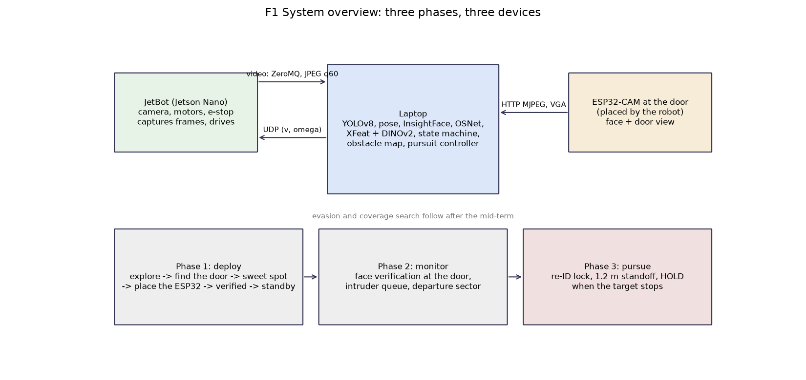

# Chương 1 — Giới thiệu

**Autonomous Collaborative Sentry Robot — CS532**

Báo cáo giữa kỳ • Đoàn Quốc Kiên, Huỳnh Nguyễn Hoài Lộc, Huỳnh Hữu Lộc • Bản tổng hợp ngày 18/11/2026, bổ sung 20/11

**Mục tiêu:** phối hợp một robot di động và một camera cố định tại cửa để phát hiện người chưa được cho phép, tiếp cận họ ở cự ly an toàn và giữ cảnh giới khi họ đứng yên. Ứng dụng hướng tới phòng học hoặc phòng làm việc có một cửa vào, với người vận hành giám sát và quyền dừng robot bằng tay cầm.

## 1.1 Bài toán và ba pha

| Pha | Đầu vào | Xử lý và đầu ra dự kiến |
| :-- | :-- | :-- |
| 1. Triển khai | Video robot, tham chiếu cửa, hiệu chuẩn | Tìm cửa, chọn điểm quan sát, yêu cầu đặt ESP32, xác minh và lùi về chờ |
| 2. Giám sát | Luồng ESP32 tại cửa, whitelist | Xác thực khuôn mặt, tạo hồ sơ người lạ với appearance/sector, đưa vào FIFO |
| 3. Đánh chặn | Video robot, mục tiêu đang hoạt động | PURSUE → HOLD; tìm lại người mất dấu; xử lý người tiếp theo |

Đầu ra phần mềm là trạng thái, lời nhắc âm thanh, hồ sơ mục tiêu và lệnh vận tốc (v, w). Laptop giữ mô hình thị giác và điều phối; JetBot thu hình và chạy động cơ; ESP32 cung cấp góc nhìn tại cửa. Khả năng tự hành được giới hạn bởi độ tin cậy khoảng cách vật cản và định vị không encoder.

## 1.2 Phạm vi đã triển khai

Đã có các module truyền hình/điều khiển, định vị dead reckoning–ArUco, nhận diện cửa, face/re-ID/tracking, hàng đợi, máy trạng thái và bộ điều khiển bám/giữ vị trí. Phase 2 live do Huỳnh Nguyễn Hoài Lộc chủ trì (#114/#115); phần nối queue với Phase3Runner và kiểm thử CPU/mô phỏng do Huỳnh Hữu Lộc phụ trách; các lượt robot hiện có là thử có giám sát, chưa chứng minh vòng đầy đủ không can thiệp. Né tấn công và coverage search trên robot là mục tiêu sau giữa kỳ.

**Phạm vi số liệu:** kết quả laptop RTX 5060, laptop RTX 4050 và Jetson được ghi riêng. Dữ liệu pilot, dev-val, mô phỏng và thử robot không được dùng thay nhau để nghiệm thu. PR #108 đã merge vào main; mã và số liệu được kế thừa qua rebase. Registry ghim commit:path và SHA256, giữ ngày/thiết bị của từng phép đo. [S0, D13]

**Tình trạng bàn giao:** đây là bản editor; PDF được render để review và chỉ commit tại freeze tag; chốt nội dung theo lịch 18–22/11 và nộp 23/11. Các phép đo còn thiếu được giữ là pending trong chương 7–8.

<!-- pagebreak -->

# Chương 2 — Kiến thức và phương pháp đã nghiên cứu

## 2.1 Phương pháp được dùng trong hệ thống

| Công trình | Kiến thức áp dụng | Vị trí trong dự án |
| :-- | :-- | :-- |
| Kannala & Brandt, TPAMI 2006 | Mô hình camera fisheye | Hiệu chuẩn/undistort trước chiếu tia mặt sàn |
| Garrido-Jurado et al., Pattern Recognition 2014 | Mốc ArUco | Tư thế camera và hiệu chỉnh định vị |
| Collins & Bartoli, IJCV 2014 | IPPE cho mặt phẳng | PnP marker vuông, loại nghiệm sai |
| Siegwart et al., MIT Press 2011 | Động học robot vi sai | Unicycle, dead reckoning, sai số odometry |
| Fischler & Bolles, CACM 1981 | RANSAC | Homography, kiểm tra hình học cửa |
| Potje et al., CVPR 2024 | XFeat | Đặc trưng cục bộ để ghép cửa |
| Oquab et al., TMLR 2024 | DINOv2 | Descriptor cửa khi khác camera tham chiếu |
| Deng et al., CVPR 2019; Chen et al., CCBR 2018 | ArcFace / MobileFaceNets | Face embedding và so whitelist |
| Zhou et al., ICCV 2019 / TPAMI 2021 | OSNet / OSNet-AIN | Re-ID giữa góc cửa và robot |
| Zhang et al., ECCV 2022 | ByteTrack | Liên kết detection confidence cao/thấp |
| Cristian, Distributed Computing 1989 | Clock synchronization | Echo RTT, so timestamp video |
| Hart et al., IEEE TSSC 1968 | A* | Nối viewpoint trên occupancy grid; phần robot còn dự kiến |

## 2.2 Lựa chọn và giới hạn

ORB được dùng làm baseline của bài so nhận diện cửa trước khi chọn XFeat. Homography cung cấp kiểm tra hình học và bearing nhưng không tự cho khoảng cách cửa khi thiếu tỷ lệ metric. DINOv2 hỗ trợ tham chiếu khác camera, với chi phí tính toán lớn hơn.

YOLOv8 là công cụ phần mềm phát hiện đối tượng; fine-tune D5 điều chỉnh cho góc nhìn thấp, nhưng không loại được phản chiếu sàn. SegFormer-B0/ORG là thí nghiệm phát hiện tiếp xúc/free-space, chưa được nhận làm detector mặc định. Những lựa chọn này được đánh giá bằng dữ liệu và các thất bại cụ thể trong chương 5.

ByteTrack ID biểu diễn track, không đồng nghĩa danh tính người. Tính tương đương backend trên quỹ đạo tổng hợp khác với re-ID rank-1 hoặc số ID-switch/phút trên video người thật. Định vị cũng tách kiểm thử hình học với sai số vật lý do sàn, pin và gá camera.

**Thư mục tham khảo đã đối chiếu:** [Mid-Term Report Plan, mục 2](../docs/Mid-Term%20Report%20Plan.md), [phương pháp Huỳnh Nguyễn Hoài Lộc](HuynhNguyenHoaiLoc/midterm/chapter-05-current.md) và các bản thảo nguồn trong [registry editor](kouun-rokku/week-07/editor-sources.md). Tên công trình ở bảng giữ đúng phạm vi đã đọc và áp dụng; coverage/A* chưa được trình bày như kết quả robot.

<!-- pagebreak -->

# Chương 3 — Kiến trúc hệ thống

## 3.1 Phân chia thiết bị

Laptop Windows 11 với RTX 4050 6 GB là cấu hình mục tiêu; laptop RTX 5060 8 GB được dùng song song để phát triển và đo riêng. Laptop chạy detector, pose, face, OSNet, XFeat/DINOv2, hàng đợi và máy trạng thái; phát lời nhắc qua loa laptop. Robot không có loa trong cấu hình hiện hành.

JetBot dùng Jetson Nano 4 GB, Ubuntu 18.04/Python 3.6. Chế độ chính chỉ capture/nén ảnh và thực thi vận tốc từ laptop. `common/` và `jetson/` được giữ tương thích Python 3.6, độc lập môi trường laptop. Chế độ TensorRT trên robot là phần mở rộng đã benchmark riêng, chưa thay kiến trúc chính.

ESP32-CAM đặt tại cửa. OV2640 có JPEG phần cứng và HTTP MJPEG; GC2145 dùng luồng ô ảnh UDP. Phần ảnh vào được xử lý trên laptop; handoff appearance không gửi vector sang JetBot.



## 3.2 Giao diện giữa các module

Perception trả detection, embedding, tọa độ tương đối và timestamp. Queue giữ identity cùng appearance/sector. StateMachine xử lý sự kiện; Phase3Runner gọi controller và chiếu lệnh về miền hợp lệ của bộ trộn bánh. Transport gửi (v, w) tới JetBot, không chạy model trên đường điều khiển.

Mô hình phân tách cho phép replay bằng cùng API logic mà không có motor. Kiểm thử đó chứng minh contract và chuỗi sự kiện, không chứng minh độ trễ hai camera thật, độ chính xác identity hay độ an toàn vật lý.

**Nguồn:** cấu trúc mã đã tích hợp PR #101; chương 3 bản thảo ngày 13/11 [D13]. Các tool PR #108 đã được nhận qua main; bằng chứng vẫn giữ ngày và điều kiện đo gốc.

<!-- pagebreak -->

## 3.3 Liên kết, timestamp và an toàn

| Đường truyền | Cấu hình | Dữ liệu và giới hạn |
| :-- | :-- | :-- |
| JetBot → laptop | ZeroMQ 5555, JPEG q60 VGA | Chỉ lấy frame mới nhất; phụ thuộc chất lượng Wi-Fi |
| Laptop → JetBot | UDP 5556, khoảng 30 Hz | Lệnh chuẩn hóa (v, w); watchdog khi ngừng nhận |
| Đồng bộ đồng hồ | UDP echo 5557 | Lọc RTT nhỏ nhất; độ trễ video cần hiệu chỉnh đồng hồ |
| ESP32 → laptop | MJPEG hoặc tile UDP | Luồng cửa riêng, không coi timing profiler là live dual-stream |

Ba thiết bị dùng cùng hotspot điện thoại 2,4 GHz theo quyết định 14/11. Hai lượt video 120 s ngày 12/11, robot cạnh laptop: median decode latency 46 ms, p95 128 ms, p99 192–199 ms; nhận 19,6/19,4 FPS. Cả FPS và p95 chưa đạt ngưỡng ≥20 FPS/p95≤50 ms. Đây là kết quả khác phép đo 53 ms của tuần 1. [S0, D13]


Dead-man/e-stop yêu cầu vũ trang bằng Start và giữ R1; thả R1 hoặc nút khác thì dừng. Watchdog danh định 300 ms. Đo wheels-up ngày 12/11: 16 lần thả R1 cắt điện motor median 7 ms (5–11 ms); năm lần nút khác 7–8 ms. Đó là timestamp điện trên Jetson, chưa gồm độ trễ không dây tay cầm hay thời gian dừng cơ học. [D13]

Các sửa SIGTERM, rate limiter và tool tiếp cận PR #108 đã có trong main. Ngày 14/11: R1 release, robot_udp ENGAGED sau estop.py 17 ms, motors 0 sau 35 ms (dry-run). Rút dongle: estop.py STOPPED sau phát hiện 48 ms (motor cut riêng 6 ms), robot_udp motors 0 sau 97 ms; tắt pad khi giữ R1: motor cut riêng 6 ms. Các ca motor thật kê bánh; không đo từ lúc rút vật lý hoặc thời gian dừng cơ học. [D14] Ngày 16/11 sau triển khai audit, một lượt kiểm tra bánh kê ghi R1 cut 10 ms, motors-zero sau log STOPPED 78 ms; nút khác 6 ms/38 ms, raw log còn local. [D16]

<!-- pagebreak -->

# Chương 4 — Robot, hiệu chuẩn và định vị

Camera fisheye 160° có lens cao 0,100 m. Intrinsics OpenCV được khớp từ 52 ảnh checkerboard còn lại sau loại ảnh lỗi: RMS 0,83 px. Chiều cao đo bằng thước, không tối ưu lại từ dữ liệu để làm giảm sai số. [C1]


Khoảng cách sàn dựa vào ray sau undistort và pose theo session. Sai số một pixel xấp xỉ d²×0,0033/H: khoảng 0,11 m ở 1,8 m và 0,19 m ở 2,4 m với H=0,100 m. Bbox bottom nằm thấp hơn chân 3–7 px; thiếu contact hoặc phản chiếu phải trả unknown thay vì dùng khoảng cách giả. Camera đổi pitch sau khi nhấc robot, nên `self_pose` trước mỗi lượt là yêu cầu vận hành; `LiveTilt` hiệu chỉnh động cho sai số 0,5–6,0% tĩnh và 3,0–20,0% động ở mức một phần. [D13, H1]

Robot không encoder; IMU đã lắp nhưng hỏng, đang sửa và chưa dự kiến có trước 23/11. Gains dead reckoning vẫn là tuần 2; fit theo sàn còn hoãn. [D16] Dead reckoning tích phân mô hình vi sai có vùng chết; ArUco sửa pose khi marker hợp lệ. Độ lệch chạy thẳng thay đổi theo sàn, pin và mức lệnh, không thể dùng một drift cố định cho mọi buổi. 13 lượt chạy thẳng trong 11–12/11 dao động −16 đến +59°/m; đây là bằng chứng #108 đã merge, không được dùng thay phép hiệu chuẩn trong `calib/motion.json`. [D13]


Một lượt có sửa ArUco đạt 14,5 cm sau khoảng 3 m, thuần DR lệch 98,3 cm. Đây là thử định vị riêng; thuần DR chưa đạt ngưỡng 40 cm. T2 tiếp cận cửa có 7 lượt được tính: 4 ngày 30/10, 2 ngày 14/11 và 1 ngày 16/11 (lượt find-door 20/11 không được tính vào đó: các câu hỏi tape để trống; cự ly cửa nay không cần đo thước mỗi lượt). Lượt 16/11 STANDBY sau 30,7 s, tape door 2,93 m, 0 va chạm; DR tại vantage lệch 0,593 m nên pass dựa tape, không chứng nhận DR. Handshake rehearsal chỉ 1 accept và 1 reject hợp lệ, chưa 10/10. [D14, D16] Kết quả tiếp cận cửa hiện tại chỉ trên một cửa/ngày và còn phụ thuộc đo thước, không chứng minh tự định vị toàn phòng. [C2, D13]

Pose camera ngày 20/11 được tự hiệu chuẩn trên bốn mặt tháp ESP32 (`tower_register`, marker 50 mm id 10–13, mỗi mặt 30 frame): pitch từ −11,09° đến −11,68°, median −11,29°, độ lệch chuẩn giữa các mặt 0,21° (chênh lớn nhất 0,59°). Lần đăng ký đầu trong ngày, đứng gần tháp 0,21–0,25 m, cho −11,67° (`camera_pose_tower_1120_1.json`, chênh 0,38° so với giá trị dùng); giá trị dùng là lần thứ hai. Mặt trước (id 11) gắn xoay 180° trong mặt phẳng, nên góc marker được sắp lại trước khi giải PnP. Pitch này thấp hơn 0,9° so với board 150 mm (−10,37°); chênh lệch chưa được giải thích và các độ cao tháp đã đo chưa được chỉnh lại. [D20]

<!-- pagebreak -->

# Chương 5 — Nhận thức thị giác và tối ưu

## 5.1 Vật cản, contact và bản đồ

Pipeline YOLO phát hiện bbox, ước lượng điểm tiếp xúc rồi chiếu xuống mặt sàn. Bbox cắt mép, contact không rõ hoặc phản chiếu không giải được thì từ chối khoảng cách. FREE trong occupancy grid chỉ đến từ footprint/seen-floor đã xác nhận; UNKNOWN vẫn chặn đường và line-of-sight. Vantage cần reachable, clearance và vị trí cửa/world truth. Chưa có sweep đủ truth để nghiệm thu F11. [H1]


Median/p90 relative error của các ID có estimate là 5,34%/20,91%; ba vị trí held-out là 5,37%/17,11%. P90 tổng vượt 20%, chưa đủ ≥20 IDs và điều kiện độc lập. Bộ ghế glossy 09/11 có 0/36 khoảng cách hợp lệ; không diễn giải thành sai số bằng không. [H1, H2]

D5 có 397 ảnh, split 307 train/90 dev-val cùng phòng/session và đã dùng chọn checkpoint/input. YOLOv8n-640 đạt mAP50 khoảng 0,810, leg recall 0,960, wire recall 0; chưa nghiệm thu recall từng class hoặc empty-floor alarms. 12 wire masks mới là annotation pilot. [H1]

ORG/SegFormer-B0: trên ruler D1 24 vật, configured tìm 1/24, obstacle-route 8/24, free-space 6/24. Median error 0,041 m chỉ trên tám vật tìm được. Glare, ghế và missing objects vẫn là thất bại; không nhận mô hình làm default chỉ vì subset có error thấp. Width fallback của ghế là proposal một loại ghế, chưa tích hợp detector. [H2, D13]

## 5.2 Nhận diện cửa

XFeat + RANSAC kiểm tra hình học; DINOv2 hỗ trợ reference khác camera. Ngưỡng phải được hiệu chuẩn bằng negative sweep theo cửa. F12 so baseline ORB với XFeat/DINOv2; kết quả nhận cửa không chứng minh door range hoặc bắt tay đủ 10/10 đặt lại camera. Cự ly cửa không do detector trả về mà suy ra từ diện tích khung viền khớp so với một mốc tham chiếu lưu cùng enrolment (`ref_range_m`, đo một lần mỗi phòng, 1,96 m cho cửa lớp): range = ref·(A_ref/A)^(1/2). Ở hai lượt `approach_door` ngày 20/11, ước lượng khi dừng là 2,21 và 2,12 m (tape ghi tay 2,25 và 2,11 m), nhưng ước lượng đầu lượt thấp khoảng 10% ở lần đo 2,91 m so với tape 3,23 m (một lần đo). [K1, D20]

<!-- pagebreak -->

## 5.3 Whitelist, re-ID và tracking

SCRFD/MobileFaceNet tạo face embedding 512D chuẩn hóa; so maximum cosine với whitelist, ngưỡng hiện hành 0,45. D2 cafe pilot có 125 face frames, 21 entries, ba người: TAR 82,99%, FAR 46,40%. Queries liên tiếp tương quan, nhãn tự động cần review; chưa đạt TAR≥95% tại FAR≤1%. [H1]


Camera opt4 và guided enrollment trong phép thử ngày 13/11 cho mặt rộng 68–91 px ở 3,0–1,8 m. Ngày 14/11, ngưỡng cố định 0,45: TAR 822/877 = 0,937 (clip bootstrap [0,904; 0,970]); FAR 0/1754 straight-frame impostor scores. FAR gate đạt trên bộ này, TAR≥95% chưa được thiết lập. Chỉ ba người cùng một session, mỗi người so với hai enrolments còn lại; không suy ra population FAR. Ngưỡng 0,45 vẫn provisional (#118). [D14] [D13]

Phase 2 live do Huỳnh Nguyễn Hoài Lộc chủ trì (#115). Pilot 14/11 trên RTX 5060: 3 authorized/3 queued, coverage segment 50% mỗi cohort, 5 unresolved và 1 interrupted; median enqueue 9,387 s, hai người cùng session, chưa T1. Ngưỡng 0,45 provisional (#118). [H7] Ngày 16/11, đăng ký lại năm tư thế cho Đoàn Quốc Kiên rồi chấm lại cùng clip: TAR của Đoàn Quốc Kiên vẫn 0,930 (279/300 khung thẳng, cùng 21 frame dưới 0,45); còn thiếu người lạ ngoài nhóm và đăng ký lại cho Huỳnh Hữu Lộc, CSV lần chấm lại còn local. [D16]

OSNet-AIN x1.0 và x0.25 đều chạy, nhưng 23 body crops hiện chưa tạo được gallery/query hợp lệ; thiếu gallery ở 2/3 người. Gate vẫn là ≥5 identities, rank-1≥85%; chưa có F14 đủ điều kiện. [H1]

ByteTrack dùng chuyển động/IoU và detection confidence thấp để nối track. Khóa/re-lock appearance cần cùng architecture, weight hash, preprocessing, cosine/margin và xác nhận qua hai frame. Vector/queue/tracker chạy trên laptop; JetBot nhận (v, w). Mất dấu/mơ hồ không được xem track ID là identity. [H1, K1]

Vendor ByteTrack đạt 407/407 synthetic ID agreement với backend tham chiếu, là T0 parity. Replay 822 frame D2 chứng minh runtime, chưa có body-ID truth/timestamp chuẩn để nghiệm thu ≤1 ID-switch/phút trên D3 ≥60 s, hai người. [H1, K1]

<!-- pagebreak -->

## 5.4 Ngân sách GPU trên laptop

Profiler nạp detector, OSNet, pose, face và cửa; có synthetic body/face padding khi thiếu detection, lập lịch tuần tự và sampled NVML. Kết quả workload không gồm đủ transport/control và hai camera thật, cũng không đo accuracy. DINO FP16, các Torch model khác FP32. Giới hạn VRAM 5,5 GB decimal khác 5,5 GiB. [H1, D13]

| Thiết bị / workload | FPS | p95 ms | Peak GiB / door Hz |
| :-- | --: | --: | :-- |
| RTX 5060, all mỗi frame | 12,72 | 90,75 | 0,939 / không schedule |
| RTX 5060, door scheduled | 19,65 | 87,62 | 0,939 / 4,52 |
| RTX 4050, all mỗi frame | 9,20 | 138,05 | 0,894 / không schedule |
| RTX 4050, door scheduled | 19,23 | 121,36 | 0,890 / 4,61 |

Dòng RTX 4050 lấy từ file JSON đo ngày 13/11 đã merge trong main; commit:path và SHA256 trong registry. Cờ `t1_accepted`/`target_rtx4050_verified` trong nguồn vẫn false. Hai GPU có điều kiện/power khác nhau, chưa phải so sánh có kiểm soát. Scheduled FPS vượt 15 nhưng door thực chưa 5 Hz; không tự coi toàn pipeline realtime đã đạt. [D13]


Cùng 90 ảnh dev-val, batch 1, mỗi precision process riêng: FP32/FP16 đạt 123,59/107,38 FPS, p95 12,01/16,35 ms; Torch allocated 32,41/17,53 MiB; mAP50 81,071%/81,072%. FP16 giảm allocator nhưng chậm hơn lần này; không kết luận FP16 tốt hơn nói chung. Timing gồm predict/preprocess/NMS và kiểm tra dtype, không gồm disk/video/control; chưa TensorRT hay independent accuracy. [H1]

<!-- pagebreak -->

## 5.5 Chuyển đổi và triển khai Jetson Nano

Model xuất ONNX trên laptop, xây TensorRT 7.1.3 FP16 trên Nano, batch 1/fixed shape. Nguồn 16/10 cho GPU time YOLOv8n-320 14,8 ms (FP32 20,7), pose 15,7 ms, OSNet x0.25 9,3 ms, AIN 26,6 ms; DINOv2-S 359,5 ms nên giữ trên laptop. Đây là latency model, không phải FPS cả vòng. [D13, E1]


SCRFD Resize opset 11 tạo sai khác trên TensorRT 7.1; lớp này được thay từ nearest-neighbor 2× sang grouped ConvTranspose. Stock-model cosine gần 1 không chứng nhận custom D5 hoặc re-ID độc lập. D5 ONNX parity laptop có 90/90 count, 294 reference boxes ghép IoU≥0,9; khác nghiệm thu accuracy/edge. [H1, E1]

| Bench Nano | FPS | p95 capture-to-result |
| :-- | --: | --: |
| 16/10, không người, stage B | 20,00 | 51,1 ms |
| 13/11, có người, stage B 60 s | 19,75 | 89,2 ms |
| 13/11, cửa ESP32 thật, 60 s | 17,7 / 17,1 | 118,5 / 123,9 ms |
| 13/11, cửa thật, người ngồi 600 s | 14,45 | 153,0 ms |

Lượt dài 600 s có RAM khoảng 2,13 GB, GPU tối đa 38,5°C, pin khoảng 11,96→11,72 V; vẫn chưa đủ 15 phút. Edge gate ≥20 FPS/p95≤100 ms chưa đạt với người và ESP32 thật. Lượt 16/10 không người/ảnh cửa tĩnh không thay kết quả mới. Các số 13/11 là bằng chứng từ #108 đã merge, không có motor/e-stop trong vòng benchmark. [D13]

<!-- pagebreak -->

# Chương 6 — Hành vi và điều khiển

StateMachine nhận event có timestamp và trả Command(v, w, play, actions, target_id). Phase3Runner nối hàng đợi, hold detector và controller. Logic CPU tách khỏi socket/hardware để replay và kiểm thử xác định. [K2]


TargetQueue giữ FIFO và vector chuẩn hóa. TARGET_EXITED hoàn tất người hiện tại, chuyển SEARCH cho người tiếp theo hoặc STANDBY khi hết queue. Handoff reset observation, dwell/filter/controller và yêu cầu mẫu mới đúng identity.

HoldDetector chiếu target sang world theo pose robot, vào HOLD khi speed<0,1 m/s đủ 2 s và thoát khi >0,2 m/s. Bù pose giảm sai lệch do robot xoay, còn chịu drift odometry.

**Find-door (20/11).** `FindDoorRunner` không dùng toạ độ cửa: robot đứng yên đo bearing và diện tích khung cửa (median), quay theo bearing đo được (±8°) và chỉ tiến từng nhịp khi cự ly ước lượng lớn hơn stand-off 2,25 m; ngưỡng quãng đường theo tốc độ xấu nhất chặn việc tiến vô hạn. Cổng đặt tháp (`PlacementGate`) chỉ cho handshake tính khi marker lưng (id 10) nằm trong 0,20–0,30 m và ±15° liên tục 1 s. Lượt thật (lần thứ tư trong ngày; ba lượt trước dùng bản runner quét cũ, một không tìm thấy cửa sau 45 s, một dừng vì R1 bị nhả khi đang quét, chưa thấy cửa, một dừng vì R1 bị nhả khi chờ đặt tháp; ngoài ra hai lượt T2 `--tower-place` với vantage thủ công cũng dừng vì R1 bị nhả ở 14,1 và 17,2 s): ước lượng ban đầu 3,45 m, quay trái 32°, 18 lần đo trong 35,8 s, dừng khi ước lượng còn 2,21 m; cổng mở (140 frame trong vùng cho phép, trên 756 frame cả lượt), handshake đạt ở 54,3 s (25/194 frame thấy cửa, inliers cuối 53, tối đa 62, ngưỡng 27), STANDBY ở 56,3 s, tổng 58,6 s. Tape ghi tay sau lượt: tháp–cửa 1,9 m; robot–cửa 2,1–2,2 m (xấp xỉ, vị trí đo không được ghi: khớp điểm dừng; sau khi lùi khoảng 0,3 m theo DR, robot còn xa cửa hơn, khoảng 2,4 m nếu tháp–cửa 1,9 m). Chưa có tìm kiếm tịnh tiến: cửa không vào khung khi xoay tại chỗ thì runner báo không tìm thấy. [D20]

Live 16/11: tracked 99,7%, cự ly 1,2±0,2 m chỉ 32% (gate 80%, chưa đạt), centred 91%, 0 HOLD event. Điều kiện: glossy, 5 W giả định từ lần đọc cuối buổi, mã robot trước audit, gói điều khiển unsigned. Ngày 16/11 tháp chưa được né như vật cản (thử né tháp ngày 18/11 và 20/11: mục 7.2). [D16]


HOLD giữ v=0, chỉ yaw recenter. PURSUE nhắm 1,2 m và dùng estimate vật cản. Projector kiểm tra vùng chết 0,40, NaN/±Inf dừng trước saturation. STRIKE có xung 400 ms, thử robot thuộc sau giữa kỳ.

**Sửa #101** xử lý mỗi timestamp một lần ở cả hai API, stale/wrong-ID không tiến dwell. Observation quá 0,25 s dừng motor, gap>1 s hoặc TARGET_LOST giải phóng HOLD và đồng bộ mode. [K2]

Mô phỏng scripted ghi HOLD 6,32 s, resume 8,26 s, v=0 trong HOLD, hai targets hoàn tất và lệnh hợp lệ. [K2]

<!-- pagebreak -->

# Chương 7 — Kiểm thử và kết quả

## 7.1 Tầng kiểm thử và tái hiện

| Tầng | Điều kiện | Có thể kết luận |
| :-- | :-- | :-- |
| T0 | CPU, dữ liệu tổng hợp, fake transport, SimRobot | Logic hình học, contract, chuyển trạng thái, guards |
| T1 | Replay có nhãn/truth và protocol định trước | Accuracy/latency theo bộ dữ liệu và thiết bị ghi rõ |
| T2 | Robot/ESP32 thật, pin và điều kiện có kiểm soát | Hành vi vật lý đủ số lượt, không suy từ T0 |

Checkout sạch trên nhánh sau tích hợp `#130` và `#131` (commit, tree, command và dependency versions ghi trong `week-07/clean_checkout_pytest.log` và `week-07/validation.json`): bộ CPU/replay pass không có lỗi ngoài các mục skip thiếu dữ liệu/weights/tùy chọn và 4 ca GPU/HIL bị loại trừ. Số test chỉ áp dụng cho đúng commit được log, không chứng nhận model/GPU hoặc phần cứng. Kết quả cũ 754/773 không dùng để chứng nhận bản sửa này. [K3]

Checkout sạch tuần 7 clone từ commit candidate được ghi riêng cùng tree SHA, Python/dependency versions, command, exit code và pytest output. Chỉ dùng môi trường package đã cài của máy; D5 và ZIP D2 vẫn tracked theo quyết định nhóm; không copy dữ liệu local bổ sung, weights hoặc `.venv` vào clone. Model/GPU environment được ghi riêng nếu thiếu; CPU/replay không chứng nhận full inference setup. [K3]


Checker gói nộp đọc **committed export** qua index tạm từ `git read-tree`, cùng pathspec với `git archive`. Dữ liệu phát triển vẫn tracked; data/team_data/recordings/weights chỉ bị loại khỏi ZIP. `--index` chỉ hỗ trợ pre-commit. Các path data/recordings/weights, secret filenames và model binaries bị từ chối. Checker theo tên file không phải kiểm toán nội dung hoặc lịch sử Git.

Gói ZIP lấy từ `git archive` của đúng commit, không chứa `.git`; manifest lưu SHA256 từng file. Test xác nhận workspace bẩn không lọt vào ZIP, dữ liệu tracked không bị xóa khi tạo ZIP, secret ngoài vùng loại vẫn làm HEAD fail, file output cũ không bị ghi đè. [K3]

<!-- pagebreak -->

## 7.2 Bảng đối soát nghiệm thu

| Hạng mục | Bằng chứng hiện có | Trạng thái so với gate |
| :-- | :-- | :-- |
| Video JetBot | 12/11: 19,4–19,6 FPS, p95 128 ms | Chưa đạt ≥20 FPS/≤50 ms; #108 |
| E-stop | Dry 305–315 ms; R1 7 (12/11), 35/97 (14/11), 10/78 ms (16/11) | Unsigned; chưa đo dừng cơ học |
| Fisheye / LiveTilt | RMS 0,83 px (52 ảnh); LiveTilt 0,5–6% tĩnh, 3–20% động | Fisheye đạt; LiveTilt một phần |
| DR + ArUco / T2 cửa | 7 lượt T2 cửa; handshake 1 accept/1 reject | DR 98,3 cm chưa đạt; chưa 10/10 |
| Khoảng cách ghế | 8/9 IDs, p90 20,91%; bộ mới 0/36 | Chưa p90≤20%/≥20 IDs/độc lập |
| D5/Wire | 307/90 cùng session; wire recall 0 | Dev-val, chưa T1/class gates |
| Face whitelist | 14/11: 822/877 genuine; 0/1754 impostor | 3 người; FAR đạt, TAR 95% chưa đạt |
| Re-ID/tracking | Parity/replay; Sector 99,7% (T0) | Chưa gallery≥5/D3≥60 s/truth |
| Pursuit/HOLD | 16/11: tracked 99,7%, dải 32%, tâm 91%, 0 HOLD | Không PASS: dải <80%; chưa HOLD |
| Pursuit + tháp 20/11 | 31 s: tracked 34,3%, dải 9,4%, tâm 23,7% (mất mục tiêu 5 s); 105 s: 59,6%, 18,1%, 47,6%; 0 HOLD; tower avoid 4 và 9 lần, không abort | Không PASS: dải <80%; chẩn đoán (D20) |
| Find-door + handshake | 20/11: STANDBY 56,3 s (tổng 58,6 s); ước lượng dừng 2,21 m (tape ghi tay robot–cửa 2,1–2,2 m, tháp–cửa 1,9 m); 25/194 frame thấy cửa, inliers cuối 53 | 1 lượt thật, chưa lặp; tape xấp xỉ; chưa 10/10 |
| Né tháp ESP32 | Steer ~0,4 m; bám 120 s: 13 triggers (12 xong), 67,2%/9,2%/40% | 18/11 (`tower_avoid_1118/`); tắt det. |
| GPU laptop | Scheduled 5060 19,65; 4050 19,23 FPS | Door Hz<5; chưa dual-stream T1 |
| Edge live | 14,45 FPS/p95 153 ms ở 600 s | Chưa ≥20 FPS/≤100 ms/15 phút |
| Vòng đầy đủ | Module, Hold 2 s, Standoff v=0 (T0) | Chưa ≥4/5 không can thiệp |


Lượt 16/11: sàn glossy, 5 W (cuối buổi), code trước audit, gói unsigned, chưa tower avoidance; bổ sung 18/11 thử `TowerSteer` theo marker khi tắt detector tổng quát [D18]; gains DR vẫn tuần 2. Phase 2 live do Huỳnh Nguyễn Hoài Lộc chủ trì; pilot #115 gồm 3 authorized/3 queued, coverage 50%, chưa T1. [D16, H7]

Lượt 20/11: sàn glossy (`--floor` unknown), pin 11,6 V, pose tháp `camera_pose_tower_1120_2.json`; gói điều khiển unsigned; lượt 1 tháp ở 0,56 m, 6,7° trước robot nên tower avoid kích hoạt ngay frame đầu, lượt 2 tháp ở 0,65 m, 53°; tower avoid chiếm 251/620 và 483/2088 frame; detector vật cản tổng quát bật (chặn 140 và 244 frame, khác dòng 18/11 tắt detector nên hai dòng không so sánh trực tiếp); lượt 2 đổi `--lost-end-s` 5→20 s và `--seconds` 90→105 s. Pursuit chạy ngay sau một lượt find-door đã STANDBY, không phải T2 độc lập. [D20]

Không cộng frame liên tiếp thành lượt độc lập; không bỏ missed objects khi tính error. Các khối đã có mã và bằng chứng phát triển, nhưng các gate hệ thống chính vẫn pending. Nguồn: [registry](kouun-rokku/week-07/editor-sources.md), H1/H2/D13/D18/C1/C2/K2; D20 theo mục A.3.

<!-- pagebreak -->

# Chương 8 — Kết quả kỳ vọng và kế hoạch

## 8.1 Mốc bàn giao

| Mốc | Kết quả cần có | Chủ trì |
| :-- | :-- | :-- |
| 16/11 | Đóng thí nghiệm giữa kỳ, chốt hình/nhãn nguồn | Cả nhóm |
| 18/11 | Bản draft chung | Huỳnh Hữu Lộc (Editor) |
| 19/11 | Quay các cảnh còn lại tại lớp, gồm Phase 2 | Cả nhóm |
| 20–22/11 | Review/PR freeze 20/11; dựng 20–21/11, chốt video 22/11 | Cả nhóm |
| 21–23/11 | Tag main sau review, PDF/video final, nộp 23/11 | Cả nhóm |
| Tuần 8–9 | Evasion, reaction-time, coverage path theo gate | Chủ sở hữu từng module |
| Tuần 10–13 | Search trên robot, loop nhiều người, stress và buffer | Cả nhóm |

Kỳ vọng vòng đầy đủ ≥4/5 không can thiệp, tìm T2 ≥4/5, search exhaustion 3/3 không va chạm. Các con số là mục tiêu, chưa phải kết quả. `r_det` 3,0 m vẫn là placeholder phải đo. Bất kỳ phần nào chưa làm ổn ở thời điểm freeze đều ghi in progress, không hạ ngưỡng để chạy kịp báo cáo. [S0]

## 8.2 Rủi ro và việc tiếp tục

**Bổ sung sau đóng băng, 18/11 (ký túc xá):** nhánh thử tránh tháp giữ tối thiểu ~0,4 m theo tape (`steer_a`, không chạm). Pursuit 120 s với `TowerSteer` và `--search` (tắt detector vật cản tổng quát vì 2 ghế xa 3 m bị nhận là gần trên sàn bóng) ghi 13 triggers, 12 hoàn tất, một còn active, tracked 67,2%, trong dải 9,2%, căn tâm 40%, lặp tiến–tránh quanh tháp (6 lần trong 45 s cuối). Có ba HOLD rows trong ~0,14 s (không theo protocol đứng yên). Motion fit bị từ chối vì tỷ lệ forward phân tán (0,56–0,87). Các lượt này thiếu protocol nghiệm thu và được tách khỏi kết quả 16/11. [D18]

- **Sàn bóng:** contact ghế không giải được; cần held-out floor/chair/empty-floor controls và rule fallback đã freeze. ORG hoặc width cue chưa là model mặc định.
- **Pose/motion:** camera gá xê dịch, drift đổi theo sàn/pin/lệnh; mỗi lượt đo lại pose, giữ phạm vi thử có giám sát và kiểm pin.
- **Face/re-ID:** guided enrollment cải thiện genuine scores nhưng còn impostors, gallery/body-ID truth; quyết định ngưỡng/model thuộc perception owner.
- **Video/edge:** latency và FPS chưa đạt trong điều kiện mới; cần đo đủ protocol, không lấy benchmark không người để thay thế.
- **Find-door:** chưa có tìm kiếm tịnh tiến (tiến–lùi) nên nếu cửa không lọt vào khung hình khi robot xoay tại chỗ thì lượt chạy thất bại (giới hạn đã biết); cần một `ref_range_m` mỗi phòng và sai số khoảng −10% ở một lần đo 3,23 m; khi tiến không có kiểm tra vật cản (chỉ R1 và ngưỡng quãng đường); mới một lượt thật thành công, chưa lặp. [D20]
- **Tích hợp:** Phase 2 live và graded T2 chưa đủ; dùng replay có nhãn trong video khi thiếu cảnh thật, không trình bày như robot đã chạy.
- **Bàn giao mã:** D5, ZIP D2 và default password được giữ theo quyết định nhóm. Chỉ ZIP nộp bài loại data/team_data/recordings/weights; không chứa lịch sử. Tag `midterm` trên main chờ freeze/review.

Bản tuần 7 hoàn thiện công việc editor và gói review từ những nguồn hiện có. Nó không tạo thay thí nghiệm vật lý, chữ ký owner hay lịch sử đã được làm sạch. PDF hiện tại là snapshot review, video cuối được cập nhật khi hoàn tất cắt dựng. [D13, K3]

<!-- pagebreak -->

# Phụ lục A — Mã nguồn, tái hiện và nguồn

## A.1 Module / owner / tests

| Module | Owner | Kiểm tra chính |
| :-- | :-- | :-- |
| StateMachine, TargetQueue, Phase3Runner | Huỳnh Hữu Lộc | state_machine, target_queue, phase3_runner |
| HoldDetector, controllers, tower_avoid | Huỳnh Hữu Lộc / Đoàn Quốc Kiên | hold_detector, controllers, tower_avoid; T0 |
| Localization, wheel model | Huỳnh Hữu Lộc / Đoàn Quốc Kiên | localization, wheel_model; T2 chưa đủ |
| Entrance / sector / audio | Huỳnh Hữu Lộc / Đoàn Quốc Kiên | entrance, sector, audio |
| Phase 2 live / door monitor | Huỳnh Nguyễn Hoài Lộc; Huỳnh Hữu Lộc nối queue | phase2_live, phase2_reid, phase2_replay |
| Obstacle, face, re-ID, tracker | Huỳnh Nguyễn Hoài Lộc | obstacle, face, reid, tracker; gates T1 riêng |
| Net / clock / streams | Huỳnh Nguyễn Hoài Lộc / Huỳnh Hữu Lộc | camera_pub, clock_sync, mjpeg_rx |
| Jetson / ESP32 / motor interlocks | Đoàn Quốc Kiên / Huỳnh Hữu Lộc | estop, jetson_espcam; HIL riêng |
| Report / package tools | Huỳnh Hữu Lộc | midterm_package, page audit, PDF pages |
| FindDoorRunner, PlacementGate, session_run | Đoàn Quốc Kiên | phase1_runner (find-door), tower_markers, approach_door, deploy_live, session_run |

## A.2 Tái hiện

Cài môi trường theo `docs/Setup.md`. CPU/replay trên Linux có test-only winsound shim trong `tools/run_cpu_tests.py`; không thay âm thanh production. Logs ghi interpreter và packages. Report export cần `requirements-report.txt` và DejaVu Sans.

```text
python tools/check_env.py --cpu-ok
python -m tools.run_cpu_tests
python -m tools.render_midterm_report
python -m tools.check_midterm_page_budget --pdf reports/midterm_report.pdf
python -m tools.check_midterm_package --ref HEAD
python -m tools.tower_register
python -m tools.deploy_live --label x --find-door --handshake <thư mục> --tower-place
python -m tools.session_run --label x --camera-pose <pose> -- --handshake <thư mục> --tower-place
python -m tools.build_midterm_package --ref HEAD --out /tmp/submission.zip
```

Repo: https://github.com/DoanQuocKien/Autonomous-Collaborative-Sentry-Robot . Nhánh review: `kouun-rokku/w07-midterm-package`, gồm fix #101. Tag `midterm` trên main chờ freeze/review theo lịch; gói có thể xây từ commit đã ghi trong manifest. Video: chưa có URL cuối; [shot list và cách quay replay](kouun-rokku/midterm-appendix-a.md).

## A.3 Chỉ mục bằng chứng

S0: `docs/Implementation Plan.md`, `docs/Mid-Term Report Plan.md`. C1/C2: `calib/camera.json`, báo cáo dead-reckoning 24/10. K1/K2: tuần 4–6 (parity/hold/replay/review #101). K3: `reports/kouun-rokku/week-07/` (checkout sạch và package). H1/H2: `midterm/chapter-05-current.md`, addenda 05/11 và 11/11. E1: `docs/Edge Deployment.md`. D13: bằng chứng #108 đã merge (chapters/README/GPU/edge JSON và hình). D14: `t2_1114` và `heartbeat_dryrun_1114`; D16: `classroom_1116`; D18: `tower_avoid_1118` và `tower_marker_range_1118`; H7: pilot Phase 2 live (#115). D20: `reports/DoanQuocKien/week-07/finddoor_1120/` (find-door, pursuit, approach, tower_register; tape do vận hành ghi tay, không nằm trong summary). Registry kèm SHA256: `reports/kouun-rokku/week-07/editor-sources.md` (commit:path + SHA256).
