# Chương 1: Giới thiệu

**Autonomous Collaborative Sentry Robot (CS532)**

Báo cáo giữa kỳ • Đoàn Quốc Kiên, Huỳnh Nguyễn Hoài Lộc, Huỳnh Hữu Lộc • Bản tổng hợp ngày 18/11/2026, bổ sung 20/11.

**Mục tiêu:** robot di động làm việc cùng camera cố định ở cửa, phát hiện người chưa được phép vào, tiến tới họ ở cự ly an toàn rồi đứng canh khi họ đứng yên. Bối cảnh là phòng học hoặc phòng làm việc có một cửa vào, người vận hành theo dõi và giữ quyền dừng robot bằng tay cầm.

## 1.1 Bài toán và ba pha

| Pha | Đầu vào | Xử lý và đầu ra dự kiến |
| :-- | :-- | :-- |
| 1. Triển khai | Video robot, tham chiếu cửa, hiệu chuẩn | Tìm cửa, chọn điểm quan sát, yêu cầu đặt ESP32, xác minh và lùi về chờ |
| 2. Giám sát | Luồng ESP32 tại cửa, whitelist | Xác thực khuôn mặt, tạo hồ sơ người lạ với appearance/sector, đưa vào FIFO |
| 3. Đánh chặn | Video robot, mục tiêu đang hoạt động | PURSUE → HOLD; tìm lại người mất dấu; xử lý người tiếp theo |

Phần mềm xuất trạng thái, lời nhắc âm thanh, hồ sơ mục tiêu và lệnh vận tốc (v, w). Mô hình thị giác và điều phối nằm trên laptop, JetBot lo thu hình và chạy động cơ, còn ESP32 nhìn từ phía cửa. Mức tự hành bị giới hạn vì khoảng cách vật cản chưa đủ tin cậy và định vị không có encoder.

## 1.2 Phạm vi đã triển khai

Đã có module truyền hình/điều khiển, định vị dead reckoning–ArUco, nhận diện cửa, face/re-ID/tracking, hàng đợi, máy trạng thái và bộ điều khiển bám/giữ vị trí. Phase 2 live do Huỳnh Nguyễn Hoài Lộc chủ trì (#114/#115), phần nối queue với Phase3Runner và kiểm thử CPU/mô phỏng do Huỳnh Hữu Lộc phụ trách. Mọi lượt robot đến nay đều được giám sát, nên vòng đầy đủ không can thiệp chưa được chứng minh. Né tấn công và coverage search trên robot để sau giữa kỳ.

**Phạm vi số liệu:** số đo trên laptop RTX 5060, laptop RTX 4050 và Jetson được ghi riêng. Khi nghiệm thu, dữ liệu pilot, dev-val, mô phỏng hay thử robot không được dùng thay nhau. PR #108 đã merge vào main, mã và số liệu được giữ qua rebase. Với từng phép đo, registry ghim commit:path và SHA256, kèm ngày và thiết bị. [S0, D13]

**Tình trạng bàn giao:** đây là bản editor, PDF chỉ render để review, đến freeze tag mới commit. Nội dung chốt 18–22/11, nộp 23/11. Phép đo còn thiếu được giữ pending ở chương 7–8.

<!-- pagebreak -->

# Chương 2: Kiến thức và phương pháp đã nghiên cứu

## 2.1 Phương pháp được dùng trong hệ thống

| Công trình | Kiến thức áp dụng | Vị trí trong dự án |
| :-- | :-- | :-- |
| Kannala & Brandt, TPAMI 2006 | Mô hình camera fisheye | Hiệu chuẩn/undistort trước chiếu tia mặt sàn |
| Garrido-Jurado et al., Pattern Recognition 2014 | Mốc ArUco | Tư thế camera và hiệu chỉnh định vị |
| Collins & Bartoli, IJCV 2014 | IPPE cho mặt phẳng | PnP marker vuông, loại nghiệm sai |
| Siegwart et al., MIT Press 2011 | Động học robot vi sai | Unicycle, dead reckoning, sai số odometry |
| Fischler & Bolles, CACM 1981 | RANSAC | Homography, kiểm tra hình học cửa |
| Potje et al., CVPR 2024 | XFeat | Đặc trưng cục bộ để ghép cửa |
| Oquab et al., TMLR 2024 | DINOv2 | Descriptor cửa khi khác camera tham chiếu |
| Deng et al., CVPR 2019; Chen et al., CCBR 2018 | ArcFace / MobileFaceNets | Face embedding và so whitelist |
| Zhou et al., ICCV 2019 / TPAMI 2021 | OSNet / OSNet-AIN | Re-ID giữa góc cửa và robot |
| Zhang et al., ECCV 2022 | ByteTrack | Liên kết detection confidence cao/thấp |
| Cristian, Distributed Computing 1989 | Clock synchronization | Echo RTT, so timestamp video |
| Hart et al., IEEE TSSC 1968 | A* | Nối viewpoint trên occupancy grid; phần robot còn dự kiến |

## 2.2 Lựa chọn và giới hạn

Trước khi chọn XFeat, ORB làm baseline để so cách nhận diện cửa. Homography dùng để kiểm tra hình học và lấy bearing, nhưng thiếu tỷ lệ metric thì không tự suy ra khoảng cách tới cửa. DINOv2 hỗ trợ đối chiếu với ảnh tham chiếu từ camera khác. Đổi lại, nó tốn tính toán hơn.

YOLOv8 là phần mềm phát hiện đối tượng. Bản fine-tune D5 chỉnh cho góc nhìn thấp nhưng vẫn không loại được phản chiếu sàn. SegFormer-B0/ORG mới chỉ là thí nghiệm phát hiện tiếp xúc/free-space, chưa phải detector mặc định. Chương 5 đánh giá chúng bằng dữ liệu và thất bại cụ thể.

ID của ByteTrack chỉ là một track, không phải danh tính người. Backend tương đương trên quỹ đạo tổng hợp là một chuyện, còn re-ID rank-1 hay số ID-switch/phút trên video người thật là chuyện khác. Định vị cũng vậy: kiểm thử hình học tách khỏi sai số vật lý do sàn, pin và gá camera.

**Thư mục tham khảo đã đối chiếu:** [Mid-Term Report Plan, mục 2](../docs/Mid-Term%20Report%20Plan.md), [phương pháp Huỳnh Nguyễn Hoài Lộc](HuynhNguyenHoaiLoc/midterm/chapter-05-current.md) và các bản thảo nguồn trong [registry editor](kouun-rokku/week-07/editor-sources.md). Bảng chỉ ghi công trình đã đọc và áp dụng, còn coverage/A* chưa trình bày như kết quả robot.

<!-- pagebreak -->

# Chương 3: Kiến trúc hệ thống

## 3.1 Phân chia thiết bị

Cấu hình mục tiêu là laptop Windows 11 có RTX 4050 6 GB. Máy RTX 5060 8 GB chạy song song để phát triển, số đo được ghi riêng. Laptop chạy detector, pose, face, OSNet, XFeat/DINOv2, hàng đợi và máy trạng thái. Lời nhắc phát qua loa laptop. Robot hiện không có loa.

JetBot dùng Jetson Nano 4 GB, Ubuntu 18.04/Python 3.6. Ở chế độ chính, robot chỉ chụp, nén ảnh và chạy theo vận tốc từ laptop. `common/` và `jetson/` giữ tương thích Python 3.6, tách khỏi môi trường laptop. TensorRT trên robot mới là benchmark riêng, chưa thay kiến trúc. Dự kiến từ 23/11 các model lên Jetson dần (ONNX rồi TensorRT FP16). Laptop giữ app đồng hành, dự phòng khi Nano không chạy được. Đây mới là kế hoạch, chưa thực hiện.

ESP32-CAM đặt ở cửa. OV2640 có JPEG phần cứng và HTTP MJPEG, còn GC2145 dùng luồng ô ảnh UDP. Ảnh từ bo nào cũng được xử lý trên laptop, và handoff appearance không gửi vector sang JetBot.


## 3.2 Giao diện giữa các module

Perception trả detection, embedding, tọa độ tương đối và timestamp. Queue lưu identity cùng appearance/sector. StateMachine xử lý sự kiện, Phase3Runner gọi controller rồi chiếu lệnh về miền hợp lệ của bộ trộn bánh, và Transport gửi (v, w) tới JetBot. Đường điều khiển không chạy model.

Tách như vậy thì logic replay được qua cùng API mà không cần motor, có điều kiểm thử này chỉ chứng minh contract và chuỗi sự kiện, không chứng minh độ trễ hai camera thật, độ chính xác identity hay độ an toàn vật lý.

**Nguồn:** cấu trúc mã đã tích hợp PR #101, chương 3 bản thảo ngày 13/11 [D13]. Tool của PR #108 đã vào main. Bằng chứng vẫn giữ ngày và điều kiện đo gốc.

## 3.3 Liên kết, timestamp và an toàn

| Đường truyền | Cấu hình | Dữ liệu và giới hạn |
| :-- | :-- | :-- |
| JetBot → laptop | ZeroMQ 5555, JPEG q60 VGA | Chỉ lấy frame mới nhất; phụ thuộc chất lượng Wi-Fi |
| Laptop → JetBot | UDP 5556, khoảng 30 Hz | Lệnh chuẩn hóa (v, w); watchdog khi ngừng nhận |
| Đồng bộ đồng hồ | UDP echo 5557 | Lọc RTT nhỏ nhất; độ trễ video cần hiệu chỉnh đồng hồ |
| ESP32 → laptop | MJPEG hoặc tile UDP | Luồng cửa riêng, không coi timing profiler là live dual-stream |

Theo quyết định 14/11, ba thiết bị dùng chung hotspot điện thoại 2,4 GHz. Hai lượt video 120 s ngày 12/11, robot cạnh laptop, cho median decode latency 46 ms, p95 128 ms, p99 192–199 ms và FPS nhận 19,6/19,4, nên cả FPS lẫn p95 chưa đạt ngưỡng ≥20 FPS/p95≤50 ms. Kết quả khác phép đo 53 ms ở tuần 1. [S0, D13]

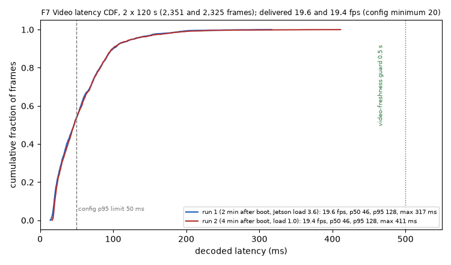

Dead-man/e-stop phải vũ trang bằng Start rồi giữ R1. Thả R1 hay bấm nút khác thì robot dừng. Watchdog danh định 300 ms. Đo wheels-up ngày 12/11: 16 lần thả R1 cắt điện motor, median 7 ms (5–11 ms), còn năm lần bấm nút khác mất 7–8 ms. Đó là timestamp điện trên Jetson, chưa tính độ trễ không dây tay cầm hay thời gian dừng cơ học. [D13]

Sửa SIGTERM, rate limiter và tool tiếp cận của PR #108 đã có trong main. Ngày 14/11, khi thả R1, robot_udp ENGAGED sau estop.py 17 ms và motors về 0 sau 35 ms, nhưng đó là một bản sao riêng chạy dry-run nên không motor nào quay. Các ca rút dongle và tắt pad chạy motor thật, kê bánh: rút dongle thì estop.py STOPPED sau phát hiện 48 ms (motor cut riêng 6 ms) và robot_udp đưa motors về 0 sau 97 ms, còn tắt pad lúc giữ R1 thì motor cut riêng 6 ms; không đo từ lúc rút vật lý hay thời gian dừng cơ học. [D14] Đến 16/11, sau triển khai audit, một lượt kê bánh ghi R1 cut 10 ms và motors-zero 78 ms sau log STOPPED, nút khác 6 ms/38 ms, raw log vẫn chỉ lưu local. [D16]

<!-- pagebreak -->

# Chương 4: Robot, hiệu chuẩn và định vị

Camera fisheye 160° có lens cao 0,100 m. Intrinsics OpenCV được khớp từ 52 ảnh checkerboard còn lại sau khi bỏ ảnh lỗi, RMS 0,83 px. Chiều cao được đo bằng thước, không tối ưu lại từ dữ liệu để kéo sai số xuống. [C1]

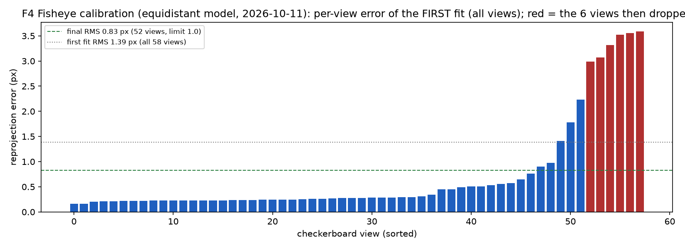

Khoảng cách trên sàn tính từ ray sau undistort và pose từng session. Lệch một pixel gây sai số xấp xỉ d²×0,0033/H, tức khoảng 0,11 m ở 1,8 m và 0,19 m ở 2,4 m với H=0,100 m. Đáy bbox nằm thấp hơn chân 3–7 px. Thiếu contact hoặc gặp phản chiếu thì trả unknown chứ không đưa khoảng cách giả.

Pitch camera đổi sau khi nhấc robot, nên trước mỗi lượt phải chạy `self_pose`. Hiệu chỉnh động `LiveTilt` mới đạt một phần: sai số 0,5–6,0% khi tĩnh và 3,0–20,0% khi động. [D13, H1]

Robot không có encoder. IMU được lắp nhưng hỏng, đang sửa, chưa dự kiến dùng được trước 23/11. Gains dead reckoning vẫn lấy từ tuần 2, phần fit theo sàn còn hoãn. [D16] Dead reckoning tích phân mô hình vi sai có vùng chết, ArUco thì sửa pose khi thấy marker hợp lệ. Vì độ lệch khi chạy thẳng đổi theo sàn, pin và mức lệnh, không thể lấy một drift cố định cho mọi buổi: trong 11–12/11, 13 lượt chạy thẳng lệch từ −16 đến +59°/m (số này là bằng chứng #108 đã merge, không dùng thay phép hiệu chuẩn trong `calib/motion.json`). [D13]

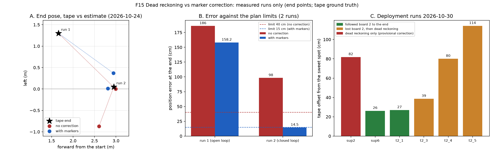

Trong phép thử định vị riêng, một lượt có sửa ArUco lệch 14,5 cm sau khoảng 3 m. DR thuần lệch 98,3 cm, chưa đạt ngưỡng 40 cm.

T2 tiếp cận cửa có 7 lượt được tính: 4 lượt ngày 30/10, 2 ngày 14/11 và 1 ngày 16/11 (lượt find-door 20/11 không tính vì câu hỏi tape bị để trống; nay cự ly cửa không cần đo thước mỗi lượt). Ở lượt 16/11, robot vào STANDBY sau 30,7 s, tape tới cửa 2,93 m, 0 va chạm, nhưng DR tại vantage lệch 0,593 m, nên lượt này pass nhờ tape, không chứng nhận DR. Handshake rehearsal mới có 1 accept và 1 reject hợp lệ. Vẫn chưa đạt 10/10. [D14, D16] Kết quả tiếp cận cửa hiện chỉ có trên một cửa/ngày và vẫn dựa vào đo thước, nên không chứng minh tự định vị trong cả phòng. [C2, D13]

Ngày 20/11, pose camera được tự hiệu chuẩn trên bốn mặt tháp ESP32 (`tower_register`, marker 50 mm id 10–13, mỗi mặt 30 frame), cho pitch từ −11,09° đến −11,68°, median −11,29°, độ lệch chuẩn giữa các mặt 0,21° và chênh lớn nhất 0,59°. Lần đăng ký đầu trong ngày, đứng gần tháp 0,21–0,25 m, cho −11,67° (`camera_pose_tower_1120_1.json`, chênh 0,38° so với giá trị dùng). Giá trị dùng là lần thứ hai. Mặt trước (id 11) gắn xoay 180° trong mặt phẳng, nên góc marker được sắp lại trước khi giải PnP. So với board 150 mm (−10,37°), pitch này thấp hơn 0,9°. Chưa rõ vì sao. Các độ cao tháp đã đo cũng chưa được chỉnh. [D20]

# Chương 5: Nhận thức thị giác và tối ưu

## 5.1 Vật cản, contact và bản đồ

Pipeline YOLO phát hiện bbox, ước lượng điểm tiếp xúc rồi chiếu xuống mặt sàn, nhưng gặp bbox cắt mép, contact không rõ hay phản chiếu không giải được thì bỏ khoảng cách. Trong occupancy grid, ô FREE chỉ đến từ footprint/seen-floor đã xác nhận, còn ô UNKNOWN vẫn chặn đường và line-of-sight. Vantage phải reachable, đủ clearance và có vị trí cửa/world truth. Chưa có sweep đủ truth để nghiệm thu F11. [H1]

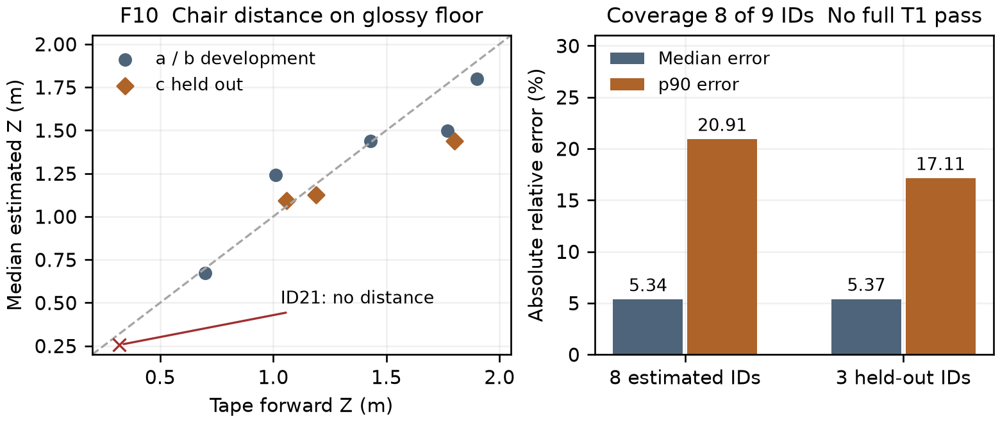

Trên các ID có estimate, median/p90 relative error là 5,34%/20,91%, ba vị trí held-out cho 5,37%/17,11%. P90 tổng vẫn vượt 20%, chưa đủ ≥20 IDs và điều kiện độc lập. Bộ ghế glossy 09/11 có 0/36 khoảng cách hợp lệ. Đó là thiếu khoảng cách, không phải sai số bằng không. [H1, H2]

D5 có 397 ảnh, chia 307 train/90 dev-val cùng phòng/session, được dùng để chọn checkpoint/input. YOLOv8n-640 đạt mAP50 khoảng 0,810, leg recall 0,960. Riêng wire recall bằng 0. Recall từng class và empty-floor alarms chưa nghiệm thu, 12 wire masks cũng mới là annotation pilot. [H1]

ORG/SegFormer-B0 trên ruler D1 có 24 vật: configured tìm 1/24, obstacle-route 8/24, free-space 6/24, median error 0,041 m chỉ tính trên tám vật tìm thấy. Glare, ghế và missing objects vẫn thất bại, nên không nhận mô hình làm default chỉ vì một subset có error thấp. Width fallback mới là proposal cho một loại ghế, chưa tích hợp detector. [H2, D13]

## 5.2 Nhận diện cửa

XFeat + RANSAC kiểm tra hình học, còn DINOv2 lo reference từ camera khác. Ngưỡng phải được hiệu chuẩn bằng negative sweep theo cửa. F12 so baseline ORB với XFeat/DINOv2, nhưng nhận ra cửa chưa chứng minh door range hay bắt tay đủ 10/10 lần đặt lại camera.

Detector không trả cự ly cửa. Cự ly suy ra từ diện tích khung viền khớp so với một mốc tham chiếu lưu cùng enrolment: range = ref·(A_ref/A)^(1/2). Mốc này (`ref_range_m`) được đo một lần mỗi phòng, 1,96 m cho cửa lớp. Ở hai lượt `approach_door` ngày 20/11, ước lượng lúc dừng là 2,21 và 2,12 m (tape ghi tay 2,25 và 2,11 m), nhưng ước lượng đầu lượt thấp khoảng 10% ở lần đo 2,91 m so với tape 3,23 m (một lần đo). [K1, D20]

## 5.3 Whitelist, re-ID và tracking

SCRFD/MobileFaceNet tạo face embedding 512D chuẩn hóa, rồi so maximum cosine với whitelist theo ngưỡng hiện hành 0,45. Trên D2 cafe pilot (125 face frames, 21 entries, ba người), TAR là 82,99% và FAR là 46,40%, chưa đạt TAR≥95% tại FAR≤1%, trong khi query liền nhau tương quan và nhãn tự động còn cần review. [H1]

Trong phép thử ngày 13/11, camera opt4 cùng guided enrollment cho mặt rộng 68–91 px ở 3,0–1,8 m. Ngày 14/11, với ngưỡng cố định 0,45, TAR đạt 822/877 = 0,937 (clip bootstrap [0,904; 0,970]) và FAR là 0/1754 straight-frame impostor scores, nên FAR gate đạt trên bộ này, còn TAR≥95% chưa được thiết lập; bộ chỉ có ba người trong một session, mỗi người so với hai enrolments còn lại, nên không suy ra population FAR. Ngưỡng 0,45 vẫn provisional (#118). [D14] [D13]

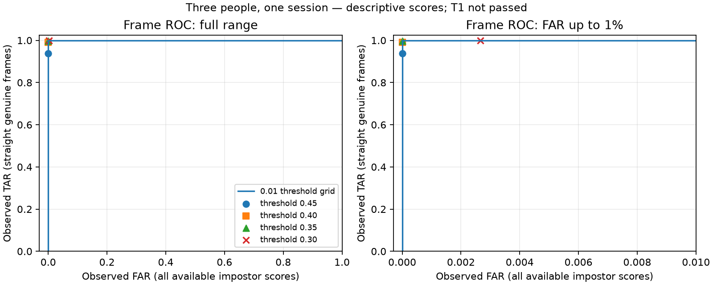

Phase 2 live do Huỳnh Nguyễn Hoài Lộc chủ trì (#115). Pilot 14/11 trên RTX 5060 ghi 3 authorized/3 queued, coverage segment 50% mỗi cohort, 5 unresolved, 1 interrupted và median enqueue 9,387 s. Dữ liệu chỉ có hai người cùng session, chưa phải T1, và ngưỡng 0,45 vẫn provisional (#118). [H7] Ngày 16/11, sau khi đăng ký lại năm tư thế cho Đoàn Quốc Kiên và chấm lại cùng clip, TAR của người này vẫn 0,930 (279/300 khung thẳng, cùng 21 frame dưới 0,45); còn thiếu người lạ ngoài nhóm và lần đăng ký lại cho Huỳnh Hữu Lộc. CSV chấm lại vẫn chỉ lưu local. [D16]

Theo quyết định tạm ngày 14/11, person đã xác nhận mà thiếu mặt hợp lệ thì giữ unresolved, chưa enqueue, nghĩa là yêu cầu flag người chưa đăng ký chưa đáp ứng đầy đủ, và counter confirmed-unresolved chỉ phục vụ audit, chưa thay chính sách. [S0, H7]

OSNet-AIN x1.0 và x0.25 đều chạy. Có điều 23 body crops chưa tạo được gallery/query hợp lệ, 2/3 người còn thiếu gallery, trong khi gate vẫn là ≥5 identities, rank-1≥85%. Chưa có F14 đủ điều kiện. [H1]

ByteTrack nối track bằng chuyển động/IoU, dùng cả detection confidence thấp. Muốn khóa và re-lock theo appearance thì phải cùng architecture, weight hash, preprocessing, cosine/margin và xác nhận qua hai frame. Vector, queue và tracker chạy trên laptop. JetBot chỉ nhận (v, w). Lúc mất dấu hay không chắc, track ID không được coi là identity. [H1, K1]

Vendor ByteTrack đạt 407/407 synthetic ID agreement với backend tham chiếu (T0 parity). Replay 822 frame D2 chứng minh runtime, nhưng chưa có body-ID truth và timestamp chuẩn để nghiệm thu ≤1 ID-switch/phút trên D3 ≥60 s với hai người. [H1, K1]

## 5.4 Ngân sách GPU trên laptop

Profiler nạp detector, OSNet, pose, face và cửa, chạy tuần tự với sampled NVML, thiếu detection thì dùng synthetic body/face padding. Số workload chưa gồm đủ transport/control và hai camera thật. Accuracy không được đo. DINO chạy FP16, model Torch khác FP32. Giới hạn VRAM 5,5 GB decimal khác 5,5 GiB. [H1, D13]

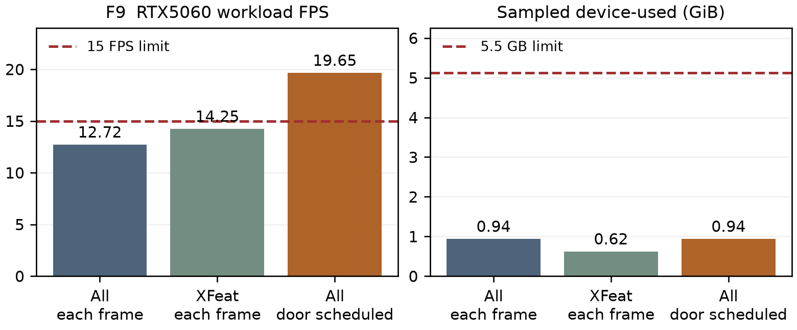

| Thiết bị / workload | FPS | p95 ms | Peak GiB / door Hz |
| :-- | --: | --: | :-- |
| RTX 5060, all mỗi frame | 12,72 | 90,75 | 0,939 / không schedule |
| RTX 5060, door scheduled | 19,65 | 87,62 | 0,939 / 4,52 |
| RTX 4050, all mỗi frame | 9,20 | 138,05 | 0,894 / không schedule |
| RTX 4050, door scheduled | 19,23 | 121,36 | 0,890 / 4,61 |

Dòng RTX 4050 lấy từ file JSON đo 13/11, đã merge vào main, có commit:path và SHA256 trong registry, nhưng cờ `t1_accepted`/`target_rtx4050_verified` trong nguồn vẫn false. Hai GPU khác điều kiện/power nên đây chưa phải so sánh có kiểm soát. Scheduled FPS vượt 15 nhưng door thực chưa tới 5 Hz, nên chưa thể coi cả pipeline là realtime. [D13]

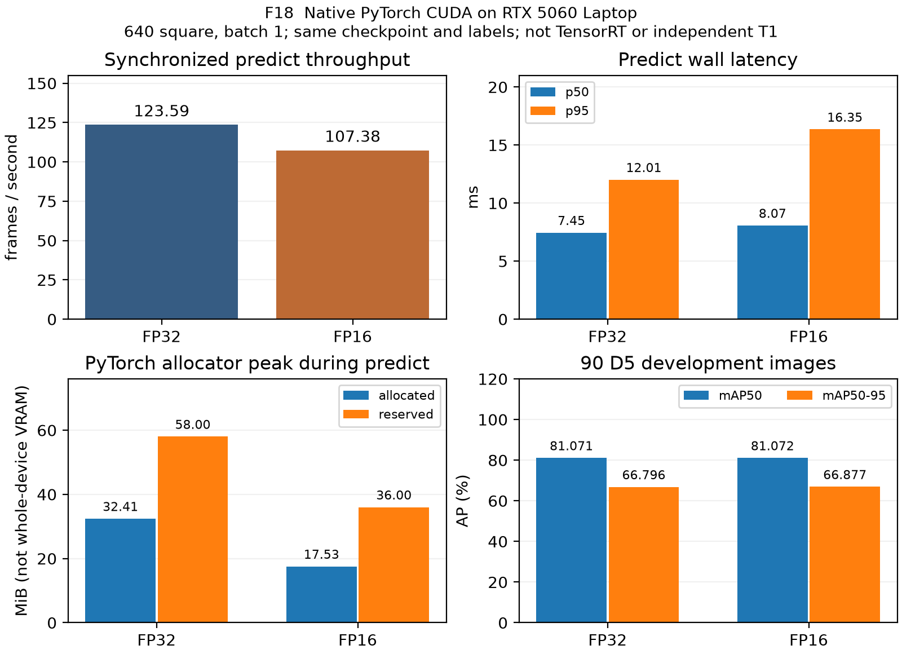

Trên cùng 90 ảnh dev-val, batch 1, mỗi precision một process riêng, FP32/FP16 đạt 123,59/107,38 FPS, p95 12,01/16,35 ms, Torch allocated 32,41/17,53 MiB và mAP50 81,071%/81,072%; FP16 dùng ít allocator hơn nhưng lần này chậm hơn; không kết luận FP16 tốt hơn nói chung. Timing gồm predict/preprocess/NMS và kiểm tra dtype, không gồm disk/video/control. Chưa có TensorRT hay independent accuracy. [H1]

## 5.5 Chuyển đổi và triển khai Jetson Nano

Model xuất ONNX trên laptop, rồi build TensorRT 7.1.3 FP16 trên Nano, batch 1/fixed shape; theo nguồn 16/10, GPU time của YOLOv8n-320 là 14,8 ms (FP32 20,7), pose 15,7 ms, OSNet x0.25 9,3 ms, AIN 26,6 ms, còn DINOv2-S mất 359,5 ms nên để trên laptop; đây là latency từng model, không phải FPS cả vòng. [D13, E1]

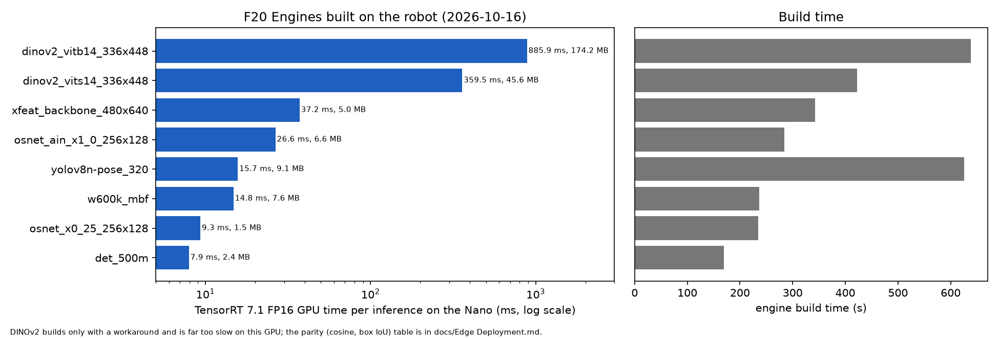

Trên TensorRT 7.1, Resize opset 11 của SCRFD cho kết quả lệch, nên lớp này đổi từ nearest-neighbor 2× sang grouped ConvTranspose. Cosine gần 1 trên stock model không chứng nhận custom D5 hay re-ID độc lập. D5 ONNX parity trên laptop có 90/90 count, 294 reference boxes ghép với IoU≥0,9. Parity không phải nghiệm thu accuracy/edge. [H1, E1]

| Bench Nano | FPS | p95 capture-to-result |
| :-- | --: | --: |
| 16/10, không người, stage B | 20,00 | 51,1 ms |
| 13/11, có người, stage B 60 s | 19,75 | 89,2 ms |
| 13/11, cửa ESP32 thật, 60 s | 17,7 / 17,1 | 118,5 / 123,9 ms |
| 13/11, cửa thật, người ngồi 600 s | 14,45 | 153,0 ms |

Với lượt dài 600 s, RAM khoảng 2,13 GB, GPU tối đa 38,5°C, pin khoảng 11,96→11,72 V. Vẫn chưa đủ 15 phút. Khi có người và ESP32 thật, edge gate ≥20 FPS/p95≤100 ms chưa đạt, còn lượt 16/10 không người, ảnh cửa tĩnh, nên không thay kết quả mới. Các số 13/11 là bằng chứng từ #108 đã merge. Vòng benchmark không có motor/e-stop. [D13]

# Chương 6: Hành vi và điều khiển

StateMachine nhận event có timestamp và trả Command(v, w, play, actions, target_id). Phase3Runner nối hàng đợi, hold detector và controller. Logic CPU tách khỏi socket/hardware nên replay và kiểm thử cho kết quả xác định. [K2]

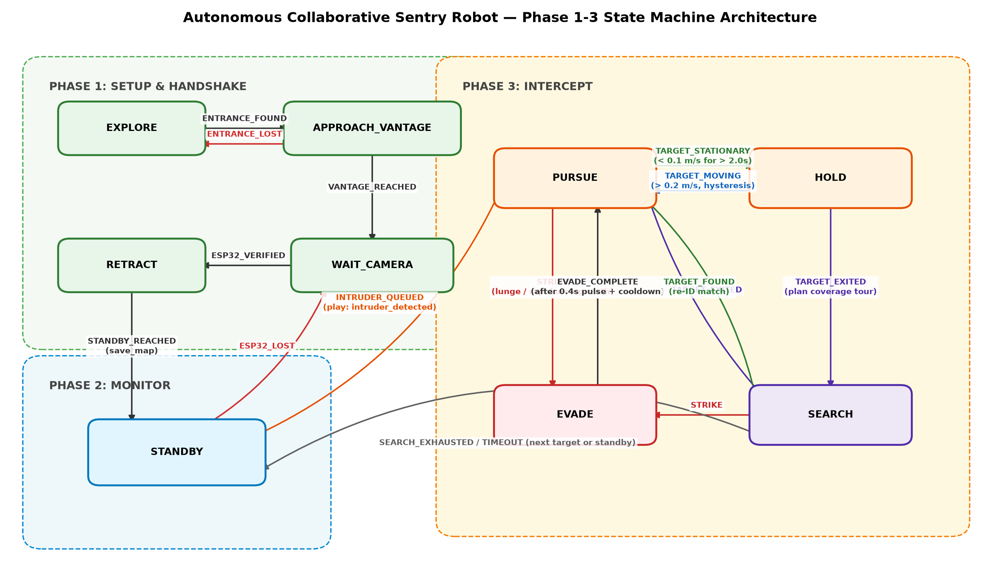

TargetQueue giữ FIFO và vector chuẩn hóa. TARGET_EXITED đóng người hiện tại rồi chuyển SEARCH cho người kế tiếp, hoặc về STANDBY khi hết queue. Lúc handoff, observation và dwell/filter/controller đều reset, rồi phải có mẫu mới đúng identity.

HoldDetector chiếu target sang world theo pose robot, vào HOLD khi speed<0,1 m/s đủ 2 s và thoát khi >0,2 m/s. Bù pose giảm sai lệch do robot xoay. Drift odometry thì vẫn còn.

**Find-door (20/11).** `FindDoorRunner` không dùng toạ độ cửa. Robot đứng yên đo bearing và diện tích khung cửa (median), quay theo bearing đo được (±8°), và chỉ tiến từng nhịp khi cự ly ước lượng còn lớn hơn stand-off 2,25 m; ngưỡng quãng đường theo tốc độ xấu nhất chặn robot tiến vô hạn. Cổng đặt tháp (`PlacementGate`) chỉ tính handshake khi marker lưng (id 10) nằm trong 0,20–0,30 m và ±15° liên tục 1 s.

Lượt thật là lần thứ tư trong ngày. Ba lần trước dùng bản runner quét cũ: một lần không tìm thấy cửa sau 45 s, một lần dừng vì R1 bị nhả khi đang quét (chưa thấy cửa), lần còn lại dừng vì R1 bị nhả lúc chờ đặt tháp. Ngoài ra, hai lượt T2 `--tower-place` với vantage thủ công cũng dừng vì R1 bị nhả, ở 14,1 và 17,2 s.

Lượt thật có ước lượng ban đầu 3,45 m. Robot quay trái 32°, đo 18 lần trong 35,8 s rồi dừng khi ước lượng còn 2,21 m. Cổng mở với 140 frame trong vùng cho phép trên 756 frame cả lượt, handshake đạt ở 54,3 s (25/194 frame thấy cửa, inliers cuối 53, tối đa 62, ngưỡng 27), rồi STANDBY ở 56,3 s. Tổng 58,6 s. Tape ghi tay sau lượt: tháp–cửa 1,9 m, robot–cửa 2,1–2,2 m (xấp xỉ), đo tại điểm dừng, trước khi lùi khoảng 0,3 m. Runner chưa có tìm kiếm tịnh tiến. Xoay tại chỗ mà cửa không vào khung thì báo không tìm thấy. [D20]

Lượt live 16/11 có tracked 99,7% và centred 91%, nhưng trong dải 1,2±0,2 m chỉ 32% thời gian (gate 80%, chưa đạt), và 0 HOLD event. Hôm đó sàn glossy, 5 W giả định từ lần đọc cuối buổi, mã robot trước audit, gói điều khiển unsigned. Ngày 16/11 tháp chưa được né như vật cản, lần thử né tháp ngày 18/11 và 20/11 xem mục 7.2. [D16]

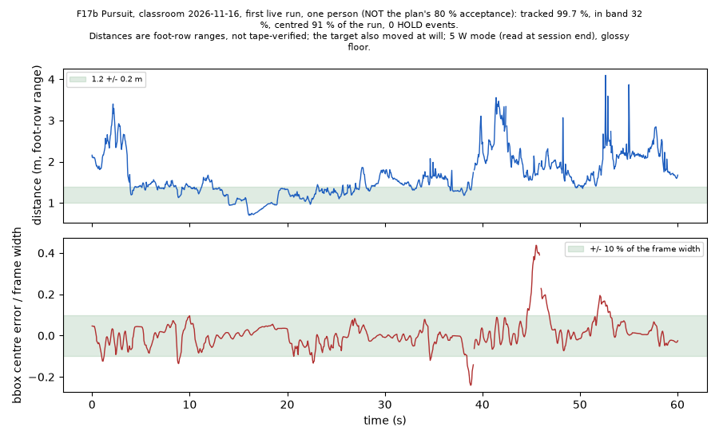

HOLD giữ v=0, chỉ yaw recenter. PURSUE nhắm 1,2 m và dùng estimate vật cản. Projector kiểm tra vùng chết 0,40, NaN/±Inf dừng lại trước saturation. STRIKE có xung 400 ms, thử trên robot để sau giữa kỳ.

**Sửa #101** xử lý mỗi timestamp đúng một lần ở cả hai API, observation stale/wrong-ID không làm tăng dwell, observation cũ quá 0,25 s thì dừng motor, và gap>1 s hoặc TARGET_LOST thì nhả HOLD và đồng bộ mode. [K2]

Mô phỏng scripted ghi HOLD 6,32 s, resume 8,26 s, v=0 trong HOLD, hai targets hoàn tất và mọi lệnh hợp lệ. [K2]

# Chương 7: Kiểm thử và kết quả

## 7.1 Tầng kiểm thử và tái hiện

| Tầng | Điều kiện | Có thể kết luận |
| :-- | :-- | :-- |
| T0 | CPU, dữ liệu tổng hợp, fake transport, SimRobot | Logic hình học, contract, chuyển trạng thái, guards |
| T1 | Replay có nhãn/truth và protocol định trước | Accuracy/latency theo bộ dữ liệu và thiết bị ghi rõ |
| T2 | Robot/ESP32 thật, pin và điều kiện có kiểm soát | Hành vi vật lý đủ số lượt, không suy từ T0 |

Checkout sạch chạy trên nhánh sau tích hợp `#130` và `#131`, với commit, tree, command và dependency versions ghi trong `week-07/clean_checkout_pytest.log` và `week-07/validation.json`: bộ CPU/replay pass, không lỗi, chỉ có mục skip vì thiếu dữ liệu/weights/tùy chọn và 4 ca GPU/HIL bị loại. Số test chỉ đúng cho commit được log, không chứng nhận model/GPU hay phần cứng. Kết quả cũ 754/773 không được dùng để chứng nhận bản sửa này. Lần chạy mới nhất trên commit a798f43 (983 passed, 4 skipped, 4 GPU deselected) nằm ở `HuynhNguyenHoaiLoc/week-07/review-2026-11-21/clean_checkout_pytest.log`. Chưa chạy lại trên clone của tag. [K3]

Checkout sạch tuần 7 clone từ commit candidate, ghi riêng tree SHA, Python/dependency versions, command, exit code và pytest output. Clone chỉ dùng môi trường package đã cài trên máy, không copy thêm dữ liệu local, weights hay `.venv`. D5 và ZIP D2 vẫn tracked theo quyết định nhóm. Thiếu model/GPU environment thì ghi riêng. CPU/replay không chứng nhận full inference setup. [K3]

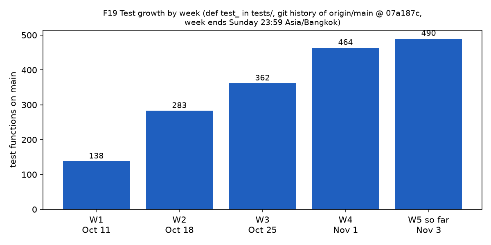

Checker gói nộp đọc **committed export** qua index tạm từ `git read-tree`, cùng pathspec với `git archive`. Dữ liệu phát triển vẫn tracked, data/team_data/recordings/weights chỉ bị loại khỏi ZIP. `--index` chỉ dùng cho pre-commit. Path data/recordings/weights, secret filenames và model binaries bị từ chối, nhưng checker chỉ xét tên file, không kiểm toán nội dung hay lịch sử Git.

Gói ZIP lấy từ `git archive` của đúng commit, không chứa `.git`, manifest lưu SHA256 từng file, và test xác nhận workspace bẩn không lọt vào ZIP, tạo ZIP không xóa dữ liệu tracked, secret ngoài vùng loại vẫn làm HEAD fail và file output cũ không bị ghi đè. [K3]

## 7.2 Bảng đối soát nghiệm thu

| Hạng mục | Bằng chứng hiện có | Trạng thái so với gate |
| :-- | :-- | :-- |
| Video JetBot | 12/11: 19,4–19,6 FPS, p95 128 ms | Chưa đạt ≥20 FPS/≤50 ms; #108 |
| E-stop | Dry 305–315 ms; R1 7 (12/11), 35/97 (14/11), 10/78 ms (16/11) | Unsigned; chưa đo dừng cơ học |
| Fisheye / LiveTilt | RMS 0,83 px (52 ảnh); LiveTilt 0,5–6% tĩnh, 3–20% động | Fisheye đạt; LiveTilt một phần |
| DR + ArUco / T2 cửa | 7 lượt T2 cửa; handshake 1 accept/1 reject | DR 98,3 cm chưa đạt; chưa 10/10 |
| Khoảng cách ghế | 8/9 IDs, p90 20,91%; bộ mới 0/36 | Chưa p90≤20%/≥20 IDs/độc lập |
| D5/Wire | 307/90 cùng session; wire recall 0 | Dev-val, chưa T1/class gates |
| Face whitelist | 14/11: 822/877 genuine; 0/1754 impostor | 3 người; FAR đạt, TAR 95% chưa đạt |
| Re-ID/tracking | Parity/replay; Sector 99,7% (T0) | Chưa gallery≥5/D3≥60 s/truth |
| Pursuit/HOLD | 16/11: tracked 99,7%, dải 32%, tâm 91%, 0 HOLD | Không PASS: dải <80%; chưa HOLD |
| Pursuit + tháp 20/11 | 31 s: tracked 34,3%, dải 9,4%, tâm 23,7% (mất mục tiêu 5 s); 105 s: 59,6%, 18,1%, 47,6%; 0 HOLD; tower avoid 4 và 9 lần, không abort | Không PASS: dải <80%; chẩn đoán (D20) |
| Find-door + handshake | 20/11: STANDBY 56,3 s (tổng 58,6 s); ước lượng dừng 2,21 m (tape ghi tay tại điểm dừng, trước khi lùi: robot–cửa 2,1–2,2 m, tháp–cửa 1,9 m); 25/194 frame thấy cửa, inliers cuối 53 | 1 lượt thật, chưa lặp; tape xấp xỉ; chưa 10/10 |
| Né tháp ESP32 | Steer ~0,4 m; bám 120 s: 13 triggers (12 xong), 67,2%/9,2%/40% | 18/11 (`tower_avoid_1118/`); tắt det. |
| GPU laptop | Scheduled 5060 19,65; 4050 19,23 FPS | Door Hz<5; chưa dual-stream T1 |
| Edge live | 14,45 FPS/p95 153 ms ở 600 s | Chưa ≥20 FPS/≤100 ms/15 phút |
| Vòng đầy đủ | Module, Hold 2 s, Standoff v=0 (T0) | Chưa ≥4/5 không can thiệp |

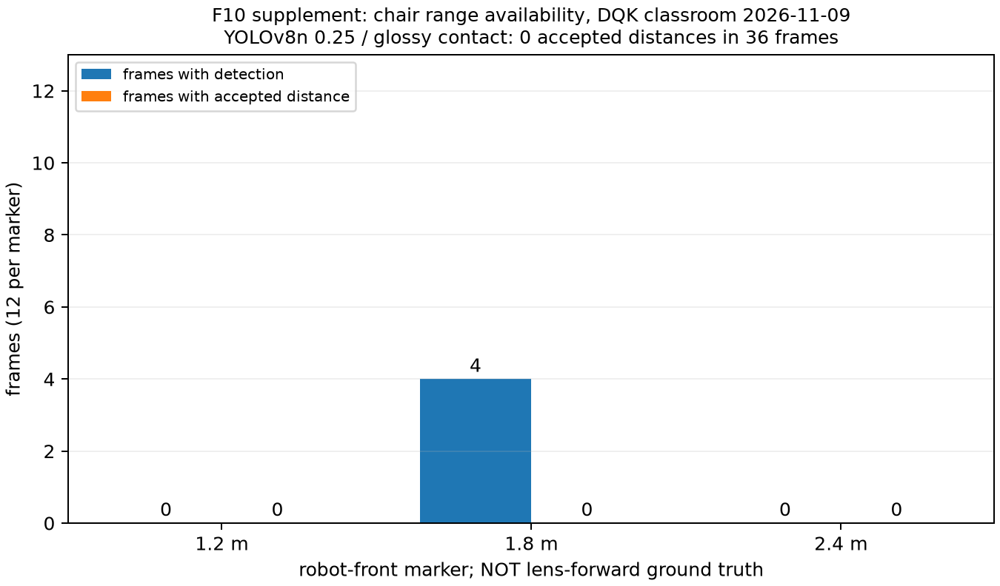

Lượt 16/11 chạy trên sàn glossy, 5 W (cuối buổi), code trước audit, gói unsigned và chưa có tower avoidance, đến 18/11 mới có lần thử `TowerSteer` theo marker khi tắt detector tổng quát [D18]; gains DR vẫn của tuần 2. Pilot Phase 2 live #115 gồm 3 authorized/3 queued, coverage 50%, chưa T1. [D16, H7]

Lượt 20/11: sàn glossy (`--floor` unknown), pin 11,6 V, pose tháp `camera_pose_tower_1120_2.json`, gói điều khiển unsigned; ở lượt 1, tháp cách 0,56 m, 6,7° trước robot, nên tower avoid bật ngay frame đầu, còn ở lượt 2, tháp cách 0,65 m, 53°; tower avoid chiếm 251/620 và 483/2088 frame. Lần này detector vật cản tổng quát được bật và chặn lần lượt 140 và 244 frame. Dòng 18/11 chạy với detector tắt, nên hai dòng không so trực tiếp. Lượt 2 còn đổi `--lost-end-s` 5→20 s và `--seconds` 90→105 s. Pursuit chạy ngay sau một lượt find-door đã STANDBY nên không phải T2 độc lập. [D20]

Frame liên tiếp không cộng thành lượt độc lập, missed objects cũng không bị bỏ khi tính error. Các khối đã có mã và bằng chứng phát triển, nhưng gate hệ thống chính vẫn pending. Nguồn: [registry](kouun-rokku/week-07/editor-sources.md), H1/H2/D13/D18/C1/C2/K2; D20 xem mục A.3.

# Chương 8: Kết quả kỳ vọng và kế hoạch

## 8.1 Mốc bàn giao

| Mốc | Kết quả cần có | Chủ trì |
| :-- | :-- | :-- |
| 16/11 | Đóng thí nghiệm giữa kỳ, chốt hình/nhãn nguồn | Cả nhóm |
| 18/11 | Bản draft chung | Huỳnh Hữu Lộc (Editor) |
| 19/11 | Quay các cảnh còn lại tại lớp, gồm Phase 2 | Cả nhóm |
| 20–22/11 | Review/PR freeze 20/11; dựng 20–21/11, chốt video 22/11 | Cả nhóm |
| 21–23/11 | Tag main sau review, PDF/video final, nộp 23/11 | Cả nhóm |
| Tuần 8–9 | Evasion, reaction-time, coverage path theo gate; Stage A (lớp né vật cản chạy trên robot) thêm vào tuần 8 vì gate G2 (mốc 9/11) chưa đạt; Stage B sang tuần 9 | Chủ sở hữu từng module |
| Tuần 10–13 | Search trên robot, loop nhiều người, stress và buffer; phần model còn lại lên robot đến 13/12, model nào không đạt kiểm tra thì giữ ở laptop | Cả nhóm |

Kỳ vọng vòng đầy đủ đạt ≥4/5 không can thiệp, tìm T2 ≥4/5 và search exhaustion 3/3 không va chạm. Đó là mục tiêu, chưa phải kết quả. `r_det` 3,0 m vẫn là placeholder, cần đo. Phần nào chưa ổn lúc freeze đều được ghi in progress, không hạ ngưỡng cho kịp báo cáo. [S0]

## 8.2 Rủi ro và việc tiếp tục

**Bổ sung sau đóng băng, 18/11 (ký túc xá):** nhánh thử tránh tháp giữ tối thiểu ~0,4 m theo tape (`steer_a`, không chạm). Pursuit 120 s dùng `TowerSteer` và `--search`, tắt detector vật cản tổng quát vì trên sàn bóng 2 ghế xa 3 m bị nhận là gần. Kết quả ghi 13 triggers (12 hoàn tất, một còn active), tracked 67,2%, trong dải 9,2%, căn tâm 40%, và robot lặp vòng tiến rồi tránh quanh tháp (6 lần trong 45 s cuối); ba HOLD rows nằm trong ~0,14 s, không theo protocol đứng yên; motion fit bị loại vì tỷ lệ forward phân tán (0,56–0,87). Các lượt này thiếu protocol nghiệm thu và được tách khỏi kết quả 16/11. [D18]

- **Sàn bóng:** contact ghế không giải được. Cần held-out floor/chair/empty-floor controls và rule fallback đã freeze. ORG hay width cue chưa là model mặc định.
- **Pose/motion:** gá camera xê dịch và drift đổi theo sàn/pin/lệnh, nên lượt nào cũng phải đo lại pose, giữ phạm vi thử có giám sát và kiểm pin.
- **Face/re-ID:** guided enrollment làm genuine scores tốt hơn, nhưng impostors vẫn còn, gallery/body-ID truth cũng thiếu. Ngưỡng/model do perception owner quyết.
- **Video/edge:** trong điều kiện mới, latency và FPS chưa đạt. Cần đo đủ protocol, không lấy benchmark không người để thay.
- **Find-door:** chưa có tìm kiếm tịnh tiến (tiến–lùi), nên nếu robot xoay tại chỗ mà cửa không lọt vào khung hình thì lượt thất bại (giới hạn đã biết). Cần một `ref_range_m` mỗi phòng và sai số khoảng −10% ở một lần đo 3,23 m. Lúc tiến, robot không kiểm tra vật cản, chỉ có R1 và ngưỡng quãng đường. Mới một lượt thật thành công, chưa lặp. [D20]
- **Tích hợp:** Phase 2 live và graded T2 chưa đủ. Chỗ nào thiếu cảnh thật thì video dùng replay có nhãn, không trình bày như robot đã chạy.
- **Bàn giao mã:** D5, ZIP D2 và default password được giữ theo quyết định nhóm. Chỉ ZIP nộp bài loại data/team_data/recordings/weights, không chứa lịch sử. Tag `midterm` trên main chờ freeze/review.

Bản tuần 7 hoàn thiện phần editor và gói review từ nguồn hiện có. Nó không thay thí nghiệm vật lý, chữ ký owner hay lịch sử được làm sạch. PDF hiện tại là snapshot review, video cuối được cập nhật khi cắt dựng xong. [D13, K3]

<!-- pagebreak -->

# Phụ lục A: Mã nguồn, tái hiện và nguồn

## A.1 Module / owner / tests

| Module | Owner | Kiểm tra chính |
| :-- | :-- | :-- |
| StateMachine, TargetQueue, Phase3Runner | Huỳnh Hữu Lộc | state_machine, target_queue, phase3_runner |
| HoldDetector, controllers, tower_avoid | Huỳnh Hữu Lộc / Đoàn Quốc Kiên | hold_detector, controllers, tower_avoid; T0 |
| Localization, wheel model | Huỳnh Hữu Lộc / Đoàn Quốc Kiên | localization, wheel_model; T2 chưa đủ |
| Entrance / sector / audio | Huỳnh Hữu Lộc / Đoàn Quốc Kiên | entrance, sector, audio |
| Phase 2 live / door monitor | Huỳnh Nguyễn Hoài Lộc; Huỳnh Hữu Lộc nối queue | phase2_live, phase2_reid, phase2_replay |
| Obstacle, face, re-ID, tracker | Huỳnh Nguyễn Hoài Lộc | obstacle, face, reid, tracker; gates T1 riêng |
| Net / clock / streams | Huỳnh Nguyễn Hoài Lộc / Huỳnh Hữu Lộc | camera_pub, clock_sync, mjpeg_rx |
| Jetson / ESP32 / motor interlocks | Đoàn Quốc Kiên / Huỳnh Hữu Lộc | estop, jetson_espcam; HIL riêng |
| Report / package tools | Huỳnh Hữu Lộc | midterm_package, page audit, PDF pages |
| FindDoorRunner, PlacementGate, session_run | Đoàn Quốc Kiên | phase1_runner (find-door), tower_markers, approach_door, deploy_live, session_run |

## A.2 Tái hiện

Cài môi trường theo `docs/Setup.md`. CPU/replay trên Linux có winsound shim chỉ cho test trong `tools/run_cpu_tests.py`, không thay âm thanh production. Log ghi interpreter và packages. Export report cần `requirements-report.txt` và DejaVu Sans.

```text
python tools/check_env.py --cpu-ok
python -m tools.run_cpu_tests
python -m tools.render_midterm_report
python -m tools.check_midterm_page_budget --pdf reports/midterm_report.pdf
python -m tools.check_midterm_package --ref HEAD
python -m tools.tower_register
python -m tools.deploy_live --label x --find-door --handshake <thư mục> --tower-place
python -m tools.session_run --label x --camera-pose <pose> -- --handshake <thư mục> --tower-place
python -m tools.build_midterm_package --ref HEAD --out /tmp/submission.zip
```

Repo: https://github.com/DoanQuocKien/Autonomous-Collaborative-Sentry-Robot . Tag `midterm` trên main ([liên kết](https://github.com/DoanQuocKien/Autonomous-Collaborative-Sentry-Robot/tree/midterm)) được gắn tại freeze; gói có thể xây từ commit đã ghi trong manifest. Video demo (tùy chọn, không nằm trong git): [DEMO_VIDEO.mp4](https://drive.google.com/file/d/1vzN8MM-Eqlog4NTn8Ap4_7F7AqkGI8Cb/view?usp=sharing); [shot list và cách quay replay](kouun-rokku/midterm-appendix-a.md).

## A.3 Chỉ mục bằng chứng

[Registry editor](kouun-rokku/week-07/editor-sources.md) ghi commit:path và SHA256 theo nhãn nguồn. S0 là kế hoạch; C1/C2 là hiệu chuẩn; K1/K2/K3 là parity, replay, review và package; H1/H2 là perception; E1 là edge; D13/D14/D16/D18 là các buổi đo DQK; H7 là pilot Phase 2. D20 ghim log find-door/pursuit/approach/tower_register ngày 20/11 trong `reports/DoanQuocKien/week-07/finddoor_1120/`, kể cả tape người vận hành nhập sau lượt chạy.
